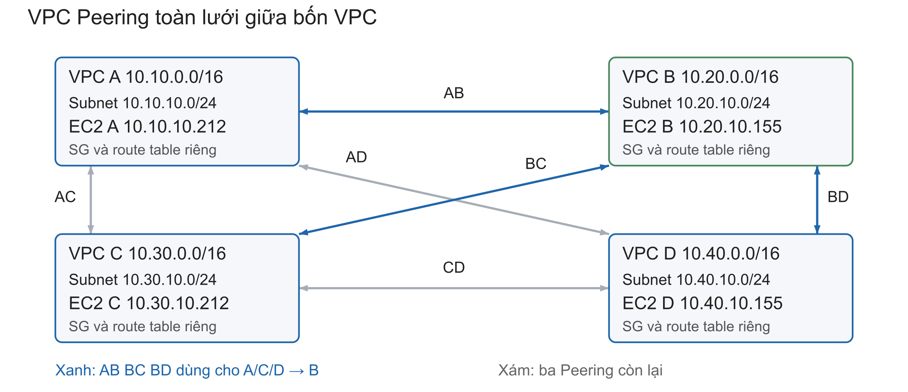
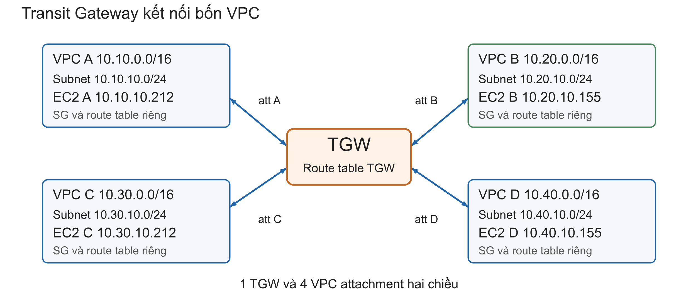

# Đồ án NT531 — Đánh giá hiệu năng AWS VPC Peering và Transit Gateway

**Đã chốt dữ liệu ngày 13/10:** 5 block RTT và 3 block ứng dụng hợp lệ, gồm 252.000 request ứng dụng trong cửa sổ đo. TGW trừ Peering có RTT trung bình +0,3119 ms; tăng 8 lên 16 slots cải thiện đúng hạn tại 800 rps trung bình 96,8417 điểm phần trăm qua hai mode. Đây là kết quả mô tả trong cấu hình đã thử. Thiết kế 16 block gốc được rút ngắn vì ngân sách; không công bố kiểm định xác nhận của thiết kế đó. Lịch đo tự động đã xóa, không mở thêm phiên. [Phạm vi và bảng thống kê](docs/35-pham-vi-rut-gon-va-ket-luan.md) thay thế danh sách đo tiếp trong kế hoạch cũ dưới đây.

## Đồ án trả lời câu hỏi gì?

Giữ nguyên bốn EC2 và điều kiện thử nghiệm, thay đường định tuyến giữa
VPC Peering và Transit Gateway (TGW), rồi so sánh thông lượng, RTT,
retransmission và tải CPU. Kết quả phản ánh toàn đường truyền giữa các
EC2 trong cấu hình này, không phải giới hạn tuyệt đối của dịch vụ AWS.

Phần ứng dụng mới hỏi: khi một yêu cầu gọi hai worker song song, đường
mạng và mức tải ảnh hưởng bao nhiêu đến P95 và tỷ lệ hoàn thành đúng hạn?

Tên đăng ký: **Performance Evaluation of AWS VPC Peering and Transit Gateway**.
Bảng lớp ghi nhóm 21, thứ tự báo cáo 9, lịch 26/10.
[Bảng môn học](https://docs.google.com/spreadsheets/d/1WJ8oUXO-NLPxHZ2eL1pFzYHndRo64IWtAPUTtsWq7Ro/edit?gid=0).

## Đọc theo thứ tự

Đọc [báo cáo tổng hợp hiện hành](docs/34-bao-cao-tong-hop.md) để xem kiến trúc,
kịch bản, công thức, kết quả theo block và phạm vi kết luận trong một tài liệu.
[Trạng thái xác nhận](docs/32-trang-thai-xac-nhan.md) ghi số block đã kiểm tra
và trạng thái đã kết thúc thu dữ liệu. [Phụ lục Word đã kiểm tra 7 trang](docs/31-phu-luc-bang-chung-thong-ke.docx) có bảng kết quả, 10 công thức chỉnh sửa được, ký hiệu và phạm vi diễn giải. Các cập nhật theo ngày bên dưới là snapshot lịch sử.

Xem [trạng thái bản công bố ngày 07/10/2026 và việc tiếp theo](docs/19-trang-thai-ban-cong-bo.md).
Bản này gồm Terraform bốn VPC, script đo, sáu bộ kết quả chính đã kiểm chứng,
chương kết quả DOCX, sơ đồ, biểu đồ, công thức và kế hoạch trước 26/10.
Đây chưa phải báo cáo toàn bộ đồ án hoặc bằng chứng đã chạy các bài bổ sung.

Trên GitHub, thiết kế cũ cùng dữ liệu mô phỏng được lưu tại
`legacy/pre-four-vpc/`; không dùng dữ liệu đó để tính kết quả AWS thực nghiệm.
Thư mục này chỉ có trong bản Git công bố; thư mục vận hành giữ state riêng.

1. [Kiến trúc và cách vận hành bốn VPC](docs/03-bon-vpc.md).
2. [Chi tiết Terraform, state và IP SSH](infra/terraform/README.md).
3. [Hướng dẫn đo, nguyên tắc so sánh và câu hỏi bảo vệ](docs/04-do-va-giai-thich.md).
4. [Trạng thái triển khai và kiểm chứng](docs/05-trang-thai-trien-khai.md).
5. [Truy cập và chuẩn bị máy bằng Systems Manager](docs/06-truy-cap-ssm.md).
6. [Kết quả fan-in Peering đã kiểm tra](docs/10-ket-qua-fan-in-peering.md).
7. [Quy trình bài fan-in TGW đã thực hiện](docs/11-do-fan-in-tgw.md).
8. [Kết quả fan-in TGW và đối chiếu Peering](docs/12-ket-qua-fan-in-tgw-va-so-sanh.md).
9. [Chương kết quả DOCX có kiến trúc, biểu đồ và công thức giải thích đầy đủ](docs/13-tong-hop-ket-qua.md).
10. [Công thức, ký hiệu, đơn vị và ví dụ thế số](docs/14-cong-thuc-va-ky-hieu.md).
11. [Khái niệm cho người mới và kết luận Peering TGW có lợi thế ở đâu](docs/15-khai-niem-va-ket-luan-so-sanh.md).
12. [Kế hoạch củng cố đồ án trước ngày 26/10](docs/16-ke-hoach-hoan-thien-den-26-10.md).
13. [Đối chiếu bài giảng NT531, công cụ cần thêm và công thức áp dụng](docs/17-doi-chieu-bai-giang-va-cong-cu.md).
14. [Số liệu từng lượt, công thức và file nguồn để kiểm chứng](docs/18-so-lieu-de-kiem-chung.md).
15. [Phân bố RTT, xác suất vượt ngưỡng, TCP theo thời gian và thiết kế suy luận thống kê](docs/20-thong-ke-va-xac-suat.md).
16. [Rà soát PDF 27 trang: chỗ cần sửa và vị trí ghép phần thống kê](docs/21-ra-soat-bao-cao-main-pdf.md).
17. [Đợt xác nhận RTT 16 block: giả thuyết, công suất, tiêu chí kết luận và script tự động](docs/23-thiet-ke-xac-nhan-rtt.md).
18. [Cơ sở khoa học, công thức, liên hệ bài giảng và quyết định OpenTelemetry/Grafana](docs/24-co-so-khoa-hoc-thong-ke-va-observability.md).
19. [Cấu hình OpenTelemetry → Prometheus → Grafana cho phiên demo riêng](monitoring/README.md).
20. [Ứng dụng A → B → C/D: thời gian hoàn thành, tỷ lệ đúng hạn và distributed tracing](docs/25-ung-dung-phan-tan-va-qos.md).
21. [Kết quả hai phiên ứng dụng, 62.200 yêu cầu và vùng tải trễ hạn](docs/26-ket-qua-pilot-ung-dung.md).
22. [Can thiệp 8 → 16 slots, đo hàng đợi và thiết kế xác nhận](docs/27-can-thiep-slots-va-hang-doi.md).
23. [Sao lưu, stop EC2 và cách tiếp tục cùng cohort](docs/28-tam-dung-va-tiep-tuc-xac-nhan.md).
24. [Kết quả engineering: can thiệp slots, chờ hàng đợi và deadline](docs/29-ket-qua-engineering-slots.md).
25. [Bằng chứng, tiêu chí hoàn thành và cách kết luận thống kê](docs/30-bang-chung-va-tieu-chi-hoan-thanh.md).
26. [Phụ lục Word có công thức và bằng chứng xác nhận đã kiểm tra từng trang](docs/31-phu-luc-bang-chung-thong-ke.docx).
27. [Trạng thái xác nhận, số block còn thiếu và lịch tự tiếp tục](docs/32-trang-thai-xac-nhan.md).
28. [Hàng đợi ứng dụng, chứng minh công thức Little trong cửa sổ hữu hạn và thế số từ raw](docs/33-hang-doi-va-dinh-luat-little.md).
29. [Báo cáo tổng hợp kiến trúc, kịch bản, kết quả và thiết kế thống kê từ nguồn đã kiểm tra](docs/34-bao-cao-tong-hop.md).

Snapshot buổi trưa 13/10: RTT có **3/16 block hợp lệ trên hai ngày**; block 3 có
Peering 0,1900 ms, TGW 0,6157 ms, chênh +0,4257 ms, không mất phản hồi.
Slots có **1/16 block hợp lệ**, 84.000 yêu cầu đo: ở 800 rps, 8 → 16 slots
nâng đúng hạn **2,083% → 100% qua Peering**, **3,283% → 100% qua TGW**;
tăng trung bình hai mode **97,3167 điểm phần trăm**. Raw không có issue
theo analyzer, 56 file tải sau capture đã đối chiếu size/SHA và host key.
Chưa công bố suy luận trước khi đủ 16 block và tiêu chí ngày/chất lượng.
Attempt uptime bị chặn trước outcome được giữ cùng quyết định retry.

Theo yêu cầu đẩy nhanh ngày 13/10, lịch tự tiếp tục là
00:15, 03:15, 06:15, 09:15, 12:15, 15:15, 18:15 và 21:15 giờ Việt Nam
qua heartbeat trong chat; mỗi phiên kiểm tra và sao lưu. Quyết định mới lúc
16:43 ngày 13/10: **người dùng tự dừng EC2**, runner dừng workload nhưng
giữ EC2 running sau phiên. Lịch phụ thuộc ứng dụng đang hoạt động và AWS còn đăng nhập.
Xem tài liệu 32 để biết phạm vi, điều kiện và việc còn thiếu.
Phiên buổi trưa 13/10 đã xác nhận bốn máy `stopped` lúc 12:05 giờ Việt Nam;
[bằng chứng stop và checksum backup riêng](results/session-lifecycle/20261013T050449Z-stop.json).
Đã xóa bản sao khóa tải raw tạm; khóa SSH gốc giữ nguyên.

Sau đó người dùng yêu cầu tiếp tục. Mỗi phiên dùng wrapper
`scripts/run-confirmation-session.py` có khóa chống chạy chồng và cleanup
sao lưu trong finally; mặc định stop EC2, còn `--leave-ec2-running` thực hiện
lựa chọn dừng máy thủ công. `--wait-until-due --prewarm-before-due` chờ và
chuẩn bị cohort khoảng 31 phút trước eligibility; chỉ đo khi đủ spacing và
uptime. Bộ lập kế hoạch giữ block cuối cho đủ bốn ngày;
tăng số phiên/ngày không thay đổi protocol hoặc tăng giả số mẫu độc lập.
Trạng thái máy hiện tại phải đọc bằng chứng phiên mới nhất hoặc AWS;
bằng chứng stop buổi trưa là trạng thái tại thời điểm đó.

Đợt slots có protocol riêng đã khóa: **16 block, ít nhất bốn ngày**, tỷ lệ
đúng hạn 50 ms là outcome chính; request trong một phiên không thay cho
block độc lập. Engineering được loại khỏi suy luận xác nhận. Người dùng
trước đây chọn stop bốn EC2 cuối phiên và giữ EBS/EIP/TGW; lựa chọn dừng
thủ công ngày 13/10 ở trên thay thế việc tự động stop.
Trạng thái dừng phải đối chiếu bằng chứng tại `results/session-lifecycle/`.
Cuối phiên đã xác nhận cả bốn EC2 `stopped` lúc 23:38–23:39 ngày 12/10;
[bằng chứng và checksum backup](results/session-lifecycle/20261012T163804Z-stop.json).
Giữ EBS/EIP/TGW; xem tài liệu 28 về phí và quy trình mở lại.

Engineering slots 12/10 đã thu và kiểm tra **84.000 yêu cầu**: tại 800 rps,
8 → 16 slots nâng tỷ lệ đúng hạn từ **3,6% → 100% (Peering)** và
**3,2% → 100% (TGW)**; P95 chờ worker giảm từ cỡ giây xuống cỡ 0,01 ms.
Đây là một phiên kỹ thuật, đóng góp **0 block xác nhận slots**, chưa có CI liên
block. Lỗi AWS OAuth 429 khi tải log cuối đã được phục hồi bằng đọc lại
file còn thiếu, không đo lại; giữ dấu vết lỗi và phạm vi route snapshot.
Xem tài liệu 29 để kiểm chứng mọi số liệu và hạn chế.

Cập nhật ứng dụng tối 12/10: đã chạy pilot và calibration trên bốn EC2,
kiểm tra toàn bộ **62.200 yêu cầu**. Trong calibration, 600 yêu cầu/s giữ
100% đúng hạn 50 ms ở cả hai mode; 800 chỉ còn khoảng 6%; 1.000 xuất hiện
khoảng 47% lỗi/time-out. Đây là workload có 8 slots/I/O mô phỏng mỗi worker,
không phải phép đo công suất tối đa mạng AWS. Chưa có CI liên phiên hoặc
kết luận tương đương. Đã có 12 traces thật/120 spans, Collector → Tempo →
Grafana local qua replay dữ liệu đã lưu. Không chạy hostmetrics agent EC2.
Xem tài liệu 26 và [thiết kế xác nhận tiếp](experiments/application-qos/study-plan.md).

Cập nhật 12/10: đã khôi phục hạ tầng bằng Terraform với **100 tạo, 0 sửa,
0 xóa**. Bốn EC2 đã pass full-mesh ICMP/TCP và smoke test qua TGW. Đợt xác
nhận RTT có protocol đóng băng hiện **2/16 block hợp lệ**. Chênh lệch TGW −
Peering ở block 1 là +0,2303 ms và block 2 là +0,2397 ms; hai block dùng hai
thứ tự khác nhau, không mất packet. Chưa có kết luận suy diễn
trước khi đủ 16 block và tiêu chí chất lượng.

OpenTelemetry/Grafana được giữ cho phiên observability phụ trợ và demo. Không
chạy collector trên A/B trong 16 block chính vì hoạt động scrape/export định
kỳ có thể làm nhiễu chênh lệch RTT cỡ phần mười mili giây. Xem tài liệu 24.

Cập nhật 11/10: đã khai thác log cũ để tính ECDF/P50/P95/P99 và tần suất
vượt ngưỡng, cùng đồ thị TCP RTT/cwnd. Không có phép đo AWS mới; các đợt
suy luận thống kê và RTT khi tải vẫn chưa thực hiện. Phần mới ở tài liệu 20,
chưa ghép vào chương DOCX 19 trang.

Kết luận hiện tại: Peering có RTT thấp hơn và TCP một luồng cao hơn
trong các phiên đã đo; TGW có lợi thế kiến trúc về kết nối nhiều VPC
và định tuyến tập trung. Bài fan-in cho thấy giới hạn máy nhận, chưa
xếp hạng năng lực tối đa dịch vụ. Ưu tiên hiện tại là hoàn tất RTT xác nhận
và kiểm chứng ứng dụng bằng lặp độc lập/can thiệp slots; RTT khi có tải giữ
làm tùy chọn. Kế hoạch chưa chạy không được tính thành kết quả.

`docs/01-hai-vpc.md`, `docs/02-van-hanh-ec2.md` và ảnh tổng quan cũ ghi lại
các bước ban đầu; phạm vi mới nằm ở tài liệu bốn VPC. Không dùng sơ đồ cũ
để xác nhận số tài nguyên đang chạy.

## Kiến trúc

| VPC | CIDR | IP riêng EC2 | Vai trò ví dụ |
|---|---|---|---|
| A | 10.10.0.0/16 | 10.10.10.212 | Nguồn dữ liệu |
| B | 10.20.0.0/16 | 10.20.10.155 | Máy nhận |
| C | 10.30.0.0/16 | 10.30.10.212 | Nguồn dữ liệu |
| D | 10.40.0.0/16 | 10.40.10.155 | Nguồn hoặc máy nhận |

Bốn máy `c6i.large`, cùng AZ `us-east-1a`, cùng AMI, root disk 8 GiB gp3.
Mỗi VPC có một subnet /24, IGW, route table, SG. Mỗi EC2 có một EIP để SSH.

- **Peering:** AB, AC, AD, BC, BD, CD (6 kết nối hai chiều).
- **TGW:** 1 TGW + 4 VPC attachment, mỗi VPC có đường tới ba VPC khác.
- **Chuyển chế độ:** 12 route liên VPC đổi target theo `routing_mode`.
- **Không đổi:** địa chỉ riêng EC2, máy đo, cổng công cụ và đường quản trị.

Hai phương án có thể cùng được cấp tài nguyên nhưng mỗi route chỉ có một
target. `enable_transit_gateway=true` giữ TGW tồn tại; `routing_mode` mới
chọn đường gói tin. Không mặc định dữ liệu tự chia đều qua hai công nghệ.

## Cách hiểu từng thành phần

| Thành phần | Vai trò |
|---|---|
| VPC/subnet | Phân chia mạng và dải địa chỉ |
| Route table | Chọn next hop theo địa chỉ đích |
| Peering | Nối trực tiếp một cặp VPC, không chuyển tiếp qua VPC thứ ba |
| TGW/attachment | Router trung tâm và kết nối của từng VPC vào router |
| SG | Cho phép SSH từ IP quản trị; ICMP và TCP đo giữa các endpoint |
| EIP/IGW | Truy cập quản trị từ máy cá nhân; không phải đường đo private IP |
| Terraform state | Ánh xạ địa chỉ resource trong code với tài nguyên AWS thật |
| iperf3 | Tạo tải và đo thông lượng ở tầng ứng dụng |

SSH dùng `ssh_admin_cidr`; cấu hình demo hiện tại là `0.0.0.0/0` theo yêu cầu.
ICMP giữa các endpoint được cho phép.
TCP 5201–5203 giữa các EC2 dành cho iperf3. Không mở UDP cho bài đo hiện tại.
Ba listener riêng trên mỗi máy hỗ trợ ba client đồng thời tới một receiver.

## Git và nơi chạy lệnh

Thư mục vận hành: `D:\NT531-DanhGiaHieuNang`. State local nằm trong
`infra/terraform/nt531.tfstate`. Các bản Git là bản sao riêng:
đẩy code lên GitHub không đồng nghĩa di chuyển state.

Commit: `.tf`, `.terraform.lock.hcl`, test, scripts, docs, `.example` và
kết quả đã rà soát. Không commit `.pem`, `.tfstate*`, `.tfplan`, file biến
thật `.tfvars`, `.env`, `.terraform/` hoặc `tmp/`. Không áp dụng lại plan
cũ sau khi thay đổi cấu hình; luôn tạo plan mới.

## Giới hạn và chi phí

Terraform không tự quản lý nội dung hệ điều hành của các EC2 đã import.
Script SSH chuẩn bị công cụ và listener; dữ liệu đo lưu trên từng máy rồi
sao lưu về `results/`. Key pair `nt531-key` là phụ thuộc đã có trong AWS.

EIP, EBS và attachment TGW vẫn có phí khi stop EC2. Bốn EIP có giá niêm
yết 0.48 USD/ngày; TGW còn phí attachment và lượng dữ liệu xử lý. Không
để benchmark không giới hạn thời gian. Xem [AWS VPC pricing](https://aws.amazon.com/vpc/pricing/)
và [TGW pricing](https://aws.amazon.com/transit-gateway/pricing/).

`prevent_destroy` bảo vệ EC2 trong các thao tác Terraform thông thường;
nó không bảo vệ thao tác xóa thủ công qua Console. Sao lưu kết quả và state.
