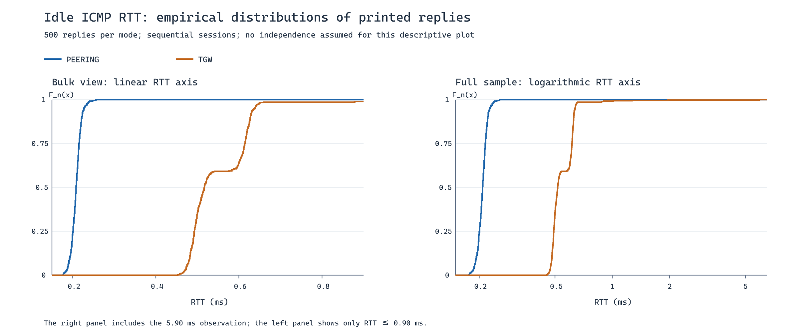
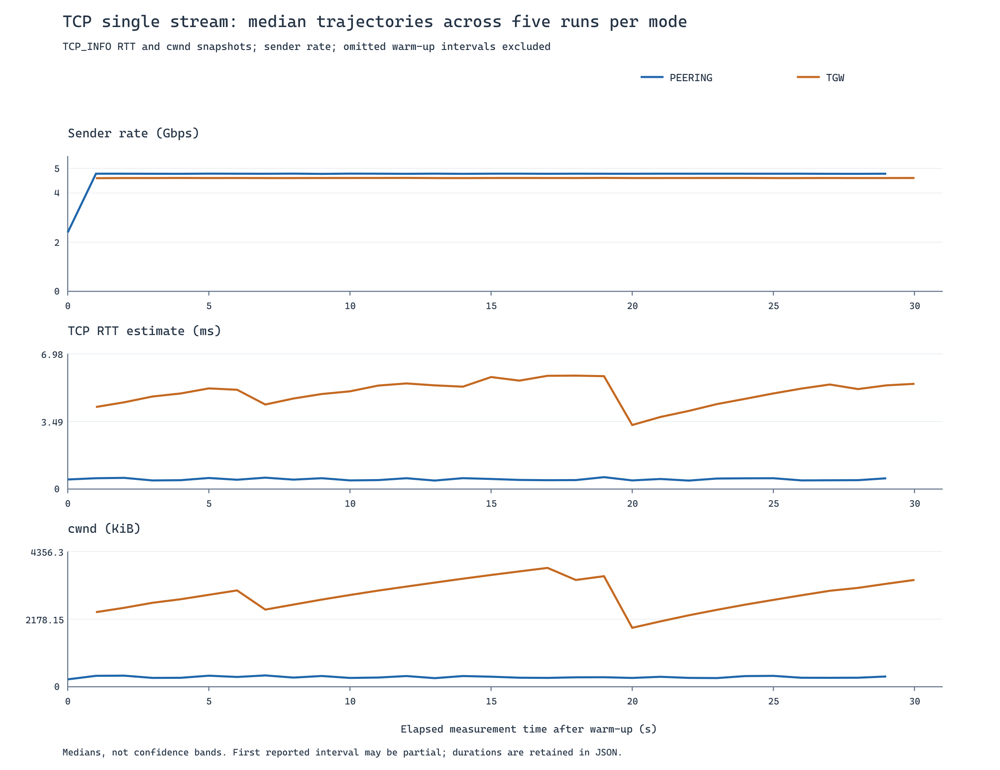

# Bổ sung thống kê và xác suất gắn với NT531 — 11/10/2026

## Nhận xét phản biện đúng ở đâu?

Bản trước đã có thống kê mô tả: trung bình, SD, CV và Jain. Vì vậy nói hoàn
toàn không có thống kê là chưa chính xác. Tuy nhiên, bản trước chủ yếu trả lời
“đo được bao nhiêu”, chưa triển khai phân bố độ trễ, tần suất vượt ngưỡng và
suy luận có độ bất định. Một số công thức vật lý/kiến trúc chỉ là giải thích,
không phải kiểm định thực nghiệm. Cần bổ sung phân tích có câu hỏi, không tăng
số công thức chỉ để có toán.

Bổ sung này dùng lại log ngày 05–06/10, không chạy EC2 hoặc tạo phép đo mới.
Không thay số ở chương kết quả 19 trang. Đây là phần bổ sung để ghép vào báo
cáo; DOCX hiện tại chưa chứa các hình/bảng mới dưới đây.

## 1. Liên hệ trực tiếp với bài giảng

| Bài giảng, trang PDF từ 1 | Nội dung | Vận dụng vào dữ liệu của nhóm |
|---|---|---|
| Internet Performance, QoS and Cloud-Native Metrics, trang 40–45, đặc biệt 41 | Mean không đủ mô tả đuôi; P50/P95/P99, SLO | ECDF, phân vị và tần suất RTT vượt ngưỡng từ từng phản hồi ping |
| Congestion Control, trang 3 và 18 | Biểu hiện congestion, cwnd, quan hệ cửa sổ/RTT | Đồ thị sender rate, TCP RTT và cwnd từ 10 JSON một luồng; không dùng RTT idle thay RTT TCP khi tải |
| Arrival Processes and Queuing Systems, trang 32, 34, 43, 64–66 | Kiểm tra arrival process, giả định Markov, Little | Ghi ranh giới hệ thống và chỉ dùng mô hình hàng đợi khi đo được đầu vào/phục vụ phù hợp |

Các PDF do sinh viên cung cấp, không đóng gói trong repo. Trang 32 của bài
Arrival yêu cầu đo inter-arrival và kiểm tra mô hình trước khi tin giả định
Poisson; trang 34 nêu inter-arrival/service exponential và nguồn độc lập.
Log ping của nhóm chứa RTT, không chứa inter-arrival của gói tại TGW.

## 2. Biến ngẫu nhiên và phân bố thực nghiệm RTT

**Câu hỏi:** RTT thường gặp, phần đuôi và tỷ lệ phản hồi vượt một ngưỡng khác
nhau thế nào giữa hai phiên Peering/TGW?

Gọi X là RTT (ms) của một probe có phản hồi trong điều kiện thử nghiệm đã chọn.
Các x_i là giá trị hiển thị trong log ping; i chỉ số phản hồi, n số phản hồi hợp lệ.
Hàm phân phối tích lũy và bản thực nghiệm:

$$
F_X(x)=P(X\le x\mid\text{probe có phản hồi}),\qquad
\widehat F_n(x)=\frac{1}{n}\sum_{i=1}^{n}\mathbf 1\{x_i\le x\}.
$$

x là ngưỡng RTT tính bằng ms; ký hiệu 1{…} bằng 1 khi điều kiện đúng và 0 nếu
sai; P là xác suất trong mô hình. F và F̂ không có đơn vị, nằm từ 0 tới 1.
F̂ là tần suất trong tập quan sát. Tính F̂ không cần giả định các mẫu độc lập;
diễn giải nó thành phân bố cho các phiên tương lai cần thiết kế lấy mẫu phù hợp.
Mất phản hồi được thống kê riêng, không tự bỏ khỏi mẫu số của một SLI thất bại.

Sắp tăng dần x_(1) ≤ … ≤ x_(n), dùng **nearest rank**:

$$
\widehat Q_q=x_{(\lceil nq\rceil)},\qquad q\in(0,1].
$$

q là mức phân vị; ⌈…⌉ làm tròn lên; chỉ số thứ tự bắt đầu từ 1. Q có đơn vị
ms. P50/P95/P99 tương ứng q=0.50/0.95/0.99. Với n=500, P95 lấy giá trị thứ
475; không phải lấy trung bình năm P95 từng lượt. Không nội suy trong bản này.

| Chỉ số từ 500 RTT hiển thị | Peering | TGW |
|---|---:|---:|
| Mean của các phản hồi hiển thị (ms) | 0.208334 | 0.563464 |
| SD mẫu của các phản hồi hiển thị (ms) | 0.012014 | 0.258814 |
| P50 (ms) | 0.208 | 0.517 |
| P95 (ms) | 0.227 | 0.638 |
| P99 (ms), chỉ mô tả phiên | 0.239 | 0.880 |
| Max hiển thị (ms) | 0.256 | 5.900 |

Hình trái phóng vùng ≤0.90 ms; hình phải dùng trục RTT logarithmic để giữ cả
quan sát 5.90 ms. Không xóa outlier. TGW có đuôi dài hơn trong phiên này.
P99 của 500 phản hồi nằm ở vị trí 495, chỉ có năm quan sát cao hơn; không dùng
nó như ước lượng đuôi chính xác cho mọi thời điểm hoặc mọi ứng dụng.

**Khác với bảng cũ:** mean 0.2078/0.5630 ms trong chương kết quả lấy từ năm
dòng summary avg của ping; bảng mới lấy từng giá trị RTT được in ra.
Hai đầu ra có độ chính xác hiển thị khác nhau. Không thay số cũ để ép khớp.
SD 0.007855/0.077508 ms cũ là SD giữa năm trung bình; SD trên đây tính giữa
500 RTT hiển thị, là đại lượng khác. Raw và bảng cũ được giữ nguyên.

## 3. Xác suất vượt ngưỡng: câu hỏi QoS có đầu ra kiểm chứng được

Với ngưỡng τ (ms), định nghĩa chỉ báo Y_i(τ)=1{x_i>τ} và tần suất:

$$
\widehat p_\tau=\frac{k_\tau}{n}=1-\widehat F_n(\tau),\qquad
k_\tau=\sum_{i=1}^{n}Y_i(\tau).
$$

k_τ là số phản hồi vượt ngưỡng; p̂_τ không có đơn vị, nhân 100% để hiển thị
phần trăm. Đây là xác suất thực nghiệm có điều kiện đã phản hồi.

| Ngưỡng khám phá τ | Peering: vượt/n (%) | TGW: vượt/n (%) |
|---|---:|---:|
| 0.25 ms | 2/500 (0.4%) | 500/500 (100%) |
| 0.50 ms | 0/500 (0%) | 322/500 (64.4%) |
| 1.00 ms | 0/500 (0%) | 4/500 (0.8%) |

**Ngưỡng được chọn sau khi có dữ liệu**, chỉ để khám phá và minh họa công
thức. Không gọi 1 ms là SLA AWS, SLO đã đăng ký trước hoặc mức phù hợp cho
mọi ứng dụng. Lần đo xác nhận phải chốt ngưỡng theo nhu cầu trước khi chạy.
Không chọn ngưỡng cho một mode rồi dùng kết quả đẹp nhất để kết luận.

| Lượt | Peering P95 (ms) | TGW P95 (ms) | Peering >1 ms | TGW >1 ms |
|---|---:|---:|---:|---:|
| 1 | 0.231 | 0.635 | 0/100 | 1/100 |
| 2 | 0.210 | 0.533 | 0/100 | 1/100 |
| 3 | 0.234 | 0.505 | 0/100 | 1/100 |
| 4 | 0.224 | 0.648 | 0/100 | 0/100 |
| 5 | 0.219 | 0.514 | 0/100 | 1/100 |

Nếu định nghĩa SLI “probe không phản hồi hoặc RTT>τ”, dùng N là số gửi và
M là số không phản hồi theo quy tắc timeout đã ghi:

$$
\widehat p_{bad}(\tau)=\frac{M+k_\tau}{N},\qquad
\widehat {SLI}_{good}=1-\widehat p_{bad}(\tau).
$$

N=n+M nếu không có phản hồi trùng và quy tắc phân loại đầy đủ. Trong dữ liệu
này M=0, N=n=500 mỗi mode, nên hai tần suất trùng nhau. Với log có mất phản
hồi phải giữ đúng mẫu số; ICMP không phản hồi không chỉ ra mất gói ở hop nào.
Vài phút probe không chứng minh availability tháng hoặc SLA dịch vụ.

## 4. Không mất phản hồi không có nghĩa xác suất mất bằng không

**Mô hình minh họa có giả định:** nếu Z_i=1 khi một probe không có phản hồi,
Z_i độc lập và cùng phân phối Bernoulli(p), thì K=ΣZ_i có phân phối Binomial(N,p).

$$
P(K=k)=\binom Nk p^k(1-p)^{N-k},\qquad P(K=0)=(1-p)^N.
$$

p là xác suất không phản hồi theo quy tắc đo; K là số không phản hồi trong N
probe; k giá trị cụ thể của K; tổ hợp N chọn k đếm cách xuất hiện k sự kiện.
Không áp dụng Bernoulli của ICMP cho retransmits TCP hoặc delta ENA.

Khi quan sát K=0, cận trên một phía mức tin cậy 1−α của mô hình:

$$
(1-p_U)^N=\alpha\quad\Longrightarrow\quad
p_U=1-\alpha^{1/N}.
$$

Với α=0.05 và N=500, p_U≈0.00597355 = **0.597355%**.
Đây là cận **một phía 95%**, không phải khoảng hai phía 95% (hai phía dùng
α/2 ở phương trình cận trên). Xác suất trên liên quan cơ chế lấy mẫu lặp;
không nói có 95% xác suất tham số cố định nằm trong một khoảng đã tính.
[NIST: exact binomial confidence limits](https://www.itl.nist.gov/div898/software/dataplot/refman2/auxillar/exacbici.htm).

Giá trị 0.597355% chỉ là **ví dụ có điều kiện theo mô hình iid**, chưa phải
cận đảm bảo cho AWS: probe liên tiếp trong một phiên có thể phụ thuộc, môi
trường có thể thay đổi. Dữ liệu hiện tại chưa xác nhận giả định iid/constant-p.
Không gộp 500 Peering và 500 TGW thành N=1000 cho một p chung chưa được chứng minh.

Script ghi thêm tương quan lag-1 trong từng lượt như chẩn đoán mô tả. Giá trị
khác 0 không tự chứng minh phụ thuộc có ý nghĩa, và gần 0 không chứng minh
độc lập. Không dùng 500 gói như 500 đợt thí nghiệm độc lập để tạo p-value nhỏ.

## 5. Suy luận thống kê để so sánh công nghệ: phần còn phải làm

Hai mode hiện đo ở hai phiên nối tiếp: thời điểm và mode bị trộn lẫn. Chạy
t-test/Welch/KS lên hàng trăm gói rồi ghi “Peering chắc chắn tốt hơn” không
loại được yếu tố thời điểm và phụ thuộc trong lượt. Bản bổ sung này không
báo p-value hoặc CI nhân quả giả từ dữ liệu cũ.

Thiết kế theo [kế hoạch](16-ke-hoach-hoan-thien-den-26-10.md): đợt b có đủ
cả hai mode trên cùng A/B, thứ tự Peering/TGW được cân bằng và lưu trước khi
chạy. Trong mỗi đợt lấy thống kê đã chốt trước, rồi tính:

$$
d_b=\bar x_{TGW,b}-\bar x_{Peering,b},\qquad
\bar d=\frac1B\sum_{b=1}^{B}d_b,\qquad
s_d=\sqrt{\frac{\sum_b(d_b-\bar d)^2}{B-1}}.
$$

$$
H_0:\mu_d=0,\quad H_1:\mu_d\ne0,\qquad
T=\frac{\bar d}{s_d/\sqrt B},\qquad
CI_{95\%}=\bar d\pm t_{0.975,B-1}\frac{s_d}{\sqrt B}.
$$

b là chỉ số đợt; B số đợt độc lập đủ hai mode; x̄_mode,b là trung bình các
lượt của chỉ số đã chọn trong đợt; d_b chênh lệch theo đợt, μ_d trung bình
chênh lệch của quá trình lấy đợt được định nghĩa; s_d SD mẫu giữa các đợt.
T không có đơn vị; t là phân vị Student với B−1 bậc tự do. d và CI có đơn
vị ms nếu phân tích RTT, Gbps nếu phân tích goodput. Không trộn các chỉ số.
H0/H1 chỉ áp dụng cho điều kiện và quá trình lấy mẫu đã định nghĩa.

CI/t-test cần chênh lệch giữa các đợt đủ độc lập và mô hình phân phối phù
hợp; ít đợt làm kiểm tra giả định yếu. Phải báo cỡ ảnh hưởng và CI, không chỉ
“p<0.05”. CI chứa 0 không chứng minh hai phương án tương đương. Không thực
hiện paired test bằng cách ghép lượt cùng số của hai phiên cũ.
[NIST: confidence limits for the mean](https://www.itl.nist.gov/div898/handbook/eda/section3/eda352.htm).

**Bốn đợt trong kế hoạch cũ là mức khởi đầu, không bảo đảm đủ mạnh thống kê.**
Ví dụ, exact sign test hai phía với B chênh lệch độc lập không bằng 0, dưới
H0 xác suất dấu dương bằng 1/2: p-value nhỏ nhất (mọi dấu cùng phía) là 2/2^B.
Với B=4, nhỏ nhất 0.125; không thể đạt mức 0.05 bằng phép test này. B=6 cho
0.03125 chỉ khi mọi dấu cùng phía, không phải cam kết công suất thống kê.
Đó là H0 về dấu, không phải tự động cùng H0 về mean ở trên. Chọn số đợt,
phép test và độ chính xác mong muốn trước khi chạy; không tăng B rồi dừng
ngay lúc p-value đẹp. Chưa bổ sung đợt mới hoặc thay lịch AWS trong lần này.

Ưu tiên một đầu ra chính (ví dụ RTT trung bình theo đợt), các đầu ra phụ ghi
khám phá. Nếu kiểm định nhiều ngưỡng/đầu ra cần kế hoạch xử lý nhiều phép
so sánh; không chọn một p nhỏ từ nhiều phép thử rồi coi là xác nhận.

## 6. Congestion Control: công thức dùng đúng RTT và cửa sổ

Đã phân tích 10 JSON TCP một luồng, mỗi file có 30 interval không omitted.
Hình là median tại từng vị trí interval giữa năm lượt của mỗi mode, không
phải CI; mọi interval từng lượt được giữ trong JSON phân tích.

Mã iperf3 3.19.1 xuất snd_cwnd/snd_wnd theo byte và rtt theo microsecond.
Đổi RTT ms bằng rtt/1000; cwnd KiB bằng snd_cwnd/1024.
[Nguồn mã TCP_INFO](https://github.com/esnet/iperf/blob/3.19.1/src/tcp_info.c).
Đường rate trong hình là **phía gửi**, không đổi nhãn thành goodput phía nhận.
Snapshot khoảng một giây không ghi mọi RTT segment hoặc mọi thay đổi cwnd.
Interval đầu sau khi reset warm-up có thể rất ngắn: giữ start/end/seconds
trong JSON, không coi điểm rate đầu thấp là bằng chứng máy khởi động chậm.

Liên hệ trang 18 của bài Congestion Control:

$$
R_{window}\approx\frac{8\min(W_c,W_r)}{T_{TCP}}\quad\text{bit/s}.
$$

W_c/W_r là cửa sổ congestion/receive, byte; T_TCP là RTT TCP, giây, lấy cùng
flow/cửa sổ. Công thức giả định cửa sổ được sử dụng đầy; là quan hệ giải thích,
không đảm bảo rate thực tế. CPU, pacing, offload, credits và retransmission
cũng ảnh hưởng. Hình mới giúp liên hệ các biến thật, chưa chứng minh nguyên
nhân hoặc vị trí nghẽn. Metadata là CUBIC, không coi toàn bộ thuật toán Reno
trên slide là thuật toán đang chạy trong thí nghiệm.

## 7. Arrival/Queueing: điều gì cần bổ sung để dùng mô hình?

Little L=λW cần cùng nhóm đơn vị và cùng ranh giới hệ thống: L số gói trung
bình, λ gói/giây hiệu dụng, W giây trong hệ thống đó. Không lấy goodput bit/s
nhân RTT ICMP để suy ra hàng đợi TGW. Bộ đếm ENA không đo thời gian chờ.

Không coi TCP iperf bão hòa hoặc probe ping cách đều 0.2 s là arrival Poisson.
Muốn thêm kiểm tra theo trang 32 phải thu inter-arrival tại endpoint trong
một phiên trace riêng phù hợp tải, xem phân bố và sự phụ thuộc; trace host
còn chịu offload. Có Poisson arrival cũng chưa đủ để khẳng định M/M/1:
cần mô hình service, số server, ranh giới queue và trạng thái ổn định.

Bài hữu ích hơn để làm tiếp là RTT **khi có tải được kiểm soát**, cùng ngưỡng
và mức tải thực đạt giữa hai mode. So ΔP95=P95_load−P95_idle (ms), CPU và ENA.
Nó kiểm tra biểu hiện độ trễ tăng khi tải; vẫn không tách chính xác hàng đợi
nội bộ AWS. Bài này chưa thực hiện. Mô phỏng M/M/1 nếu thêm phải ghi là lý
thuyết/minh họa, tách khỏi số đo AWS.

## 8. Tái tạo và trạng thái hoàn thành

Chạy `python scripts/analyze-statistics-probability.py` từ gốc repo để tính
JSON và SVG (cần ReportLab); PNG dùng Node/Sharp với `--node` và
`--node-modules`. Script kiểm SHA256 của 20 raw đầu vào với gói kiểm chứng,
không sửa log gốc, không gọi AWS. Phần ECDF/phân vị chỉ dùng thư viện chuẩn.

Nguồn và số đầy đủ: [statistics-probability.json](../results/analysis/statistics-probability.json).
Mean/SD cũ: [số liệu đã kiểm chứng](18-so-lieu-de-kiem-chung.md).
Kiểm chứng độc lập: [645 kiểm tra](../results/analysis/statistics-probability-verification.json)
bằng NumPy phân vị inverted_cdf, SD ddof=1, byte/thời lượng interval và hash nguồn.

| Đầu ra | Trạng thái |
|---|---|
| P50/P95/P99, ECDF, tần suất vượt ngưỡng và bảng từng lượt | Đã tính từ log có sẵn |
| Ví dụ Bernoulli/Binomial và cận zero-event | Đã giải thích; giả định iid chưa được xác nhận |
| TCP RTT/cwnd/rate theo thời gian cho một luồng | Đã phân tích 10 JSON, 300 interval |
| Đồ thị interval của 30 JSON fan-in | Chưa triển khai trong bản này |
| CI/kiểm định theo đợt độc lập, lặp cân bằng thứ tự | Chưa có dữ liệu các đợt mới |
| RTT khi tải, related work, chi phí và báo cáo toàn bộ | Còn theo kế hoạch |

Đo thêm có mục tiêu là bước để củng cố suy luận; không cần dựng lại topology
hoặc thêm nhiều công cụ chỉ để có tên. Khi bảo vệ, trình bày theo chuỗi:
câu hỏi → biến/mẫu → công thức → số liệu → điều kiện kết luận.
