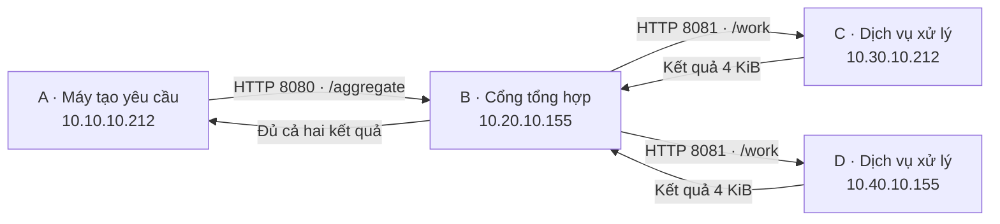

# Ứng dụng phân tán: chênh lệch mạng có ảnh hưởng tới người dùng?

Phần mở rộng trả lời: **Với cùng ứng dụng gọi hai dịch vụ song song, đường
Peering hoặc TGW ảnh hưởng thế nào đến thời gian hoàn thành và tỷ lệ đúng hạn
khi tốc độ yêu cầu tăng?** Đây là thí nghiệm ứng dụng tổng hợp, không giả vờ là
hệ thống sản xuất hoặc phát hiện một định luật mới về AWS.

## Kiến trúc ứng dụng trên bốn VPC hiện có



Mỗi đường liên VPC chọn Peering hoặc TGW bằng route table. B thực hiện hai
lời gọi thực sự riêng biệt qua private IP; không forward gói IP từ A sang C/D.
Do đó Peering không cần tính bắc cầu. Sáu peering hoặc bốn attachment TGW
đã có sẵn; bài này chỉ sử dụng AB, BC và BD cùng các đường phản hồi.

Không thêm EC2, EIP, TGW hay S3. Terraform thêm đúng ba ingress rule: A/32 tới
B:8080, B/32 tới C:8081 và D:8081. Dịch vụ bind private IP, không mở HTTP
ra Internet. Cổng quản trị và bài iperf3 giữ nguyên.

## Workload và pilot đã định trước

[Cấu hình pilot](../experiments/application-qos/pilot.json) lưu trước khi chạy:

| Tham số | Giá trị | Ý nghĩa |
|---|---:|---|
| Tốc độ đến λ | 10, 100, 600 yêu cầu/s | Lịch gửi đều, không phải quá trình Poisson |
| Mỗi mức tải | 10 giây sau 3 giây warm-up | Pilot ngắn, chưa đủ suy luận thống kê |
| Worker | 8 vị trí xử lý, chờ I/O mô phỏng 10 ms | Không phải workload tính toán CPU |
| Kết quả worker | 4096 byte/máy | Kiểm tra đúng kích thước và đúng C/D |
| Ngân sách hoàn thành D | 50 ms | Ngưỡng minh họa đặt trước pilot, không phải SLA bên ngoài |
| Timeout mỗi HTTP | 2 giây | Lỗi/timeout vẫn nằm trong mẫu số đúng hạn |
| Tracing so sánh | Tắt | Phiên trace smoke riêng có 6 yêu cầu |

Tải đến theo lịch **open-loop**: A không đợi phản hồi rồi mới phát yêu cầu
tiếp theo. Nếu generator chậm, thời gian hoàn thành vẫn tính từ thời điểm
đáng lẽ gửi, và lưu riêng độ trễ phát. Điều này tránh bỏ qua thời gian chờ do
generator. Phiên có P95 độ trễ phát >5 ms hoặc chạm giới hạn 2000 in-flight
bị gắn cờ chất lượng; không diễn giải thành giới hạn của AWS.

Mức 600 yêu cầu/s là thăm dò mức tải cao hơn, không được gọi là saturation
đã biết. Phép tính 8 / 0,010 = 800 lượt xử lý/s chỉ là năng lực danh nghĩa
của semaphore và thời gian chờ mô phỏng, không phải capacity đo được:
scheduling, HTTP, CPU và các chi phí khác vẫn hiện diện.

Pilot chọn ngẫu nhiên thứ tự hai công nghệ trước khi bắt đầu; mức tải tăng
dần giống nhau cho hai mode. Chỉ một phiên ghép cặp, có hiệu ứng thời gian/
thứ tự tải chưa được tách. Không tính p-value hoặc coi hàng nghìn request
trong cùng phiên là hàng nghìn lần thử độc lập.

Bước hiệu chỉnh riêng [calibration v2](../experiments/application-qos/calibration.json)
thăm dò 600/800/1000 yêu cầu/s quanh năng lực danh nghĩa của worker, giữ
nguyên tác vụ, 8 vị trí, 10 ms, 4 KiB và ngưỡng 50 ms. Safety cap generator
là 4000 và FD server là 8192 để tránh nhầm trần kỹ thuật của harness với
worker. Đây là calibration sau pilot, không nhập vào kiểm định xác nhận:

```powershell
py scripts/application-qos.py pilot --protocol calibration
```

Raw lưu ở `results/application-qos-calibration-v2/`, tách khỏi v1. Tải cao
có thể tạo backlog kéo dài từ warm-up sang đo; phải đọc đây là phiên tải
hữu hạn, không mặc nhiên là trạng thái cân bằng. Không loại request chậm
hoặc phiên quá tải vì số liệu không đẹp.

## Công thức và ký hiệu

Với yêu cầu i: aᵢ là thời điểm gửi theo lịch, sᵢ là lúc thực sự phát và fᵢ là
lúc nhận xong/ghi lỗi. Tất cả lấy từ cùng đồng hồ đơn điệu trên A.

- **Độ trễ phát:** Lᵢ = max(0, sᵢ − aᵢ), đổi sang ms bằng nhân 1000.
- **Thời gian hoàn thành:** Tᵢ = max(0, fᵢ − aᵢ). Bao gồm trễ phát và
  hành trình HTTP/xử lý. Không cần trừ đồng hồ giữa các máy.
- **Chỉ báo đúng hạn:** Yᵢ = 1 nếu HTTP/thân kết quả đúng và Tᵢ ≤ D;
  còn lại Yᵢ = 0. Timeout, lỗi và yêu cầu không phát được đều là 0.
- **Tỷ lệ đúng hạn:** p̂_D = (Σ Yᵢ) / N, N là tổng yêu cầu theo lịch.
- **P95:** sắp xếp T của các yêu cầu thành công, lấy vị trí ceil(0,95n).
  Đây là P95 có điều kiện thành công; luôn đọc cùng số lỗi và p̂_D.
- **Chênh lệch:** ΔP95(λ) = P95_TGW(λ) − P95_Peering(λ), đơn vị ms;
  Δp_D(λ) = 100 × (p̂_D,TGW − p̂_D,Peering), đơn vị điểm phần trăm.

Với fan-out song song, thời gian B chờ hai kết quả gần dạng
**max(R_C, R_D) + H_B**, trong đó R là thời gian RPC gồm truyền, chờ và xử
lý ở worker, H_B là chi phí tổng hợp. Đây là phân rã giải thích, không khẳng
định các R độc lập hoặc lấy RTT ICMP làm R. Trường hợp gọi nối tiếp sẽ có
dạng tổng, nhưng pilot hiện tại chỉ chạy song song.

Khái niệm hàng đợi giúp giải thích worker-slot wait. Không áp dụng M/M/1
trực tiếp: tải đều, hai nhánh, tám vị trí xử lý và service time mô phỏng
không thỏa giả thiết Poisson/exponential/một server. Little L=λW chỉ dùng
khi có phép đo số yêu cầu trong hệ thống, tốc độ hoàn thành và cửa sổ ổn
định tương ứng; hiện pilot chưa báo cáo phép tính đó.

## OpenTelemetry dùng để kiểm tra điều gì?

Một yêu cầu thành công có cùng trace ID qua bốn máy và 10 span:
load.request; gateway.handle; hai gateway.call; hai worker.handle;
hai worker.queue; hai worker.process. W3C traceparent được truyền qua HTTP.
Kiểm tra cha/con và hai RPC chồng nhau chứng minh triển khai đúng luồng.

Các span lưu JSONL ngay trên EC2 rồi tải về và kiểm tra SHA256. Có thể phát
lại tới Collector → Tempo → Grafana trên laptop; phát lại giữ timestamp
gốc và được ghi rõ là dữ liệu lưu, không phải luồng đo live.

Span gateway.call bao gồm HTTP, mạng và xử lý ở worker. Chênh giữa span
client/server còn chịu lệch đồng hồ và instrumentation; không gọi phần đó
là độ trễ mạng một chiều. Tracing chỉ bật ở phiên smoke riêng, chưa đo độ
tác động của instrumentation và không nhập số liệu smoke vào bảng so sánh.

## Cách chạy và kiểm chứng

```powershell
py scripts/application-qos.py setup
py scripts/application-qos.py pilot
# Thay <attempt> bằng thư mục được in ở cuối:
tmp/application-venv/Scripts/python.exe experiments/application-qos/analyze.py results/application-qos-pilot-v1/<attempt>
```

Script setup chỉ chấp nhận ba rule ingress mới trong plan. Script pilot chỉ
chấp nhận thay route đã có, kiểm tra trạng thái route trước/sau, lưu nguồn
và lỗi, tắt dịch vụ cuối phiên rồi phục hồi mode ban đầu. Không bật service
theo boot. Khi mất phiên điều khiển, xem AWS Run Command trước khi chạy lại;
`py scripts/application-qos.py stop` tắt ba server.

Kết quả dưới `results/application-qos-pilot-v1/<attempt>/`: attempt.json,
preflight bốn máy, routes-before/after, requests.jsonl.gz và summary.json
mỗi mức tải, CPU từng lõi 1 Hz và ENA trước/sau mỗi mode (bao gồm warm-up,
thời gian nghỉ/tải và tải file; không phải cửa sổ riêng từng mức tải),
trace-smoke bốn máy, bản mã nguồn thực chạy, analysis.json với hash nguồn. Chỉ trạng
thái complete, cleanup_errors rỗng và analysis.issues rỗng mới qua kiểm tra.

Ứng dụng phải tắt trước block RTT xác nhận; script RTT hiện từ chối nếu
phát hiện app đang chạy. Protocol 16 block và log RTT cũ giữ nguyên.

## Tiêu chí quyết định sau pilot

1. Kiểm tra đủ dữ liệu, tỷ lệ đúng hạn và generator có giữ lịch không.
2. Xem ba mức tải đã cho vùng hoạt động hữu ích chưa; nếu đều rảnh thì
   không kết luận ứng dụng không nhạy mạng hoặc hệ thống không thể nghẽn.
3. Chọn một ngân sách nghiệp vụ được giải thích và margin có ý nghĩa trước
   nghiên cứu tiếp; đóng băng tải, thời lượng, số phiên ghép cặp và thứ tự.
4. Suy luận trên các phiên, báo cáo khoảng tin cậy chênh P95/tỷ lệ đúng hạn.
   Không dùng “p>0,05” để kết luận tương đương; tương đương cần margin đặt
   trước và khoảng tin cậy phù hợp hoàn toàn nằm trong margin.

Kết quả nhỏ hoặc gần nhau vẫn có ích nếu được lượng hóa đủ tin cậy. Không
thay tác vụ/ngưỡng sau khi xem kết quả để tạo ra kết luận “ấn tượng”.

## Tài liệu đối chiếu

- [The Tail at Scale, Dean & Barroso (2013)](https://research.google/pubs/the-tail-at-scale/):
  bối cảnh độ trễ đuôi trong dịch vụ phân tán; mô hình nhỏ này không tái hiện
  quy mô Google hoặc chứng minh mọi kết quả của bài báo.
- [OpenTelemetry Python instrumentation](https://opentelemetry.io/docs/languages/python/instrumentation/):
  tạo span, truyền context và xuất traces.
- [aiohttp client](https://docs.aiohttp.org/en/stable/client_quickstart.html):
  tái sử dụng session/connection pool; giữ cấu hình giống nhau giữa mode.
