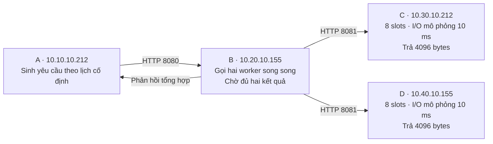
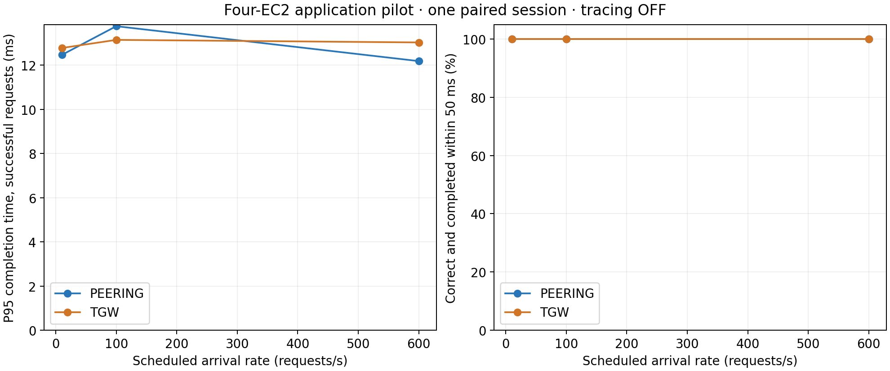
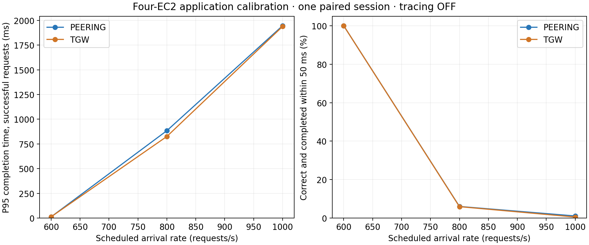
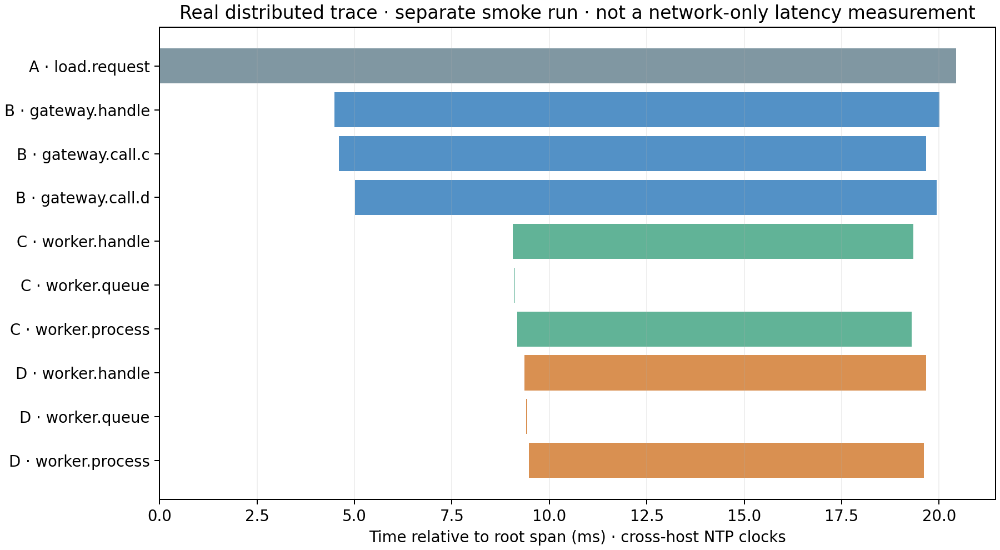

# Kết quả ứng dụng phân tán: độ trễ đuôi và xác suất đúng hạn

Ngày chạy: 12/10/2026. Trạng thái: hai phiên khám phá đã thu đủ dữ liệu và
qua kiểm tra; **chưa phải nghiên cứu xác nhận thống kê**.

## Câu hỏi và mô hình

Khi A yêu cầu B tổng hợp hai kết quả từ C/D, việc đổi Peering sang TGW ảnh
hưởng bao nhiêu đến thời gian hoàn thành và tỷ lệ phản hồi đúng hạn, ở các
mức tải khác nhau? Phân biệt ảnh hưởng đường mạng với giới hạn xử lý worker.

Mỗi EC2 thuộc một VPC, cùng c6i.large, AMI và AZ us-east-1a; MTU 1500,
NTP đồng bộ. Hai RPC C/D đều cần thành công. Thời gian 10 ms là `async sleep`
mô phỏng I/O, không phải tính toán CPU hay thời gian dịch vụ đo từ hệ thống thật.
EIP dùng quản trị; toàn bộ HTTP thử nghiệm chạy bằng private IP.

Đường HTTP được đổi bằng route tới Peering hoặc TGW. Kiểm tra đủ sáu chiều
A↔B, B↔C, B↔D trước/sau mỗi mode. Thiết kế/công thức chi tiết tại
[tài liệu 25](25-ung-dung-phan-tan-va-qos.md).

## Cách đo và mẫu số

Sinh yêu cầu theo lịch cố định, không đợi phản hồi trước khi sinh yêu cầu
tiếp theo. Mỗi điều kiện warm-up 3 giây, sau đó lập lịch trong 10 giây;
thu đến khi yêu cầu kết thúc hoặc time-out 2 giây. Warm-up không tính vào bảng.
50 ms là ngân sách minh họa được đặt trước pilot đầu tiên, không phải SLA
bên ngoài. Tracing tắt trong phép so sánh, bật riêng cho kiểm tra chức năng.

Gọi N là tổng số yêu cầu đã lập lịch; a_i là thời điểm lập lịch của yêu cầu i;
f_i là thời điểm hoàn tất trên A. T_i = 1000(f_i − a_i), đơn vị ms.
Y_i = 1 nếu kết quả đúng và T_i ≤ 50 ms, ngược lại bằng 0.
Tỷ lệ đúng hạn p̂ = (ΣY_i)/N. Lỗi và time-out vẫn nằm trong N.
P95 = T_(ceil(0,95n)) của n yêu cầu thành công đã sắp tăng dần; đây là
**P95 có điều kiện thành công**, phải đọc cùng tỷ lệ lỗi, không đại diện
mọi yêu cầu khi có time-out. Thời gian bao gồm chậm phát lệnh của A.

## Pilot v1: tải thấp đến 600 yêu cầu/giây

Một phiên ghép cặp: Peering trước, TGW sau. Mỗi mode đo tăng dần tải.

| Tải (yêu cầu/s) | N mỗi mode | P95 Peering (ms) | P95 TGW (ms) | Đúng hạn Peering | Đúng hạn TGW | Lỗi mỗi mode |
|---:|---:|---:|---:|---:|---:|---:|
| 10 | 100 | 12,459 | 12,772 | 100% | 100% | 0 |
| 100 | 1.000 | 13,759 | 13,140 | 100% | 100% | 0 |
| 600 | 6.000 | 12,179 | 13,024 | 100% | 100% | 0 |

14.200 yêu cầu trong tổng hai mode đều phản hồi đúng hạn. Chênh P95
TGW − Peering lần lượt +0,313; −0,619; +0,845 ms. Dấu khác biệt không nhất
quán. Không được suy từ 100% quan sát thành xác suất thật bằng 1 hoặc hai
phương án tương đương. Phiên này cho thấy chênh RTT ICMP trước đó không
tự động dẫn tới mất deadline của workload này ở các tải đã đo.

Nguồn: [attempt](../results/application-qos-pilot-v1/ad93e8d202154733a165eee896fd5e50/attempt.json),
[analysis](../results/application-qos-pilot-v1/ad93e8d202154733a165eee896fd5e50/analysis.json).

## Calibration v2: vùng tải bắt đầu trễ hạn

Một phiên ghép cặp mới: TGW trước, Peering sau; tải 600, 800, 1.000 yêu cầu/s.
Giữ nguyên 8 slots, I/O 10 ms, payload và deadline. Giới hạn in-flight của
generator tăng từ 2.000 lên 4.000; FD server 8.192. Không gộp phiên này
với v1 để làm kiểm định xác nhận hay tính khoảng tin cậy liên phiên.

| Tải | Mode | N | Thành công | Lỗi/time-out | Đúng hạn/N | Tỷ lệ đúng hạn | P95 thành công (ms) |
|---:|---|---:|---:|---:|---:|---:|---:|
| 600 | Peering | 6.000 | 6.000 | 0 | 6.000 | 100% | 12,169 |
| 600 | TGW | 6.000 | 6.000 | 0 | 6.000 | 100% | 12,862 |
| 800 | Peering | 8.000 | 8.000 | 0 | 482 | 6,025% | 884,190 |
| 800 | TGW | 8.000 | 8.000 | 0 | 474 | 5,925% | 825,718 |
| 1.000 | Peering | 10.000 | 5.303 | 4.697 | 108 | 1,080% | 1.946,588 |
| 1.000 | TGW | 10.000 | 5.282 | 4.718 | 53 | 0,530% | 1.939,094 |

Tại 800 yêu cầu/s, không có lỗi nhưng hơn 93% phản hồi trễ ngân sách 50 ms.
Tại 1.000, khoảng 47% yêu cầu lỗi/time-out và chỉ 0,53–1,08% đúng hạn.
Toàn bộ 4.697/4.718 lỗi tương ứng Peering/TGW ở 1.000 rps được raw log
ghi là `TimeoutError` trên A; không suy từ đó thành packet loss tầng mạng.
Vì vậy chỉ báo HTTP thành công hoặc thông lượng trung bình sẽ bỏ sót phần
suy giảm chất lượng này. Hai đường cùng suy giảm mạnh khi tăng tải của
workload cố định; đổi sang Peering không giải quyết được vấn đề trong phiên này.

Nguồn: [attempt](../results/application-qos-calibration-v2/1c0d1fb25e544fb0bee95078cbfc265c/attempt.json),
[analysis](../results/application-qos-calibration-v2/1c0d1fb25e544fb0bee95078cbfc265c/analysis.json).

## Kiểm tra endpoint và giới hạn diễn giải

Tất cả 12 điều kiện của hai phiên giữ lịch phát: P95 dispatch lag trên A
không quá 1,991 ms; không chạm giới hạn in-flight. Tái tính trực tiếp từ
62.200 dòng yêu cầu nén cho kết quả khớp summary; không có ID thiếu/trùng.
Hai bộ `analysis.json` có `issues=[]`.

Trong v2, CPU host B đo bằng 100 − %idle trung bình khoảng 11–14% ở 600,
21–22% ở 800 và 34–35% ở 1.000. Mẫu 1 Hz, gồm I/O wait và mọi tiến trình;
không phải CPU riêng ứng dụng, không loại trừ nghẽn thoáng qua hay từng lõi.
Năm ENA allowance-exceeded counter trên cả bốn EC2 không tăng trong mỗi
mode. Cửa sổ ENA bao gồm warm-up, tải, nghỉ và chuyển file, không tách từng
mức tải. Không tăng counter không chứng minh mạng không có mọi loại nghẽn.
Nguồn [diagnostics v2](../results/application-qos-calibration-v2/1c0d1fb25e544fb0bee95078cbfc265c/endpoint-diagnostics.json).

Mốc c/s = 8/0,010 = 800 tác vụ/s chỉ là ngân sách xử lý danh định của
semaphore/sleep mỗi worker: c = số slots, s = thời gian dịch vụ lý tưởng,
đơn vị giây. ρ_nom = λs/c lần lượt 0,75; 1; 1,25 ở ba mức tải v2.
Overhead asyncio/RPC/timer làm công suất thực khác mốc này. Đây không phải
giới hạn EC2, TGW hay Peering, cũng không phải tham số M/M/1 đã ước lượng.
Do phát đều, nhiều slots và I/O cố định, chưa dùng mô hình Poisson/exponential.

Kết quả phù hợp với giả thuyết tích lũy hàng đợi tại ứng dụng có slots hữu hạn,
nhưng chưa xác định nguyên nhân duy nhất. Phiên tải quá mức chỉ kéo dài
10 giây, không đạt hay kiểm chứng trạng thái dừng. Chưa đo hàng đợi theo
thời gian trong phép so sánh, chưa can thiệp tăng slots và lặp độc lập;
không tính Little's Law từ các số chưa thu. Tải tăng dần và mode nối tiếp
là hạn chế của calibration, không phải thiết kế suy luận cuối cùng.

## Distributed tracing đã hoạt động

Mỗi phiên có 6 yêu cầu kiểm tra riêng ở 2 yêu cầu/s, mỗi yêu cầu đủ 10 spans
xuyên A/B/C/D và quan hệ cha–con đúng. Tổng 12 traces, 120 spans thật.
Trace kiểm tra tải thấp minh họa hai RPC song song và cấu trúc queue/process;
không đo queue ở 800/1.000 nên không dùng hình đó chứng minh nguyên nhân
overload. Đồng hồ NTP giữa host vẫn có sai số; T_i chính đo một đồng hồ trên A.

SDK OpenTelemetry trên EC2 ghi JSONL; sao lưu rồi **replay** qua Collector
local → Tempo → Grafana, giữ ID và timestamp gốc. Chưa triển khai xuất
OTLP live hoặc hostmetrics agent. Grafana truy vấn được trace thật 10 spans
và tìm đủ 12 traces qua datasource proxy. Xem
[bằng chứng runtime](../results/application-qos-calibration-v2/1c0d1fb25e544fb0bee95078cbfc265c/observability-validation.json)
và [hướng dẫn dashboard](../monitoring/README.md).

## Kết luận hiện được dữ liệu hỗ trợ

Trong workload fan-out đã cấu hình, ở 600 yêu cầu/s cả hai đường giữ 100%
đúng hạn quan sát và P95 khoảng 12–13 ms. Khi tăng lên 800, P95 tăng lên
826–884 ms dù mọi phản hồi vẫn thành công; đến 1.000, xuất hiện nhiều
lỗi/time-out. Lựa chọn mạng phải được đánh giá cùng tải, ngân sách thời gian
và khả năng xử lý ứng dụng. Một kết quả ping tốt hoặc HTTP thành công
không đủ để đánh giá chất lượng yêu cầu người dùng.

Đây là kết luận mô tả của thí nghiệm đã chạy. Chưa chứng minh TGW/Peering
tương đương hoặc một phương án thắng tổng quát. Cần các phiên ghép cặp
độc lập và can thiệp slots để định lượng effect size có CI và kiểm tra
giả thuyết nguyên nhân. Xem [kế hoạch xác nhận](../experiments/application-qos/study-plan.md).

Ý nghĩa P95 và fan-out liên hệ với vấn đề độ trễ đuôi trong
[The Tail at Scale, Dean & Barroso, 2013](https://research.google/pubs/the-tail-at-scale/).
Bài báo là cơ sở đặt câu hỏi, không phải nguồn số liệu AWS của đồ án;
mô hình bốn máy này không tái hiện quy mô hay toàn bộ kết luận của bài báo.

## Trạng thái lưu trữ và vận hành

Hai phiên hoàn tất có mã nguồn, protocol, runner thực chạy, phiên bản pip,
route snapshots, từng yêu cầu, CPU/ENA, trace và manifest SHA256. Chúng
không sửa protocol hoặc kết quả xác nhận RTT cũ (vẫn 2/16 blocks).

Attempt đầu `204da68f85f0424581d29ee405152fa7` bị chặn trước khi phát tải:
C/D còn MTU 9001. Đã lưu lỗi, chỉnh bốn máy về 1500 và chạy attempt mới;
không xóa hay nhập attempt lỗi vào bảng. Cả hai phiên thành công dừng app
và monitor cuối phiên, phục hồi TGW; không bật service theo boot. EC2 và
hạ tầng mạng vẫn tồn tại để đo tiếp.
Kiểm tra AWS sau cleanup xác nhận bốn app/monitor inactive, MTU/NTP đúng,
route TGW active. Terraform cuối phiên báo `No changes`. Kiểm thử fan-out,
overload, giữ lỗi trong mẫu số và trace cha–con đều pass; xem
[validation](../results/application-qos-calibration-v2/validation.json).
