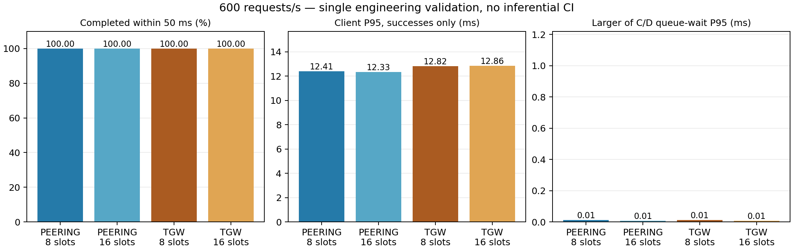
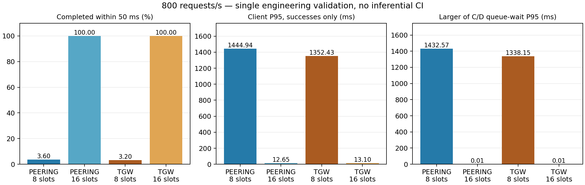

# Kết quả kiểm tra kỹ thuật can thiệp slots

Đây là **một phiên engineering**, tách khỏi 16 block xác nhận. Dữ liệu
cho thấy hiệu ứng quan sát trong phiên này; chưa có p-value hoặc CI liên
block, chưa xác nhận khả năng lặp lại giữa các ngày.

Nguồn: [raw, source và metadata](../results/application-slots-engineering-v1/9e45c8058c6942ef9805ab65cc2f8ab9/attempt.json);
[analysis tính lại mọi request](../results/application-slots-engineering-v1/9e45c8058c6942ef9805ab65cc2f8ab9/analysis.json);
[CPU/ENA theo điều kiện](../results/application-slots-engineering-v1/9e45c8058c6942ef9805ab65cc2f8ab9/endpoint-diagnostics.json).

Bắt đầu UTC: `2026-10-12T16:03:54.151956+00:00`; kết thúc: `2026-10-12T16:32:23.312776+00:00`.
Thứ tự mạng thực chạy: peering → tgw.
Tổng **84,000 yêu cầu đo** (không cộng warm-up).

A → B → C/D; hai RPC song song. MTU 1500, cùng EC2/AMI/AZ, tác vụ I/O
mô phỏng 10 ms, 4096 bytes/worker. Deadline 50 ms, timeout 2 s; mỗi tổ
hợp warm-up 5 s, drain backlog, đo 15 s. Tracing đầy đủ tắt; log hàng
đợi bật giống nhau. Thay đồng thời số slots của C và D; fresh server
mỗi tổ hợp. Giữ dữ liệu lỗi/timeout trong mẫu số.

Thu log cuối gặp AWS OAuth 429. Dấu vết `attempt.json` failed được giữ
nguyên; [download-recovery.json](../results/application-slots-engineering-v1/9e45c8058c6942ef9805ab65cc2f8ab9/download-recovery.json)
ghi việc chỉ tải lại hai queue logs còn thiếu, không đo lại. TGW
after-snapshot lấy sau cleanup đã khôi phục TGW. Các số liệu phía A
và bảy tổ hợp trước không bị ghi đè. Phạm vi route snapshot này được
công bố để không mô tả recovery như một phiên chạy sạch lỗi.

## Outcome phía A

| Mạng | Slots/worker | Yêu cầu/s | N | Đúng hạn (%) | Thành công HTTP/JSON (%) | P95 thành công (ms) |
|---|---:|---:|---:|---:|---:|---:|
| peering | 8 | 600 | 9000 | 100.000 | 100.000 | 12.406 |
| peering | 16 | 600 | 9000 | 100.000 | 100.000 | 12.334 |
| tgw | 8 | 600 | 9000 | 100.000 | 100.000 | 12.824 |
| tgw | 16 | 600 | 9000 | 100.000 | 100.000 | 12.861 |
| peering | 8 | 800 | 12000 | 3.600 | 100.000 | 1444.944 |
| peering | 16 | 800 | 12000 | 100.000 | 100.000 | 12.654 |
| tgw | 8 | 800 | 12000 | 3.200 | 100.000 | 1352.429 |
| tgw | 16 | 800 | 12000 | 100.000 | 100.000 | 13.098 |

P95 chỉ dùng request thành công; đúng hạn chia cho toàn bộ yêu cầu theo
lịch. Thành công HTTP/JSON không tự đồng nghĩa đạt deadline.

## Thời gian chờ và phục vụ tại worker

| Mạng | Slots | rps | Node | Đã vào / N | P95 chờ (ms) | P95 phục vụ (ms) | A lỗi nhưng handler hoàn tất |
|---|---:|---:|---|---:|---:|---:|---:|
| peering | 8 | 600 | C | 9000/9000 | 0.0071 | 10.645 | 0 |
| peering | 8 | 600 | D | 9000/9000 | 0.0123 | 10.647 | 0 |
| peering | 16 | 600 | C | 9000/9000 | 0.0062 | 10.533 | 0 |
| peering | 16 | 600 | D | 9000/9000 | 0.0075 | 10.536 | 0 |
| tgw | 8 | 600 | C | 9000/9000 | 0.0078 | 10.609 | 0 |
| tgw | 8 | 600 | D | 9000/9000 | 0.0125 | 10.580 | 0 |
| tgw | 16 | 600 | C | 9000/9000 | 0.0061 | 10.653 | 0 |
| tgw | 16 | 600 | D | 9000/9000 | 0.0065 | 10.635 | 0 |
| peering | 8 | 800 | C | 12000/12000 | 1287.8189 | 11.150 | 0 |
| peering | 8 | 800 | D | 12000/12000 | 1432.5659 | 11.213 | 0 |
| peering | 16 | 800 | C | 12000/12000 | 0.0079 | 11.002 | 0 |
| peering | 16 | 800 | D | 12000/12000 | 0.0095 | 11.003 | 0 |
| tgw | 8 | 800 | C | 12000/12000 | 1287.2617 | 11.157 | 0 |
| tgw | 8 | 800 | D | 12000/12000 | 1338.1508 | 11.225 | 0 |
| tgw | 16 | 800 | C | 12000/12000 | 0.0112 | 10.903 | 0 |
| tgw | 16 | 800 | D | 12000/12000 | 0.0113 | 10.901 | 0 |

Các mốc chờ/phục vụ lấy từ cùng đồng hồ monotonic của từng worker.
Request ID ghép A, C và D; warm-up có ID riêng. Không cộng hai P95
worker thành P95 end-to-end. Xem analysis để biết cancelled/missing/error
và số mẫu dùng cho từng quantile; handler hoàn tất không chứng minh A đã nhận.

## So sánh can thiệp trong phiên

- PEERING, 800 rps: đúng hạn 3.600% → 100.000% (**+96.400 điểm phần trăm**); P95 thành công 1444.944 → 12.654 ms.
- TGW, 800 rps: đúng hạn 3.200% → 100.000% (**+96.800 điểm phần trăm**); P95 thành công 1352.429 → 13.098 ms.

Diễn giải: nếu đúng hạn tăng cùng với chờ hàng đợi giảm mà phục vụ
vẫn cùng cỡ 10–11 ms, điều này hỗ trợ vai trò của giới hạn đồng thời
worker trong workload đã đặt. So sánh slot trước/sau không đổi mode
mạng. Cần các block với thứ tự cân bằng để tách biến động thời gian;
phiên đơn này không xếp hạng mạng tổng quát hay chứng minh một nguyên
nhân duy nhất. Các P95 nhỏ có thể khác giữa hai mode dù cả hai đạt SLA.

Tỷ lệ đúng hạn đạt 100% là outcome chạm trần của ngưỡng 50 ms;
không chứng minh hai mạng tương đương về latency. Trong phiên này,
đổi đường mạng ở 8 slots/800 rps vẫn để phần lớn yêu cầu trễ hạn;
tăng slots trong từng mode giải quyết trễ hạn quan sát được. Không
tuyên bố 16 slots là cấu hình tối ưu; chỉ hai mức slots đã được thử.

## CPU/ENA và chất lượng dữ liệu

| Mạng | Slots | rps | CPU B trung bình (%) | Mẫu CPU B (1 s) |
|---|---:|---:|---:|---:|
| peering | 8 | 600 | 14.944 | 15 |
| peering | 16 | 600 | 12.030 | 14 |
| tgw | 8 | 600 | 15.891 | 14 |
| tgw | 16 | 600 | 20.059 | 14 |
| peering | 8 | 800 | 23.059 | 15 |
| peering | 16 | 800 | 14.691 | 14 |
| tgw | 8 | 800 | 21.661 | 16 |
| tgw | 16 | 800 | 21.214 | 14 |

Delta năm bộ đếm allowance ENA trên cả bốn node/tám tổ hợp: **đều bằng 0**.
Cửa sổ ENA gồm warm-up/drain/đo/thu log; CPU chỉ lấy các interval một
giây nằm hoàn toàn trong cửa sổ client. CPU host = 100 − %idle, gồm
I/O wait; không phải CPU riêng ứng dụng. Không suy ra công suất AWS
vô hạn từ delta ENA bằng 0.

Analyzer kiểm tra source/hash, thư viện bốn node, route hai đầu, đủ
tám tổ hợp, generator, từng request, worker ID/timestamp và CPU/ENA.
**Không có issue theo các kiểm tra trên.** Engineering chạy phiên runner
được lưu cùng raw; bản formal bổ sung health-before để xác minh trực tiếp
slots/queue_logging/backlog và kiểm tra thời lượng block. Không tự nhập
engineering vào formal sau khi đã thấy kết quả.

## Biểu đồ

## Việc tiếp theo

[Protocol slots đã khóa](27-can-thiep-slots-va-hang-doi.md) yêu cầu
16 block trên ít nhất bốn ngày, cách nhau ít nhất hai giờ. Hiện phiên
này đóng góp **0 block xác nhận**. Kiểm định chính cần ít nhất 12/16
block có mức tăng >10 điểm phần trăm; không dừng khi vừa đạt ngưỡng.
Đợt RTT chạy riêng. [Cách dừng và mở lại](28-tam-dung-va-tiep-tuc-xac-nhan.md).
