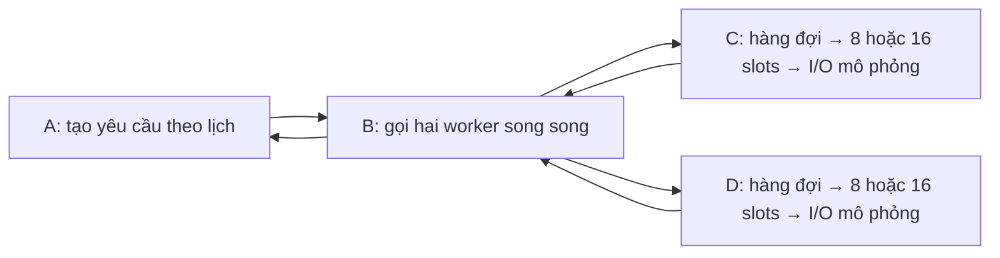
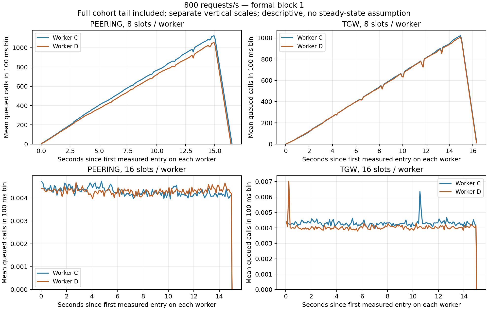

# Hàng đợi ứng dụng: kiểm tra bằng sample path và định luật Little

Phân tích bổ sung từ log đã lưu ngày 13/10/2026, không tạo tải AWS mới.
Engineering và các block xác nhận được giữ riêng trong
[JSON kết quả và SHA nguồn](../results/analysis/queue-occupancy-audit.json).
Snapshot trình bày dưới đây dùng **block xác nhận slots 1**; chưa suy luận
cho cả 16 block. Đây không phải một kiểm định chính mới.

## Mô hình được đo



Mỗi yêu cầu ở A tạo một lời gọi tới C và một tới D. Nếu cấu hình A là
800 yêu cầu/s thì tải danh nghĩa của **mỗi** worker là 800 lời gọi/s;
không ghi mỗi worker là 1.600 lời gọi/s. Tổng hai worker là 1.600.
Các máy khác VPC, đường Peering hoặc TGW đã kiểm chứng. Hình trên là
luồng ứng dụng; [kiến trúc bốn VPC](03-bon-vpc.md) vẫn giữ nguyên.

Slots là số lời gọi có thể phục vụ đồng thời trên một worker. Nó không
phải số vCPU hay băng thông của mạng AWS. I/O mô phỏng có delay cấu hình
10 ms; thời gian thực ghi trong log có thể dài hơn do lập lịch và overhead.
Trong so sánh chính, tracing đầy đủ tắt và cùng cách ghi log ở cả hai mode.

## Đại lượng và cửa sổ tính

Chỉ ghép các lời gọi worker có request ID của cửa sổ đo. Loại warm-up
bằng ID, không cắt đuôi các lời gọi còn xử lý sau khi A hết lịch gửi.
Giữ cả lời gọi bị hủy; không chỉ chọn những lời gọi phục vụ thành công.

| Ký hiệu | Nghĩa | Đơn vị |
|---|---|---|
| \(i\) | Một lời gọi trên **một** worker | chỉ số |
| \(a_i\) | `entered_s`: lúc vào handler | s, đồng hồ monotonic worker |
| \(b_i\) | Bắt đầu phục vụ; nếu bị hủy khi chờ thì lúc thoát | s, cùng đồng hồ |
| \(e_i\) | `exit_s`: lúc thoát handler | s, cùng đồng hồ |
| \(W_{q,i}=b_i-a_i\) | Thời gian ở trạng thái chờ | s |
| \(R_i=e_i-a_i\) | Thời gian trong handler worker | s; không phải RTT/latency tại A |
| \(N\) | Số lời gọi đã vào worker trong cohort ID được chọn | lời gọi |
| \(t_0=\min_i a_i,\ t_1=\max_i e_i\) | Biên cửa sổ chứa trọn cohort | s |
| \(T=t_1-t_0\) | Thời lượng cửa sổ; gồm đuôi xử lý | s |

Một cohort ở đây là nhóm lời gọi được chọn bằng request ID trong **một tổ
hợp điều kiện và một worker**, khác nghĩa cohort EC2 giữ nguyên giữa các phiên.
Không trừ timestamp monotonic của C cho timestamp monotonic của D.
Mỗi worker có cửa sổ riêng. Nếu thiếu exit hoặc interval nằm ngoài cửa sổ,
script từ chối tính thay vì giả định tác vụ đã hoàn tất.

## Công thức và chứng minh trong cửa sổ hữu hạn

Số lời gọi thuộc cohort đang chờ tại thời điểm \(t\):

\[
Q_C(t)=\sum_{i=1}^{N}\mathbf{1}\{a_i\le t<b_i\}.
\tag{1}
\]

Vì cửa sổ chứa trọn từng khoảng chờ, tích phân mỗi hàm chỉ thị là độ dài
khoảng đó. Đổi thứ tự tổng hữu hạn và tích phân:

\[
\int_{t_0}^{t_1}Q_C(t)\,dt
=\sum_{i=1}^{N}\int_{t_0}^{t_1}\mathbf{1}\{a_i\le t<b_i\}\,dt
=\sum_{i=1}^{N}(b_i-a_i)
=\sum_{i=1}^{N}W_{q,i}.
\tag{2}
\]

Đặt trung bình theo thời gian, tốc độ đếm và trung bình theo lời gọi:

\[
\overline L_{q,C}=\frac{1}{T}\int_{t_0}^{t_1}Q_C(t)\,dt,\qquad
\lambda_C=\frac{N}{T},\qquad
\overline W_q=\frac{1}{N}\sum_{i=1}^{N}W_{q,i}.
\tag{3}
\]

Từ (2) và (3), có đẳng thức sample-path của cohort được quan sát đầy đủ:

\[
\boxed{\overline L_{q,C}=\lambda_C\overline W_q}.
\tag{4}
\]

\(\overline L_{q,C}\) là số lời gọi trung bình đang chờ, có thể không nguyên.
Vế phải có đơn vị (lời gọi/s) × s = lời gọi. Tương tự, thay khoảng chờ bằng
\([a_i,e_i)\) cho \(\overline L_C=\lambda_C\overline R\).
Không thay mean bằng P95 trong các đẳng thức này.

Đây là đẳng thức hữu hạn cho nhóm lời gọi đã chọn; phép suy ra trên không
cần giả định Poisson hay trạng thái dừng. Nó **không** biến \(\lambda_C\)
thành tốc độ gửi đặt trước ở A: khi có backlog, \(T\) gồm đuôi xử lý nên
\(N/T\) thấp hơn 800 dù cấu hình gửi là 800 yêu cầu/s. Không lấy 800 nhân
mean chờ rồi gọi kết quả là \(\overline L_{q,C}\) của cửa sổ này.

Little's Law liên hệ trung bình số tác vụ, tốc độ vào và thời gian lưu;
phân tích sample path không mặc nhiên đòi hỏi một mô hình arrivals cụ thể.
Khi chuyển sang trung bình dài hạn phải xét các điều kiện tồn tại giới hạn.
Nguồn: [Sigman, Notes on Little's Law, 2009, phần 1–1.1](https://www.columbia.edu/~ks20/stochastic-I/stochastic-I-LL.pdf).
[Little, 2011](https://pubsonline.informs.org/doi/10.1287/opre.1110.0940)
trình bày vai trò của định luật trong lý thuyết và thực hành hàng đợi.
Công thức (1)–(4) là phép triển khai minh bạch cho cohort hữu hạn của đồ án,
không tuyên bố đã phát minh hay chứng minh lại một định lý mới.

## Thế số từ block xác nhận 1 tại 800 yêu cầu/s

Mỗi worker trong các hàng dưới có 12.000 lời gọi đo, đầy đủ entry/exit.
Các số đã làm tròn để đọc; JSON giữ nhiều chữ số và SHA của raw.

| Mạng | Slots | Worker | \(T\), s | \(\lambda_C\), lời gọi/s | Mean chờ, ms | Mean số đang chờ | Peak số đang chờ |
|---|---:|---|---:|---:|---:|---:|---:|
| Peering | 8 | C | 16,515550 | 726,587965 | 790,634200 | 574,465294 | 1.129 |
| Peering | 8 | D | 16,421450 | 730,751533 | 735,912114 | 537,768905 | 1.059 |
| Peering | 16 | C | 15,008839 | 799,528859 | 0,005352 | 0,004279 | 1 |
| Peering | 16 | D | 15,008789 | 799,531522 | 0,005370 | 0,004294 | 1 |
| TGW | 8 | C | 16,368082 | 733,134173 | 683,339376 | 500,979448 | 1.027 |
| TGW | 8 | D | 16,341071 | 734,345977 | 677,782949 | 497,727182 | 1.014 |
| TGW | 16 | C | 15,007492 | 799,600612 | 0,005378 | 0,004300 | 1 |
| TGW | 16 | D | 15,007555 | 799,597253 | 0,005049 | 0,004037 | 1 |

Ví dụ Peering, 8 slots, worker C, đổi ms sang s trước khi nhân:

\[
726{,}587965\ \mathrm{lời\ gọi/s}\times0{,}790634200\ \mathrm{s}
\approx574{,}465294\ \mathrm{lời\ gọi}.
\tag{5}
\]

**574,47 là số đang chờ trung bình theo thời gian**, không phải số mất gói,
không phải queue của TGW và cũng không phải P95 chờ. Thời gian phục vụ
trung bình của C ở hàng này là 10,734841 ms; tỷ lệ diện tích khoảng phục vụ
so với 8 × T đạt khoảng 97,50%. Đây là phần slot-service có timestamp trong
cohort, **không phải CPU 97,50%** hoặc toàn bộ thời gian giữ semaphore.



Hình dùng trung bình số tác vụ chờ trong bin 100 ms, gồm đuôi cohort;
gốc thời gian riêng trên từng worker. Trục dọc của hàng 8 và 16 slots khác
thang đo. Đỉnh trong bảng tính từ event sweep đầy đủ, không lấy đỉnh từ
đường bin 100 ms. Chờ tăng trong cửa sổ 8 slots hỗ trợ mô tả backlog đang
tích tụ; không áp công thức steady-state M/M/1 cho tình huống này.

## Liên hệ giả thuyết và cách kết luận

Ở block này, đổi mạng trong cấu hình 8 slots vẫn để phần lớn yêu cầu trễ
hạn; tăng 8 → 16 trong từng mạng làm mean số chờ giảm từ hàng trăm xuống
dưới 0,005 lời gọi và tỷ lệ đáp ứng đúng hạn tăng lên 100%. Cơ chế được
quan sát nằm ở queue ứng dụng đã cấu hình. Không suy ra queue nội bộ AWS
hoặc 16 slots tối ưu cho mọi ứng dụng.

Đẳng thức (4) là kiểm tra tính nhất quán giữa hai phép tính trên cùng log:
event sweep và tổng thời gian từng lời gọi. Nó không phải một kiểm định
độc lập, không tăng cỡ mẫu và không chứng minh logger/clock luôn chính xác.
Điểm mạnh của bổ sung này là giải thích định lượng cơ chế và liên hệ bài
giảng; kết luận xác nhận vẫn chờ 16 block theo protocol đã khóa.

Trong bài Lecture 02, dùng phần Little/hàng đợi đã đối chiếu tại
[tài liệu 17](17-doi-chieu-bai-giang-va-cong-cu.md). Phần QoS liên hệ deadline
và P95 tại A; mean chờ tại C/D không thay cho latency end-to-end.

## Tái tạo và giới hạn

```powershell
py scripts/test-queue-occupancy.py
py scripts/audit-queue-occupancy.py
tmp/application-venv/Scripts/python.exe scripts/plot-queue-occupancy.py
```

Audit chỉ nhận các analysis không có issue, đối chiếu raw SHA, ghép request
ID và từ chối unfinished/censored interval. Dùng Decimal theo các timestamp
đã ghi; event sweep nhóm các sự kiện trùng mốc. Kết quả engineering và
xác nhận có nhãn riêng. Các hình tái tạo chọn block xác nhận mới nhất;
bảng và ví dụ trong tài liệu này là snapshot block 1, không tự đổi số liệu
khi có block mới. JSON audit được tái tạo sẽ ghi rõ block/attempt tương ứng.

Không gọi việc kiểm tra này là mô hình Poisson, ước lượng trạng thái dừng,
phát hiện giới hạn AWS hay bằng chứng xác suất cho toàn bộ tương lai.
Không cần thay app/protocol hoặc dựng thêm công cụ để có các phép tính này.
