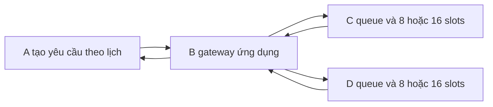
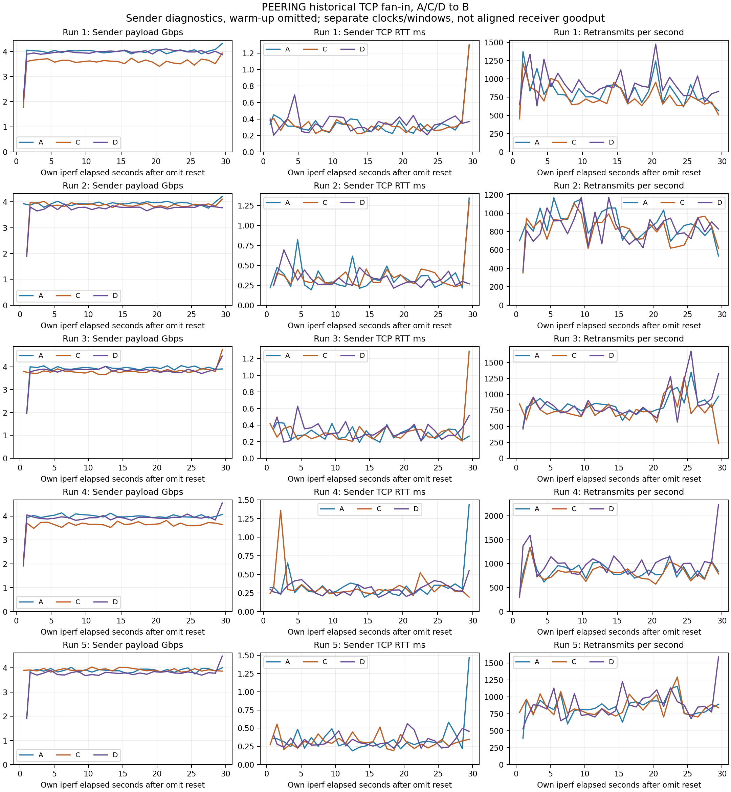
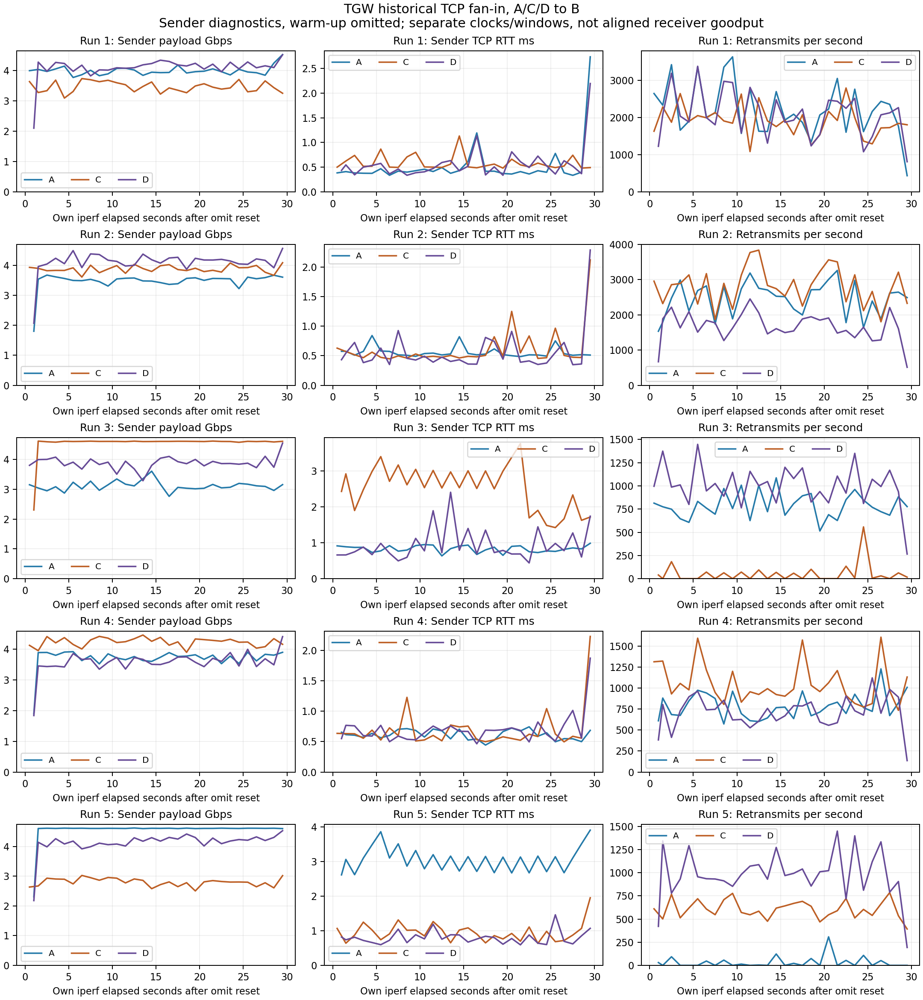
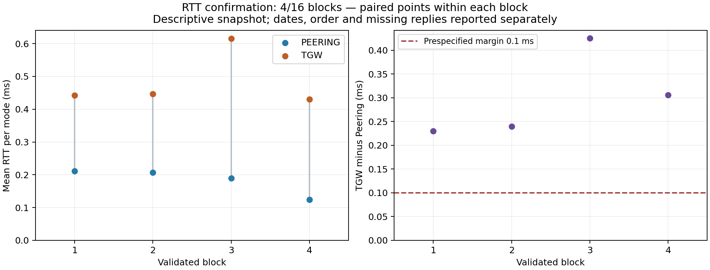
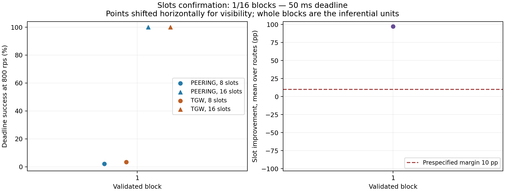
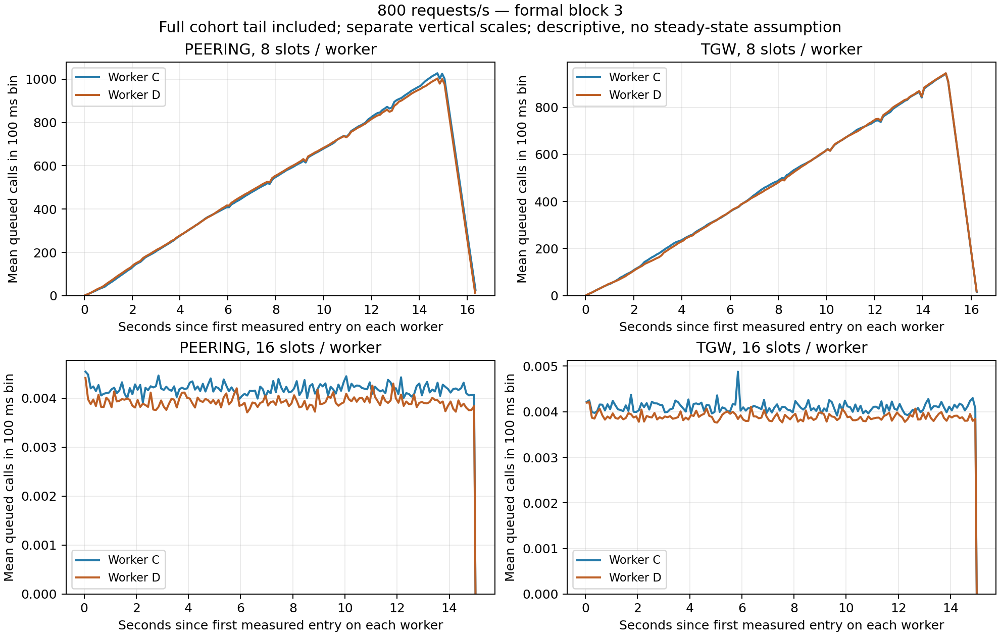

# Đánh giá VPC Peering và Transit Gateway từ RTT đến chất lượng ứng dụng

Báo cáo tổng hợp đồ án NT531. Snapshot 13/10/2026 19:27 giờ Việt Nam.
Các bảng được tạo từ analysis và đối chiếu SHA với file nguồn; không dùng
ảnh chụp để thay raw. Báo cáo này ghép phần đã thực hiện; kết luận suy diễn
chỉ xuất hiện sau khi analyzer xác nhận đủ thiết kế.

**Phạm vi rút gọn ngày 13/10 vì ngân sách:** chỉ giữ phiên cuối, tối đa 5 block RTT/3 block slots. Xác nhận 16 block/bốn ngày chưa hoàn thành; chỉ kết luận mô tả, không công bố p-value xác nhận. [Quyết định và cách kết luận](35-pham-vi-rut-gon-va-ket-luan.md).

**Kết quả quan sát:** trong 5 block RTT, chênh TGW trừ Peering trung bình 0,3119 ms. Trong 3 block ứng dụng, tăng 8 lên 16 slots nâng tỷ lệ đúng hạn tại 800 rps trung bình 96,8417 điểm phần trăm qua hai mode. Can thiệp khả năng phục vụ và log hàng đợi giải thích điểm nghẽn của workload thử nghiệm. Các con số là hiệu ứng đã đo, không chứng minh mọi hệ thống AWS có cùng hiệu ứng.

## Câu hỏi và đóng góp

Đồ án so sánh hai cách kết nối cùng bốn VPC trên AWS. Phần vận chuyển đo
RTT, TCP goodput, truyền lại, CPU và ENA. Phần ứng dụng hỏi liệu thay đường
mạng hay tăng khả năng phục vụ đồng thời của worker giúp yêu cầu hoàn thành
đúng hạn hơn khi tải tăng. Can thiệp slots cùng log hàng đợi giúp giải thích
cơ chế thay vì chỉ xếp hạng hai con số thông lượng.

Bằng chứng lịch sử cho thấy Peering có RTT thấp hơn trong đợt đo đó.
Trong phiên engineering ứng dụng, tăng 8 lên 16 slots cải thiện deadline
rõ trên cả hai đường mạng. Hai đợt xác nhận mới kiểm tra khả năng lặp lại
của các hiệu ứng đã định trước; không gộp lịch sử, pilot hay engineering
vào mẫu xác nhận.

## Kiến trúc và cách so sánh


Bốn máy c6i.large tại us-east-1a, MTU 1500. A/B/C/D thuộc bốn VPC có CIDR
khác nhau. EIP phục vụ quản trị; tải benchmark dùng private IP. Cả hai
phương án cung cấp liên lạc giữa cùng các cặp máy; TGW không bị giới hạn
chỉ chuyển A sang B. Route snapshot xác nhận đường thực dùng trước/sau đo.

Với n VPC cần liên lạc mọi cặp, Peering cần n(n−1)/2 kết nối cặp;
TGW cần n attachment VPC vào một gateway trong mô hình này. n=4 cho
6 peering so với 4 attachment. Đây là độ phức tạp topology logic,
không đo số đường vật lý hoặc công suất chuyển tiếp. Chi tiết cấu hình
và nguồn AWS ở [kiến trúc](03-bon-vpc.md).



B gọi C/D song song và A chờ cả hai kết quả. Mỗi request tạo một lời gọi
tại mỗi worker. 800 request/s tại A tương ứng tải danh nghĩa 800 lời gọi/s
ở từng worker, không phải 1.600 ở mỗi máy. B là gateway ứng dụng, không
phải TGW. Slots là giới hạn lời gọi phục vụ đồng thời, không phải vCPU.

## Các phép đo đã thực hiện

| Phần | Phép đo và mục đích | Vai trò bằng chứng |
|---|---|---|
| Vận chuyển lịch sử | RTT khi rảnh, TCP một luồng, hai cặp độc lập, ba nguồn fan-in vào B | Mô tả, chẩn đoán; khác cohort xác nhận mới |
| Pilot và calibration ứng dụng | Tải theo lịch, P95, deadline, vùng backlog, tracing mẫu | Chọn câu hỏi và kiểm tra công cụ; không tính block xác nhận |
| Engineering slots | Cùng đường mạng và mức tải, can thiệp 8 → 16 slots | Kiểm tra can thiệp và cơ chế trước xác nhận |
| Xác nhận RTT | Cặp A/B, cùng cohort, hai mode trong một block cân bằng thứ tự | Kiểm định chính riêng của RTT |
| Xác nhận slots | Hai route × hai mức tải × hai số slots trong mỗi block | Kiểm định chính riêng của hiệu ứng slots |
| Little từ queue logs | Ghép request ID, tích phân số chờ và tổng thời gian chờ | Giải thích cơ chế trên cùng raw, không phải mẫu độc lập mới |

Hai cặp độc lập A→B và C→D kiểm tra vận hành đồng thời, không tự tạo
điểm nghẽn dùng chung tại EC2. Fan-in A/C/D→B tạo điểm nhận dùng chung,
nhưng CPU/ENA tăng ở B chưa đủ phân lập giới hạn nội bộ mạng AWS.


## Kết quả vận chuyển lịch sử

| Mạng | RTT mean ms | TCP một luồng Gbps | Fan-in tổng xấp xỉ Gbps | Mean Jain từng lượt |
|---|---|---|---|---|
| PEERING | 0,2078 | 4,7828 | 11,6110 | 0,999133 |
| TGW | 0,5630 | 4,6083 | 11,5905 | 0,984494 |

Mỗi bộ có năm lượt. RTT là mean các mean từng lượt; TCP dùng payload
phía nhận. Tổng fan-in cộng goodput của các nguồn trong cửa sổ riêng,
không phải byte trong một cửa sổ chung đã căn chỉnh. Audit 30 JSON không
có đủ thông tin để đổi thành tổng common-window chính xác.
[Audit cửa sổ](../results/analysis/fanin-common-window-audit.json).

Peering/TGW đo nối tiếp nên các lượt cùng số thứ tự không mặc nhiên là
cặp cùng thời điểm. Chênh lệch mô tả không thay kiểm định qua nhiều ngày.
Số liệu này không chứng minh băng thông tối đa dịch vụ; retransmission
không trực tiếp bằng tỷ lệ mất gói. Xem [chương kết quả lịch sử](13-tong-hop-ket-qua.md).





Đồ thị từ 30 JSON cũ bỏ interval có `omitted=true`, giữ thời gian riêng của
mỗi client sau khi iperf reset omit. Cột đầu là payload phía **gửi**, không
đổi nhãn thành goodput nhận chung cửa sổ. RTT TCP là trạng thái socket tại
interval, không phải ping khi rảnh. Truyền lại/s chia counter interval cho
thời lượng thực; không biến thành phần trăm mất gói. Các lượt cùng số giữa
hai mode không là cặp ghép thời gian. [SHA và audit interval](../results/analysis/fanin-sender-interval-figures.json).


## Thiết kế xác nhận ban đầu được khóa trước khi đo

RTT hiện có **5/16 block** trên 2 ngày;
slots có **3/16 block** trên 1 ngày.
Mỗi nghiên cứu cần 16 block hợp lệ, ít nhất bốn ngày địa phương và start
cách nhau ít nhất hai giờ. Slots yêu cầu uptime tối thiểu 30 phút.

RTT giữ payload 56 byte, 100 gói/lượt, interval 0,2 s, ba lượt/mode;
không chạy tải thử nghiệm. Slots giữ I/O mô phỏng 10 ms, payload 4.096 byte,
deadline 50 ms, timeout 2 s, rate 600/800 rps, slots 8/16. Mỗi điều kiện có
fresh server, warm-up 5 s, drain, đo 15 s; tracing đầy đủ tắt ở cả hai mode.

Đơn vị suy diễn là block. Hàng nghìn request cùng phiên hoặc 100 gói cùng
lượt không được coi là hàng nghìn block độc lập. Thứ tự route/điều kiện
đã cân bằng trước; không đổi ngưỡng hoặc dừng sớm khi thấy kết quả thuận lợi.
Giữ lỗi kỹ thuật; chỉ phân xử retry có lý do ngoài outcome.

### Công thức và ký hiệu

Với block j, định nghĩa chênh lệch RTT và hiệu ứng slots tại 800 rps:

\[
\Delta_j=\overline{RTT}_{T,j}-\overline{RTT}_{P,j},\qquad
\widehat p_{m,c,j}=\frac{N_{\mathrm{đúng\ hạn}}}{N_{\mathrm{theo\ lịch}}},
\qquad d_j=\frac{(\widehat p_{P,16,j}-\widehat p_{P,8,j})
+(\widehat p_{T,16,j}-\widehat p_{T,8,j})}{2}.
\]

P là Peering, T là TGW, m là mode, c là slots mỗi worker. Δ có đơn vị ms;
p và d là tỷ lệ không đơn vị. Đúng hạn chia cho mọi request theo lịch,
bao gồm lỗi/không gửi được; P95 latency chỉ tính request thành công và
phải ghi rõ mẫu số riêng. 100d là mức tăng **điểm phần trăm**.

Trong từng nghiên cứu, Zj=1 nếu Δj>0,1 ms (RTT) hoặc dj>0,10 (slots),
ngược lại bằng 0. K là số block vượt ngưỡng, θ là xác suất một block
vượt ngưỡng trong quá trình lấy mẫu phù hợp. Kiểm định riêng H0: θ≤0,5,
H1: θ>0,5, α=0,05. Với n=16 block:

\[
K=\sum_{j=1}^{16}Z_j,\qquad
p_{\mathrm{exact}}=\sum_{k=K}^{16}\binom{16}{k}2^{-16}.
\]

K≥12 cho ngưỡng bác bỏ; tại K=12, đuôi null bằng 0,0384063721.
Đó là tính thiết kế, không phải p-value thực nghiệm trước khi hoàn tất.
Cận dưới θ một phía 95% giải P(Binomial(16,θL)≥K)=0,05 khi K>0;
K=0 thì θL=0. K và cận θ khác tỷ lệ request đúng hạn p.

Slots còn báo CI bootstrap 95% phụ trợ bằng resample nguyên block
20.000 lần; dùng cùng chỉ số block cho các đối chiếu để giữ ghép cặp.
Đây là phân tích mô tả phụ, không kiểm định tương đương. Mỗi kiểm định
chính có α riêng, không khẳng định mức sai số đồng thời 5% cho mọi câu.
Khoảng cách hai giờ không chứng minh độc lập; suy luận vẫn có điều kiện
về quá trình lấy mẫu và tương quan block.


## Kết quả xác nhận RTT

| Block | Giờ Việt Nam | Thứ tự | Peering ms | TGW ms | Δ ms | Mất phản hồi |
|---|---|---|---|---|---|---|
| 1 | 12/10 16:41 | peering → tgw | 0,2113 | 0,4417 | 0,2303 | 0 |
| 2 | 12/10 21:26 | tgw → peering | 0,2067 | 0,4463 | 0,2397 | 0 |
| 3 | 13/10 11:10 | peering → tgw | 0,1900 | 0,6157 | 0,4257 | 0 |
| 4 | 13/10 15:58 | tgw → peering | 0,1243 | 0,4300 | 0,3057 | 0 |
| 5 | 13/10 18:04 | peering → tgw | 0,1343 | 0,4923 | 0,3580 | 0 |



## Kết quả xác nhận slots mới nhất

Block 3, bắt đầu UTC 2026-10-13T11:09:26.935632+00:00.

| Mạng | Slots | rps | Theo lịch | Đúng hạn % | P95 thành công ms | Lỗi |
|---|---|---|---|---|---|---|
| PEERING | 8 | 600 | 9000 | 100,000 | 12,649 | 0 |
| PEERING | 16 | 600 | 9000 | 100,000 | 12,681 | 0 |
| TGW | 8 | 600 | 9000 | 100,000 | 13,146 | 0 |
| TGW | 16 | 600 | 9000 | 100,000 | 13,103 | 0 |
| PEERING | 8 | 800 | 12000 | 3,342 | 1350,096 | 0 |
| PEERING | 16 | 800 | 12000 | 100,000 | 12,651 | 0 |
| TGW | 8 | 800 | 12000 | 3,567 | 1225,784 | 0 |
| TGW | 16 | 800 | 12000 | 100,000 | 12,916 | 0 |

Hiệu ứng dj của block này là **96,5458 điểm phần trăm**.
Giữ mọi block trong bảng hiệu ứng sau; không chỉ trình bày block thuận lợi nhất.

| Block | Giờ Việt Nam | Tăng đúng hạn mean hai route điểm % |
|---|---|---|
| 1 | 13/10 11:39 | 97,3167 |
| 2 | 13/10 16:03 | 96,6625 |
| 3 | 13/10 18:09 | 96,5458 |



## Thống kê mô tả qua toàn bộ block ứng dụng

| Mạng | Slots | rps | Theo lịch | Đúng hạn % | Khoảng P95 từng block ms | Lỗi |
|---|---|---|---|---|---|---|
| PEERING | 8 | 600 | 27000 | 100,0000 | 12,109–12,684 | 0 |
| PEERING | 16 | 600 | 27000 | 100,0000 | 12,085–12,699 | 0 |
| TGW | 8 | 600 | 27000 | 100,0000 | 12,879–13,146 | 0 |
| TGW | 16 | 600 | 27000 | 100,0000 | 12,981–13,243 | 0 |
| PEERING | 8 | 800 | 36000 | 3,0444 | 1350,096–1499,226 | 0 |
| PEERING | 16 | 800 | 36000 | 100,0000 | 12,651–12,698 | 0 |
| TGW | 8 | 800 | 36000 | 3,2722 | 1225,784–1327,874 | 0 |
| TGW | 16 | 800 | 36000 | 100,0000 | 12,875–13,248 | 0 |

Tỷ lệ bằng tổng yêu cầu đúng hạn chia tổng theo lịch; là tần suất thực nghiệm trong các cửa sổ đã đo. Khoảng P95 là min–max của P95 từng block, không phải P95 gộp hoặc trung bình P95. Request tương quan trong cùng phiên không tạo thêm block độc lập.


Ở 800 rps, tỷ lệ đúng hạn từng block/mode với 8 slots nằm trong 2,0833–3,7083%; với 16 slots là 100,0000–100,0000%. Các quan sát này đối chiếu trực tiếp hai quyết định trong workload thử nghiệm: đổi đường mạng khi giữ nguyên khả năng phục vụ và tăng khả năng phục vụ trong từng đường mạng. Log thời gian chờ/phục vụ bên dưới giúp giải thích kết quả; không gán mọi trễ hạn cho dịch vụ mạng AWS.


## Giải thích cơ chế bằng hàng đợi ứng dụng

| Mạng | Slots | Worker | Mean chờ ms | Mean số chờ | Peak số chờ | N/T lời gọi mỗi s |
|---|---|---|---|---|---|---|
| PEERING | 8 | C | 700,951126 | 513,297103 | 1044 | 732,287 |
| PEERING | 8 | D | 697,539675 | 511,877841 | 1020 | 733,833 |
| PEERING | 16 | C | 0,005239 | 0,004189 | 1 | 799,531 |
| PEERING | 16 | D | 0,004912 | 0,003927 | 1 | 799,533 |
| TGW | 8 | C | 623,637550 | 460,119105 | 950 | 737,799 |
| TGW | 8 | D | 620,956974 | 458,305314 | 951 | 738,063 |
| TGW | 16 | C | 0,005126 | 0,004099 | 1 | 799,610 |
| TGW | 16 | D | 0,004866 | 0,003891 | 1 | 799,597 |

Mỗi worker dùng cửa sổ chứa trọn entry/exit của request ID đo, gồm đuôi
xử lý; không bỏ các lời gọi hủy. Với N lời gọi, T là thời lượng cửa sổ,
Wq,i là thời gian chờ của lời gọi i và QC(t) là số đang chờ thuộc cohort:

\[
\overline L_{q,C}=\frac{1}{T}\int Q_C(t)\,dt
=\frac{1}{T}\sum_{i=1}^{N}W_{q,i}
=\underbrace{\frac{N}{T}}_{\lambda_C}
\underbrace{\frac{1}{N}\sum_{i=1}^{N}W_{q,i}}_{\overline W_q}.
\]

λC có đơn vị lời gọi/s, Wq là s, Lq là số lời gọi trung bình. Khi backlog
có đuôi, N/T khác rate cấu hình 800. Không nhân 800 với mean chờ rồi
gán thành số chờ của cửa sổ này; không thay mean bằng P95.
Đây là đẳng thức hữu hạn, không cần giả định Poisson/trạng thái dừng.
Hai cách tính trên cùng timestamp kiểm tra nhất quán, không tạo bằng
chứng thống kê độc lập hoặc chứng minh clock/logger luôn đúng.
[Chứng minh, ký hiệu và ví dụ đầy đủ](33-hang-doi-va-dinh-luat-little.md).




## Kết luận theo mức bằng chứng


**RTT:** 5 block hợp lệ; mean hiệu ứng **0,3119 ms (TGW trừ Peering)**, median 0,3057, khoảng từng block 0,2303–0,4257. Kết luận mô tả trong các block quan sát; không công bố p-value xác nhận cho thiết kế rút ngắn.


**Slots:** 3 block hợp lệ; mean hiệu ứng **96,8417 điểm phần trăm (16 trừ 8 slots, mean hai route tại 800 rps)**, median 96,6625, khoảng từng block 96,5458–97,3167. Kết luận mô tả trong các block quan sát; không công bố p-value xác nhận cho thiết kế rút ngắn.


**Kiến trúc:** full mesh Peering có số kết nối cặp tăng bậc hai theo n;
TGW dùng topology trung tâm với attachment VPC tăng tuyến tính trong mô
hình này. Lợi ích quản trị topology tách khỏi hiệu năng đã đo.

**Ứng dụng:** engineering và block xác nhận đã thu hỗ trợ vai trò của giới
hạn đồng thời worker và backlog trong workload mô phỏng. Phải hoàn tất
đợt xác nhận trước phát biểu xác suất lặp lại; không gọi 16 slots là tối ưu
mọi ứng dụng hoặc quy mọi trễ hạn cho mạng/CPU.

Đồ án không tìm một dịch vụ thắng tổng quát. Nó cung cấp phép so sánh có
điều kiện, can thiệp có kiểm soát và raw tái tạo để chỉ ra quyết định thay
mạng cần xét cùng deadline và khả năng phục vụ của ứng dụng.

## Liên hệ bài giảng nghiên cứu và quan sát

Arrival Processes and Queuing Systems gắn với arrivals theo lịch, Wq,
slots và Little. Congestion Control gắn với TCP cwnd, RTT, retransmission
và goodput; CUBIC thực dùng không được mô tả như mọi bước Reno/Tahoe.
Internet Performance QoS and Cloud Native Metrics gắn với phân vị, ECDF,
SLI deadline và distributed tracing. [Đối chiếu bài giảng](17-doi-chieu-bai-giang-va-cong-cu.md).

Little liên hệ số tác vụ trung bình, tốc độ vào và thời gian lưu; sample
path hữu hạn ở đây có phép chứng minh và ranh giới cụ thể. Nguồn nền:
[Sigman 2009](https://www.columbia.edu/~ks20/stochastic-I/stochastic-I-LL.pdf),
[Little 2011](https://pubsonline.informs.org/doi/10.1287/opre.1110.0940).
Độ trễ đuôi khi mức sử dụng và độ phức tạp dịch vụ tăng là câu hỏi liên
quan trong [The Tail at Scale](https://research.google/pubs/the-tail-at-scale/);
workload hai worker không tái tạo quy mô Google. Theo
[ASA 2016](https://www.amstat.org/asa/files/pdfs/p-valuestatement.pdf),
p-value không cho xác suất giả thuyết đúng hay độ lớn hiệu ứng.

OpenTelemetry giúp quan sát lời gọi. Đã kiểm tra Collector → Tempo →
Grafana bằng replay 12 traces thật/120 spans; không tuyên bố OTLP live
hoặc hostmetrics EC2 đã triển khai. Tracing đầy đủ tắt trong primary.
Thêm công cụ không thay thiết kế lấy mẫu hay kiểm định.

Để bảo vệ, ưu tiên [công thức bám bài giảng và ví dụ thật](36-cong-thuc-bam-bai-giang.md):
Little ở Arrival trang 62–66, P95 ở QoS trang 41–42, SLI ở trang 26.
Phần tích phân và kế hoạch kiểm định 16 block được giữ trong phụ lục,
không trình bày như kết quả kiểm định đã hoàn thành. [Hướng dẫn video và Grafana](37-quay-video-va-grafana.md)
có kịch bản 4–5 phút. Dashboard `nt531-study-demo` phân biệt bảng kết quả đã chốt
với trace smoke nhập lại; trace smoke không phải trace của điều kiện tải 800 rps.

## Tái tạo và việc còn lại

Nguồn tổng hợp: [metrics lịch sử](../results/analysis/report-metrics.json),
[RTT](../results/confirmation-rtt-v1/analysis.json),
[slots](../results/application-slots-confirmation-v1/analysis.json),
[queue audit](../results/analysis/queue-occupancy-audit.json),
[SHA của snapshot báo cáo](../results/analysis/study-report.json).

```powershell
py scripts/audit-queue-occupancy.py
tmp/application-venv/Scripts/python.exe scripts/plot-queue-occupancy.py
tmp/application-venv/Scripts/python.exe scripts/plot-confirmation-progress.py
tmp/application-venv/Scripts/python.exe scripts/plot-fanin-history.py
py scripts/build-study-report.py
```

Dữ liệu đã chốt ở 5 block RTT/3 block ứng dụng. Không thu các block còn lại hoặc RTT khi tải. Raw, bảng thống kê và phụ lục Word đã kiểm tra; bước tiếp theo là hoàn thiện bản nộp, slide và video demo. Người dùng tự dừng EC2 theo lựa chọn cuối phiên.

Lịch đo tự động đã xóa; trạng thái hiện hành ở
[tài liệu 32](32-trang-thai-xac-nhan.md). Phần code/raw đã rà soát công bố
trên nhánh minh-work; state, credentials, SSH key và ZIP riêng không công bố.

AI Usage Declaration cần nhóm điền theo việc dùng thực tế khi nộp. Các
thành viên phải tự giải thích thiết kế, công thức, code và kết luận; báo
cáo này không khai thay tác giả hoặc việc nhóm chưa làm.
