# Hiểu đồ án và nói theo từng slide

**Dành cho nhóm NT531:** Nguyễn Ngọc Minh – 24521068, Nguyễn Minh Nhật – 24521253, Nguyễn Trung Kiên – 24520885. Giảng viên: Đặng Lê Bảo Chương.

Tài liệu này ghép đúng **18 trang của [PowerPoint](NT531-thuyet-trinh.pptx)**. Ảnh dưới mỗi tiêu đề là slide tương ứng, không phải bộ slide mới. Phần **“Hiểu trước khi nói”** để học ở nhà. Phần **“Lời nói trên lớp”** có thể dùng làm lời thoại. Phần **“Chỉ vào đâu”** giúp bạn trình bày hình, thay vì đứng đọc chữ. Không đọc hết tài liệu trên lớp. Nếu nói và giải thích đủ 14 trang chính như bản này, nên tập canh khoảng **15–18 phút**. Bản [lời thoại ngắn](Loi-thoai-NT531.md) dùng khi chỉ có 10–12 phút. Thời lượng thực tế cần nhóm tập và điều chỉnh theo thời gian thầy giao.

## Đọc đoạn này trước: đồ án đang làm gì?

Hãy tưởng tượng một khách gửi đơn tới quầy tiếp nhận. Quầy chuyển đơn tới hai bộ phận làm việc, đợi cả hai xong rồi trả kết quả. Khách chờ lâu có thể do đường đi giữa các bộ phận chậm, hoặc do bộ phận xử lý đang hết chỗ và đơn phải xếp hàng.

Đồ án biến tình huống đó thành mô hình trên AWS:

- **A** đóng vai khách, tự tạo nhiều yêu cầu.
- **B** đóng vai quầy tiếp nhận, chuyển mỗi yêu cầu sang **cả C và D**.
- **C và D** là hai bộ phận phục vụ. Mỗi bộ phận có 8 hoặc 16 chỗ làm việc đồng thời, gọi là **slots**.
- Mạng giữa các máy chọn **VPC Peering** hoặc **Transit Gateway, viết tắt TGW**.

Nhóm đo hai việc. Đầu tiên, gói ping đi và về mất bao lâu trên mỗi đường mạng. Tiếp theo, yêu cầu ứng dụng có hoàn thành trước hạn 50 ms không khi thay đổi tải và số slots. Nhờ đó, nhóm xem mạng có RTT thấp hơn liệu có đủ giúp ứng dụng đáp ứng đúng hạn khi chỗ phục vụ bị hạn chế.

**Kết quả chính cần nhớ:** Peering có RTT thấp hơn trong cả 5 block đã đo. Nhưng tại 800 yêu cầu/s và 8 slots, cả hai đường mạng chỉ có khoảng 3% yêu cầu đúng hạn. Khi tăng lên 16 slots, cả hai đạt 100% đúng hạn trong các cửa sổ đã quan sát. Log cho thấy chờ ở worker giảm rõ. Vì vậy, trong workload này, chỉ chọn đường mạng nhanh hơn vẫn chưa giải quyết được thiếu khả năng phục vụ của ứng dụng.

## Từ vựng cần biết trước khi mở slide

| Từ trên slide     | Hiểu bằng lời đơn giản                                                                          |
| ------------------- | ----------------------------------------------------------------------------------------------------- |
| AWS                 | Nền tảng đám mây nơi nhóm thuê và vận hành hạ tầng                                       |
| EC2                 | Máy tính ảo chạy trên AWS, có hệ điều hành và chương trình của nhóm                   |
| VPC                 | Mạng riêng ảo trên AWS. Nhóm có bốn mạng riêng A/B/C/D                                       |
| Peering             | Kết nối trực tiếp giữa hai VPC, khi định tuyến và quyền mạng phù hợp                     |
| TGW                 | Điểm trung chuyển kết nối các mạng. VPC gắn vào nó qua attachment                           |
| Attachment          | Liên kết gắn một VPC vào TGW                                                                     |
| Route               | Quy tắc chọn đường đi tới một mạng đích                                                    |
| Terraform           | Công cụ dùng code để mô tả và tạo hạ tầng. Terraform không phải công cụ đo RTT        |
| Private IP          | Địa chỉ của máy dùng trong đường mạng riêng, ví dụ A là 10.10.10.212                    |
| Elastic IP          | Địa chỉ public cố định phục vụ truy cập quản trị. Các phép đo ở đây dùng private IP |
| SSH / Termius       | Cách truy cập terminal trên EC2. Termius là ứng dụng nhóm dùng để SSH                       |
| Request             | Một yêu cầu gửi tới ứng dụng. Một request tại A tạo hai lời gọi worker tại C/D           |
| HTTP                | Giao thức ứng dụng dùng để gửi yêu cầu và nhận phản hồi                                  |
| Gateway B           | Chương trình trên B nhận yêu cầu rồi gọi C/D. Khác với dịch vụ Transit Gateway của AWS  |
| Worker              | Chương trình thực hiện một phần công việc. Ở đây chạy trên C và D                      |
| Slot                | Một suất phục vụ đồng thời trong chương trình worker. Slot khác với CPU hay máy ảo      |
| Queue / hàng đợi | Các lời gọi đã đến nhưng đang chờ lấy slot                                                 |
| rps                 | Requests per second, số yêu cầu theo lịch mỗi giây                                              |
| RTT                 | Thời gian một gói đi tới đích và phản hồi về nơi gửi                                     |
| Deadline            | Hạn hoàn thành. Nhóm chọn 50 ms cho thí nghiệm ứng dụng                                      |
| P95                 | Mốc phân vị 95% của độ trễ được quan sát, giải thích tại slide 6                        |
| SLI                 | Chỉ số phản ánh chất lượng dịch vụ. Nhóm dùng tỷ lệ yêu cầu đúng hạn                |
| Block               | Một đợt so sánh chứa đủ các điều kiện cần đối chiếu. Đọc kỹ slide 5                 |
| Mode                | Đường mạng đang thử: Peering hoặc TGW                                                          |
| Log                 | Bản ghi sự kiện/số liệu. Nhóm lưu kết quả và các mốc chờ/phục vụ                       |
| Trace / span        | Trace theo hành trình một yêu cầu. Span là từng phần công việc trong hành trình           |
| ms, µs             | 1 ms = 0,001 giây. 1 µs = 0,000001 giây. 1 ms = 1.000 µs                                          |

---

## Slide 1. VPC Peering và Transit Gateway

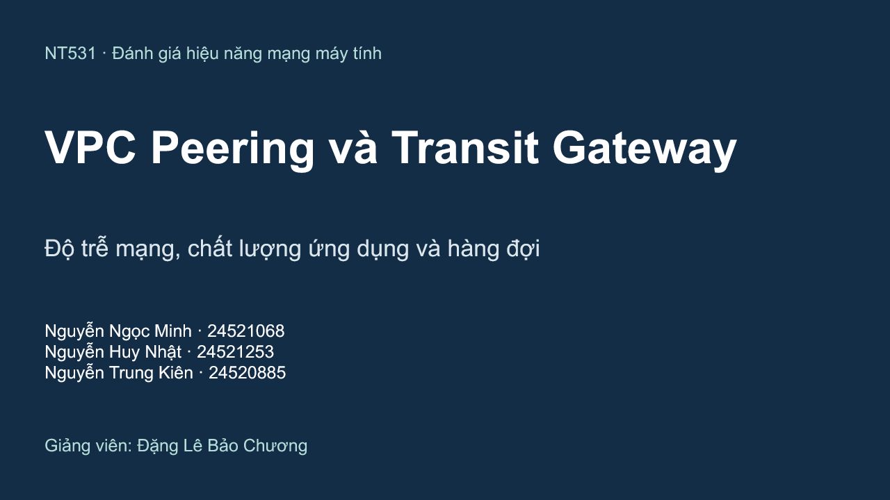

### Hiểu trước khi nói

Đây là trang giới thiệu đề tài và nhóm. “Đánh giá hiệu năng” nghĩa là dùng một mô hình có điều kiện rõ ràng, thu số liệu, rồi trả lời hệ thống hoạt động thế nào. Hiệu năng không chỉ có tốc độ truyền nhiều dữ liệu. Độ trễ, số yêu cầu hoàn thành đúng hạn và thời gian chờ cũng quan trọng.

Tên đề tài là so sánh hai cách kết nối VPC. Phần ứng dụng giúp nhóm giải thích ý nghĩa của chênh lệch mạng đối với chất lượng dịch vụ. Nó vẫn phục vụ câu hỏi của đề tài.

### Lời nói trên lớp

“Em chào thầy. Nhóm chúng em gồm Nguyễn Ngọc Minh, Nguyễn Minh Nhật và Nguyễn Trung Kiên. Nhóm thực hiện đồ án đánh giá VPC Peering và Transit Gateway trên AWS.

Nhóm so sánh độ trễ trên cùng hạ tầng, sau đó thử một ứng dụng gọi hai worker song song. Mục đích là xem đường mạng và khả năng phục vụ ảnh hưởng thế nào tới việc hoàn thành yêu cầu đúng hạn. Trong phần trình bày, nhóm sẽ giải thích mô hình, cách đo, kết quả và hàng đợi bằng công thức Little trong bài giảng.”

### Chỉ vào đâu và chuyển slide

Giới thiệu tên đề tài, tên nhóm. Không cần đọc toàn bộ MSSV nếu thầy không yêu cầu. Chuyển: **“Trước tiên, nhóm xác định câu hỏi cần trả lời.”**

## Slide 2. Câu hỏi nghiên cứu

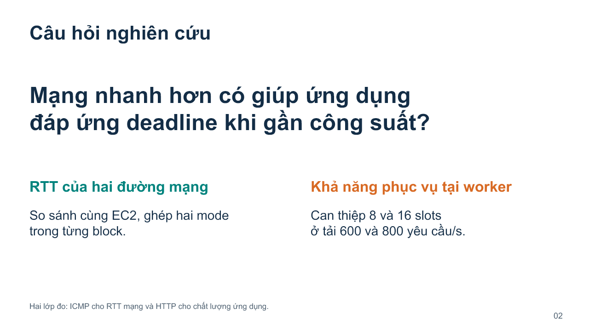

### Hiểu trước khi nói

“Cái nào tốt hơn?” là câu hỏi quá rộng. Một phương án có thể RTT thấp nhưng khó quản lý khi kết nối nhiều mạng. Một phương án quản trị thuận tiện vẫn có thể có RTT cao hơn trong một cấu hình đo.

Nhóm thu hẹp thành hai câu hỏi có thể đo. **Câu 1:** cùng hai máy, thay Peering bằng TGW thì RTT thay đổi bao nhiêu? **Câu 2:** khi ứng dụng gần khả năng phục vụ, chọn đường mạng RTT thấp hơn có đủ giữ yêu cầu đúng hạn, hay cần tăng slots?

Ví dụ quầy phục vụ giúp hiểu câu 2: hành lang ngắn hơn vài phần nghìn giây chưa chắc có ích nhiều nếu đơn phải đứng chờ ở quầy hàng trăm mili giây. Ví dụ này chỉ minh họa, kết luận phải dựa vào số liệu.

### Lời nói trên lớp

“Nhóm tách đề tài thành hai câu hỏi. Thứ nhất, nếu giữ nguyên máy và chỉ đổi đường mạng, RTT Peering và TGW khác nhau bao nhiêu?

Thứ hai, khi ứng dụng gần công suất phục vụ, mạng có RTT thấp hơn có đủ giúp yêu cầu hoàn thành đúng hạn không? Để trả lời, nhóm thử cả hai đường mạng và thay số slots ở worker từ tám lên mười sáu.

Như vậy, nhóm có một phép đo ở lớp mạng và một phép đo ở lớp ứng dụng. Phép đo ứng dụng giúp giải thích liệu lợi thế mạng có giải quyết được điểm nghẽn đang quan sát.”

### Chỉ vào đâu và chuyển slide

Chỉ hai phần “RTT” và “Khả năng phục vụ”. Chuyển: **“Hai phép đo dùng chung hạ tầng bốn VPC sau đây.”**

**Nếu hỏi “Mạng và ứng dụng khác nhau chỗ nào?”:** “Mạng chuyển dữ liệu giữa các máy. Ứng dụng còn nhận yêu cầu, chờ chỗ phục vụ và xử lý công việc. Thời gian hoàn thành ứng dụng bao gồm nhiều phần hơn RTT ping.”

## Slide 3. Kiến trúc mạng trên cùng bốn VPC

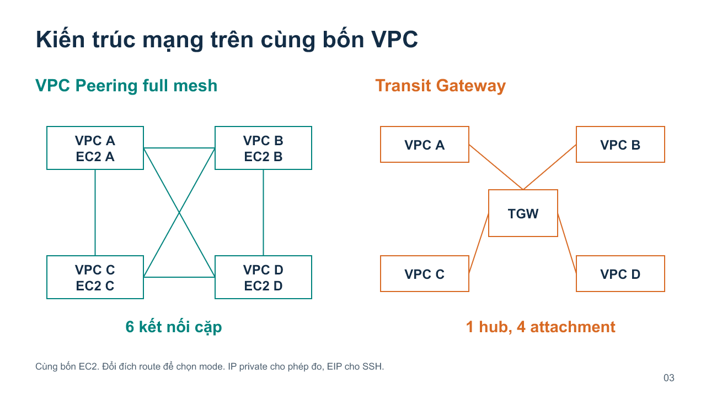

### Hiểu trước khi nói

Mỗi ô VPC là một mạng riêng, bên trong có một EC2. Hình trái là Peering full mesh: mọi cặp VPC có kết nối trực tiếp. Bốn VPC có sáu cặp: **AB, AC, AD, BC, BD, CD**. Có thể tính bằng (n(n-1)/2), vì mỗi VPC có n−1 đối tác nhưng nếu đếm hai đầu sẽ trùng mỗi cặp hai lần. Với n = 4, có 4 × 3 / 2 = 6.

Hình phải: bốn VPC gắn vào một TGW. Có bốn attachment. Đây không phải so sánh “Peering chỉ nối hai máy còn TGW nối bốn máy”: cả hai topology đều cho cùng bốn VPC liên lạc theo các route và quyền mạng đã cấu hình.

**Peering không tự có tính bắc cầu:** có AB và BC không có nghĩa A được đi qua B để sang C bằng Peering. Vì vậy mô hình full mesh có AC riêng. TGW đóng vai trò trung chuyển, nhưng vẫn cần route phù hợp, không phải cứ attachment là mọi đường tự hoạt động.

Khi đo, “đổi mode” nghĩa là thay đích của route giữa các VPC để chọn Peering hoặc TGW. Nhóm giữ nguyên các EC2. IP đo là private: A 10.10.10.212, B 10.20.10.155, C 10.30.10.212, D 10.40.10.155. EIP dùng để SSH từ bên ngoài, không dùng làm đích của benchmark.

### Lời nói trên lớp

“Nhóm có bốn VPC, mỗi VPC chứa một EC2. Bên trái là Peering full mesh. Bốn VPC có sáu cặp, nên nhóm tạo sáu kết nối để mọi cặp liên lạc trực tiếp.

Bên phải là Transit Gateway. Bốn VPC gắn vào một hub bằng bốn attachment. Hai mô hình đều dùng cùng bốn máy và cùng tập liên lạc cần so sánh. Khi đo, nhóm đổi route để chọn đường mạng, không thay loại máy.

Lưu lượng thí nghiệm dùng địa chỉ private. Elastic IP giúp nhóm truy cập SSH, không nằm trên đường benchmark. Terraform giúp dựng và quản lý cấu hình hạ tầng này.”

### Chỉ vào đâu và chuyển slide

Chỉ sáu đường trái, bốn đường phải và hub TGW. Chuyển: **“Trên bốn máy đó, nhóm tổ chức ứng dụng như sau.”**

**Nếu hỏi “Vì sao không dùng hai VPC?”:** “Hai VPC đủ để so sánh một cặp. Bốn VPC cho phép nhóm bổ sung hai cặp độc lập, ba nguồn cùng gửi một đích và ứng dụng gọi hai worker. Nhóm vẫn giữ cùng endpoint khi so sánh từng bài.”

## Slide 4. Ứng dụng gọi hai worker song song

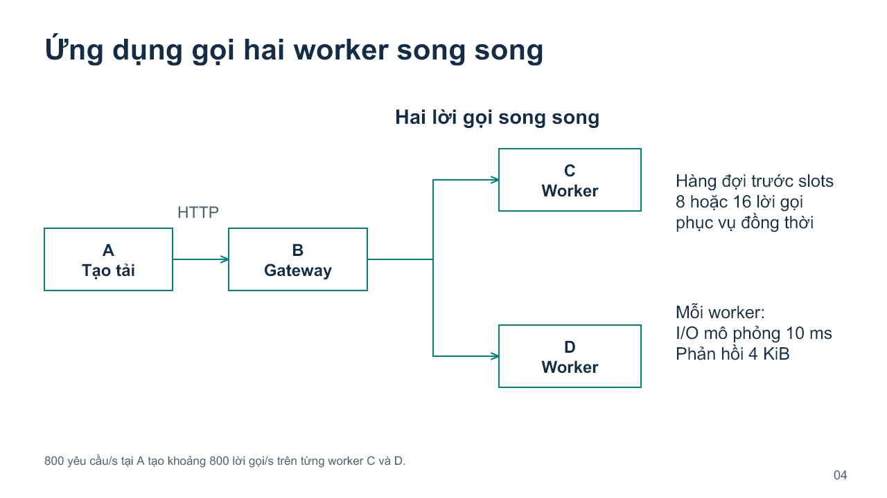

### Hiểu trước khi nói

Đọc hình từ trái qua phải. A tự tạo yêu cầu theo lịch. B nhận một yêu cầu, gọi C và D gần như đồng thời, chờ cả hai phản hồi rồi trả về A. **Gateway trên B là chương trình của nhóm**, không phải TGW của AWS. Tránh dùng cùng từ “gateway” mà không nói rõ.

Mỗi worker có một giới hạn số công việc đang phục vụ: 8 hoặc 16 slots. Nếu đã đủ 8 công việc, lời gọi thứ 9 phải đợi một slot trống. Slots được cấu hình trong phần mềm. Nhóm không đổi EC2 từ 8 CPU sang 16 CPU.

Mỗi lời gọi giữ slot để chờ I/O mô phỏng khoảng 10 ms, rồi trả 4 KiB, tức 4.096 byte. I/O mô phỏng là cách tạo công việc có thời gian phục vụ được kiểm soát, không phải một cơ sở dữ liệu sản xuất thật và không phải bài ép CPU tính toán nặng.

Nếu A gửi 800 request mỗi giây, mỗi request tạo một lời gọi C và một lời gọi D. Vì vậy **mỗi worker** có khoảng 800 lời gọi/s; tổng hai worker khoảng 1.600. Vì chạy song song, thời gian đợi hai nhánh chịu ảnh hưởng nhánh kết thúc muộn. Không cộng đơn giản thời gian C + D như hai công việc chạy nối tiếp.

### Lời nói trên lớp

“A là máy tạo tải. A gửi một yêu cầu HTTP tới chương trình gateway trên B. B gọi C và D song song, đợi cả hai xong rồi trả kết quả cho A.

Mỗi worker có tám hoặc mười sáu slots, nghĩa là có thể phục vụ từng đó lời gọi đồng thời. Khi slots đã đầy, các lời gọi mới phải xếp hàng. Một slot là giới hạn trong chương trình, không phải một CPU.

Nhóm mô phỏng công việc I/O mười mili giây và phản hồi bốn KiB để giữ phần công việc tương đối ổn định. Tại tám trăm request mỗi giây ở A, C nhận khoảng tám trăm lời gọi mỗi giây và D cũng vậy. Hai nhánh chạy song song nên nhóm quan sát cả đường mạng lẫn chờ trước khi phục vụ.”

### Chỉ vào đâu và chuyển slide

Đi theo A, B, rồi hai nhánh C/D. Chỉ phần “hàng đợi trước slots”. Chuyển: **“Để so sánh công bằng, nhóm giữ các điều kiện sau.”**

**Nếu hỏi “Có ứng dụng thật không?”:** “Có chương trình HTTP chạy thật trên các EC2. Phần công việc worker là I/O mô phỏng 10 ms, nên kết quả áp dụng cho workload này, chưa đại diện mọi ứng dụng thực tế.”

## Slide 5. Thiết kế và dữ liệu đã chốt

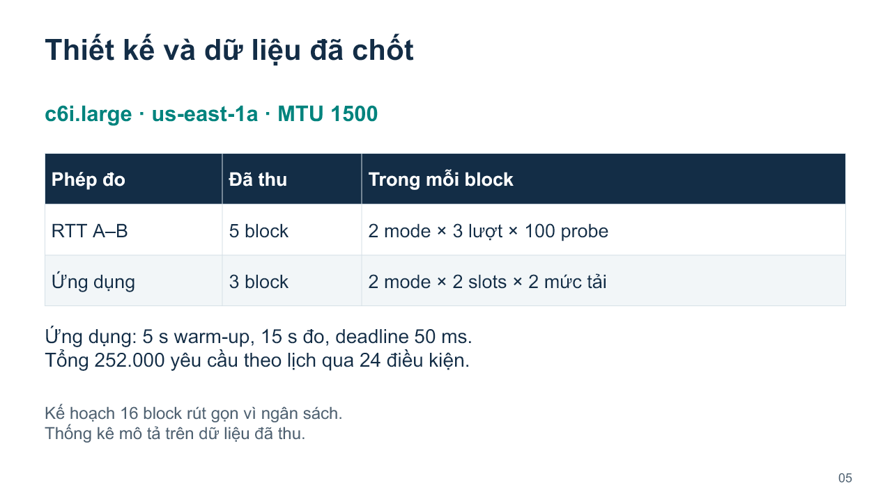

### Hiểu trước khi nói

**c6i.large** là loại EC2 dùng cho các endpoint. **AZ us-east-1a** là vùng sẵn sàng trong region us-east-1. Cùng loại máy và cùng AZ giúp hạn chế khác biệt do vị trí hay cấu hình máy khi so sánh. Nó không làm môi trường đám mây hoàn toàn hết biến động.

**MTU 1500** nghĩa là kích thước tối đa của gói IP trên giao diện mạng đang đặt là 1.500 byte. Nhóm giữ giống nhau để tránh thêm một biến cấu hình. MTU không phải tốc độ mạng.

**Block RTT** là một đợt ghép hai mode để đối chiếu: Peering có ba lượt ping, TGW cũng ba lượt, mỗi lượt 100 probe. Tổng là **5 × 2 × 3 × 100 = 3.000 probe**. Chênh lệch được tính trong block, rồi mới tổng hợp qua 5 block.

**Block ứng dụng** chứa đủ 8 điều kiện: 2 mạng × 2 mức slots × 2 mức tải. Ba block có 24 lần chạy điều kiện. Trong mỗi lần, bỏ 5 giây đầu để khởi động ổn định, đo 15 giây tiếp, rồi chờ xử lý phần đuôi. 600 rps × 15 giây = 9.000 request/lần, 800 rps × 15 giây = 12.000 request/lần. Qua ba block: một điều kiện 600 rps có 27.000 request, một điều kiện 800 rps có 36.000. Có bốn điều kiện ở mỗi mức tải, nên tổng **4 × 27.000 + 4 × 36.000 = 252.000 request** trong phần đo.

Nhiều request trong một phiên cùng chia sẻ máy và hàng đợi. Vì vậy không coi 252.000 request là 252.000 lần lặp độc lập của toàn thí nghiệm. Đơn vị lặp để đánh giá biến động giữa các đợt là block. Kế hoạch ban đầu 16 block đã rút gọn vì ngân sách. Không trình bày như đã hoàn thành 16 block hay đã có kiểm định xác nhận của kế hoạch đó.

### Lời nói trên lớp

“Nhóm giữ cùng loại EC2, cùng AZ và MTU một nghìn năm trăm. Nhóm so sánh hai đường mạng trong từng block để giảm ảnh hưởng của khác biệt giữa các đợt.

Phần RTT có năm block. Mỗi block thử hai mode, mỗi mode ba lượt ping, mỗi lượt một trăm probe. Tổng phân tích ba nghìn probe.

Phần ứng dụng có ba block, mỗi block chứa tám điều kiện, từ hai mạng, hai mức slots và hai mức tải. Mỗi điều kiện warm-up năm giây rồi đo mười lăm giây. Tổng phần đo có hai trăm năm mươi hai nghìn request theo lịch.

Nhóm đã rút gọn kế hoạch ban đầu vì ngân sách, nên kết quả hiện tại là thống kê mô tả. Số request lớn giúp mô tả trong từng phiên, còn số block phản ánh số đợt lặp của phép so sánh.”

### Chỉ vào đâu và chuyển slide

Đọc hai dòng “5 block”, “3 block”, rồi dòng điều kiện. Chuyển: **“Tiếp theo là ý nghĩa ba chỉ số để đọc kết quả.”**

**Nếu hỏi “Sao không chỉ đo một lần?”:** “Một lần có thể chịu biến động riêng của phiên đó. Lặp block giúp xem chiều và độ lớn khác biệt có giữ trong các đợt đã quan sát không. Năm và ba block vẫn là phạm vi nhỏ, nhóm không suy thành mọi phiên AWS.”

## Slide 6. Chỉ số gắn với chất lượng dịch vụ

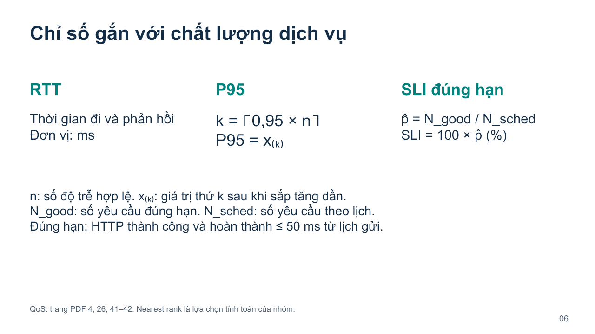

### Hiểu trước khi nói

**RTT:** A gửi ping đến B, B trả lời, A tính thời gian đi và về trên đồng hồ A. Ví dụ RTT 0,2 ms là khoảng 0,0002 giây. RTT ping không phải thời gian hoàn thành ứng dụng và cũng không phải thời gian một chiều. Không tự chia đôi để khẳng định độ trễ một chiều nếu chưa biết hai chiều đối xứng.

**P95:** sắp các độ trễ tăng dần, lấy vị trí (k = lceil 0,95n \rceil). Dấu ngoặc góc là làm tròn lên. Nếu có 100 số, lấy số thứ 95. Nếu có 101 số, 0,95 × 101 = 95,95, làm tròn lên là 96. (x_{(k)}) nghĩa là số thứ k trong dãy đã sắp. Ít nhất 95% số quan sát ở dưới hoặc bằng ngưỡng P95 theo quy tắc này. P95 không phải giá trị chậm nhất và không phải 95% của số trung bình.

Ví dụ học công thức, **không phải kết quả đo**: 100 yêu cầu có 95 yêu cầu mất 10 ms, 5 yêu cầu mất 200 ms. Trung bình là 19,5 ms, P95 nearest rank là 10 ms, còn 5 yêu cầu cuối vẫn chậm. Do đó cần đọc P95 cùng tỷ lệ đúng hạn và lỗi, không dùng riêng P95 để nói tất cả đều nhanh.

**SLI đúng hạn:** (\hat p = N_{good}/N_{sched}), rồi nhân 100 để ra phần trăm. N_good là số thành công trước hoặc đúng 50 ms; N_sched là số theo lịch. Dấu mũ trên p nói đây là tỷ lệ quan sát từ dữ liệu. Ví dụ học: 90 trên 100 đúng hạn thì SLI là 90%. Deadline tính từ lịch gửi tại A, nên bao gồm chậm khởi phát phía tạo tải nếu có.

**50 ms là ngưỡng nhóm chọn** để thử chất lượng ứng dụng. Nó không phải SLA của AWS. “HTTP thành công” và “đúng hạn” khác nhau: phản hồi hợp lệ ở 100 ms vẫn trễ hạn. P95 ở báo cáo tính trên những yêu cầu hoàn thành thành công; mẫu số SLI vẫn là toàn bộ request theo lịch.

### Lời nói trên lớp

“RTT là thời gian một gói đi đến đích rồi phản hồi về nơi gửi, tính bằng mili giây. Nhóm dùng ping để đo chỉ số mạng này.

Đối với ứng dụng, nhóm dùng P95 để nhìn các yêu cầu chậm. Nhóm sắp độ trễ tăng dần, lấy vị trí làm tròn lên của không phẩy chín mươi lăm nhân số quan sát. Ví dụ một trăm quan sát thì lấy số thứ chín mươi lăm. P95 là một mốc của phân bố, không phải thời gian chậm nhất.

SLI đúng hạn là số yêu cầu thành công trong năm mươi mili giây chia toàn bộ yêu cầu theo lịch, rồi nhân một trăm. Một yêu cầu có phản hồi hợp lệ nhưng đến sau năm mươi mili giây vẫn không đạt deadline. Ngưỡng này do nhóm chọn cho thí nghiệm. Nhóm đọc cả P95 và tỷ lệ đúng hạn để tránh kết luận chỉ từ số trung bình.”

### Chỉ vào đâu và chuyển slide

Chỉ lần lượt RTT, công thức P95, N_good/N_sched. Chuyển: **“Đầu tiên, kết quả đo RTT giữa A và B như sau.”**

**Nếu hỏi “Có yếu tố xác suất không?”:** “Tỷ lệ đúng hạn là tần suất thực nghiệm của sự kiện tốt trong mẫu đã quan sát. Nó cho biết bao nhiêu yêu cầu đạt ngưỡng, nhưng chưa xác định chính xác xác suất cho mọi phiên tương lai.”

## Slide 7. RTT Peering thấp hơn trong cả 5 block

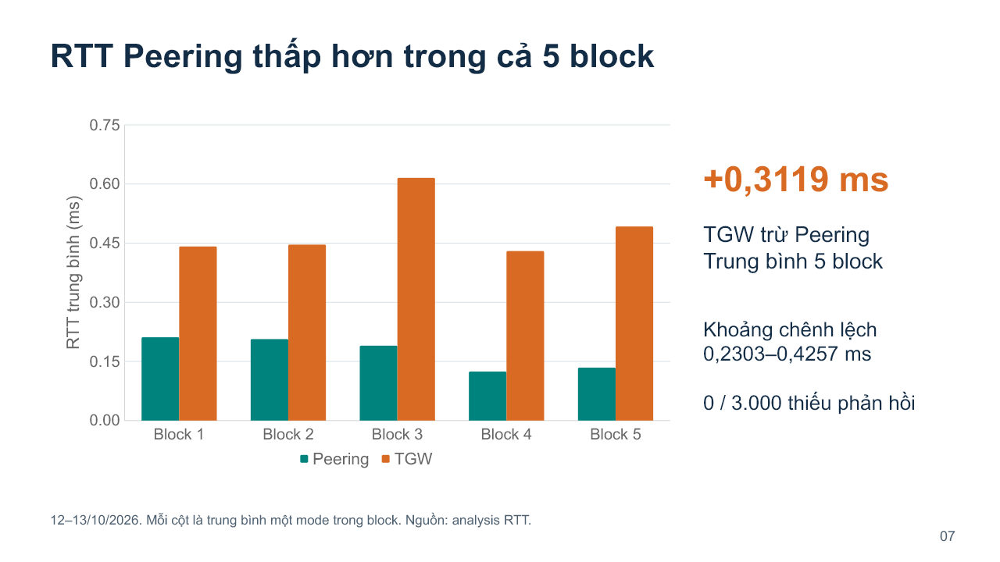

### Hiểu trước khi nói

Trục ngang là 5 block. Trục dọc là RTT trung bình, đơn vị ms. Mỗi block có hai cột: xanh Peering, cam TGW. **Cột thấp hơn nghĩa là thời gian ngắn hơn**, có lợi về RTT. Cột không biểu diễn thông lượng hay số request.

Với mỗi block, lấy TGW trừ Peering. Nếu kết quả dương, TGW có RTT cao hơn. Ví dụ block 1: **0,441667 − 0,211333 ≈ 0,230333 ms**. Năm chênh lệch khoảng 0,230333; 0,239667; 0,425667; 0,305667; 0,358000 ms. Cộng chúng rồi chia 5 được **0,3118667 ms**, làm tròn là **0,3119 ms**.

Đây là **chênh lệch trung bình**, không phải RTT riêng của TGW. Khoảng 0,2303–0,4257 là nhỏ nhất đến lớn nhất trong năm chênh lệch, không phải khoảng tin cậy. “0/3.000 thiếu phản hồi” nghĩa là trong các probe phân tích không thiếu phản hồi ping; không bảo đảm toàn AWS luôn không mất gói.

Các block dao động, nhưng trong cả năm cột cam đều cao hơn xanh. Nhóm có thể nói rõ chiều khác biệt trong mẫu đã thử. Chưa có phép đo bên trong thiết bị AWS, nên không xác định mỗi bộ phận của TGW mất bao lâu.

### Lời nói trên lớp

“Trục dọc của biểu đồ là RTT tính bằng mili giây. Mỗi cặp cột là một block so sánh. Xanh là Peering, cam là TGW. Trong cả năm block, Peering có cột thấp hơn, tức RTT nhỏ hơn.

Nhóm tính chênh lệch bằng TGW trừ Peering trong cùng block. Ví dụ block một có chênh khoảng không phẩy hai ba mili giây. Trung bình năm chênh lệch là không phẩy ba một một chín mili giây. Chênh từng block nằm từ khoảng không phẩy hai ba đến không phẩy bốn hai sáu mili giây.

Không thiếu phản hồi trong ba nghìn probe đã phân tích. Kết luận ở đây là Peering có RTT thấp hơn trong cấu hình và những block nhóm đã đo. Nhóm chưa suy phần chênh lệch thành thời gian xử lý riêng bên trong TGW.”

### Chỉ vào đâu và chuyển slide

Chỉ trục ms, màu cột, một cặp block 1, rồi +0,3119. Chuyển: **“Nhưng RTT thấp hơn có đủ giúp ứng dụng đúng hạn khi tải tăng không?”**

**Nếu hỏi “Chênh có nhỏ quá không?”:** “Khoảng 0,312 ms là chênh lệch quan sát ở lớp mạng. Ý nghĩa thực tế phụ thuộc ứng dụng và deadline. Vì vậy nhóm đo thêm hoàn thành ứng dụng, thay vì chỉ dùng RTT để quyết định.”

## Slide 8. 16 slots cải thiện rõ tỷ lệ đúng hạn

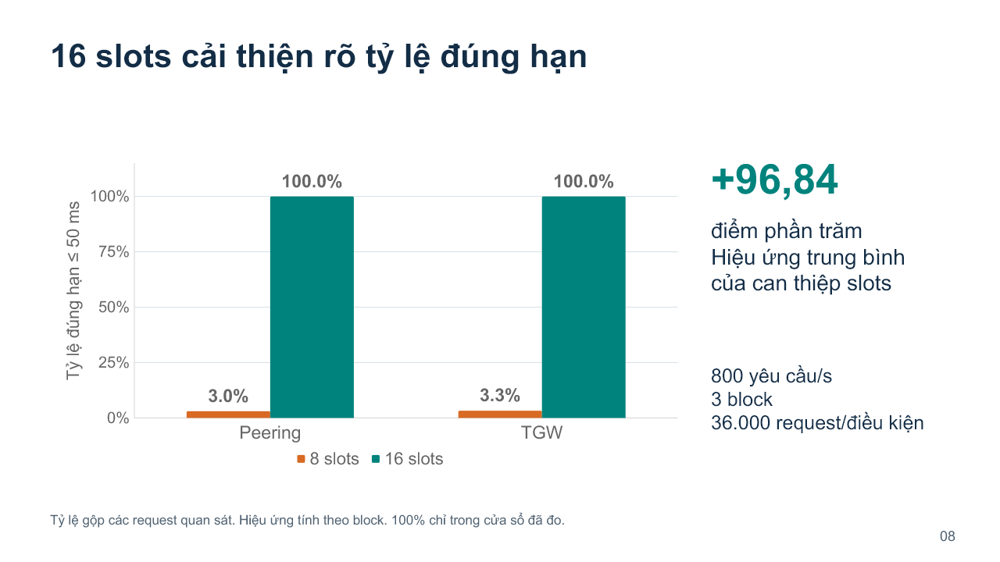

### Hiểu trước khi nói

Slide 7 đọc cột càng thấp càng ít trễ. Slide 8 đọc **cột càng cao càng nhiều yêu cầu đúng hạn**. Trục dọc bây giờ là phần trăm, không phải ms. Trục ngang là hai mạng. Cam là 8 slots, xanh là 16 slots; màu biểu đồ này biểu diễn slots, khác màu mạng ở slide 7. Luôn đọc chú giải trước.

Tất cả điều kiện trên biểu đồ này có tải **800 rps**. Qua ba block, mỗi tổ hợp mạng/slots có **36.000 request theo lịch**. Peering 8 slots có 1.096 đúng hạn, nên 1.096 / 36.000 × 100 ≈ **3,044%**. TGW 8 slots có 1.178 đúng hạn, khoảng **3,272%**. 16 slots ở cả hai mode có 36.000 / 36.000 = **100%**.

Vậy khoảng 97% request ở 8 slots không đạt deadline, nhưng không có nghĩa 97% mất gói hay lỗi HTTP. Trong dữ liệu này, chúng vẫn hoàn thành thành công nhưng quá muộn.

**+96,84 điểm phần trăm** là hiệu ứng thay đổi slots. Ví dụ 100% − 3,044% = 96,956 **điểm phần trăm**. Với TGW, 100% − 3,272% = 96,728 điểm phần trăm. Phép tổng hợp chính so sánh 16 trừ 8 trong cùng block và mode, rồi trung bình qua hai mode và ba block, được khoảng 96,8417. Đây không phải “nhanh hơn 96,84%”, vì phần trăm đúng hạn và thời gian là hai đại lượng khác nhau.

Kết quả cho thấy **cả hai mạng ở 8 slots đều kém deadline**, còn cả hai ở 16 slots đều tốt hơn rõ trong cửa sổ thử. Không nên chọn TGW là “thắng” chỉ vì 3,272 lớn hơn 3,044 ở trường hợp đã quá tải và số block ít.

### Lời nói trên lớp

“Ở slide này, trục dọc là tỷ lệ đúng hạn. Cột càng cao càng tốt. Tất cả điều kiện đang dùng tám trăm request mỗi giây. Cam là tám slots, xanh là mười sáu slots.

Với tám slots, Peering có khoảng ba phẩy không bốn phần trăm đúng hạn và TGW khoảng ba phẩy hai bảy phần trăm. Với mười sáu slots, cả hai đạt ba mươi sáu nghìn yêu cầu đúng hạn trên ba mươi sáu nghìn theo lịch.

Tăng slots cải thiện tỷ lệ đúng hạn trung bình khoảng chín mươi sáu phẩy tám bốn điểm phần trăm. Điều đáng chú ý là cả hai mạng đều không giữ được deadline khi worker chỉ có tám slots. Trong workload này, tăng khả năng phục vụ tạo cải thiện rõ hơn việc chỉ chọn đường mạng RTT thấp hơn. Một trăm phần trăm là kết quả trong cửa sổ đã đo.”

### Chỉ vào đâu và chuyển slide

Chỉ chú giải slots, hai cột cam thấp, hai cột xanh 100%. Chuyển: **“Tỷ lệ đúng hạn cho biết bao nhiêu yêu cầu đạt hạn. P95 tiếp theo cho biết các yêu cầu chậm tới mức nào.”**

**Nếu hỏi “16 slots có chạy trên máy mới không?”:** “Không. Nhóm giữ cùng các EC2, thay giới hạn phục vụ đồng thời trong chương trình worker.”

## Slide 9. P95 cho thấy độ trễ tăng mạnh ở 8 slots

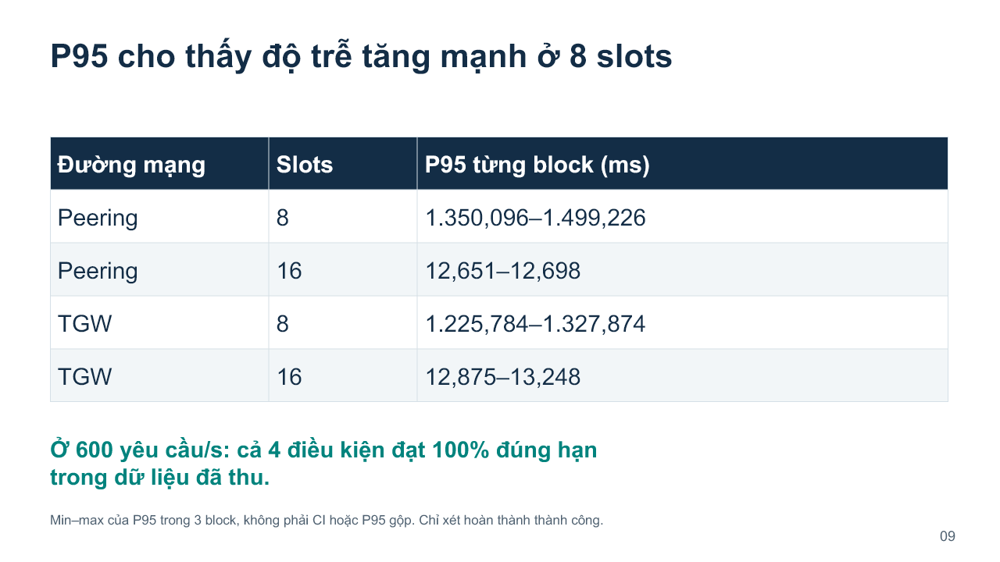

### Hiểu trước khi nói

Đây là P95 **thời gian hoàn thành ứng dụng ở A**, không phải P95 của ping và không phải P95 chỉ riêng hàng đợi C. Tất cả dòng chính là 800 rps. Mỗi khoảng gồm P95 nhỏ nhất và lớn nhất của ba block.

Cách đọc dấu Việt Nam rất quan trọng: **1.350,096 ms** nghĩa là một nghìn ba trăm năm mươi phẩy không chín sáu ms, xấp xỉ **1,35 giây**. **12,651 ms** chỉ khoảng **0,01265 giây**. Không đọc 1.350,096 ms thành 1,35 ms.

Peering 8 slots: P95 1.350,096–1.499,226 ms. Peering 16 slots: 12,651–12,698 ms. TGW 8 slots: 1.225,784–1.327,874 ms. TGW 16 slots: 12,875–13,248 ms. Độ trễ ứng dụng thay đổi lớn theo slots trong điều kiện tải này.

Dòng xanh phía dưới nói ở **600 rps** cả bốn tổ hợp mạng/slots đều đạt 100% đúng hạn trong dữ liệu. Nó là kết quả ở tải thấp hơn, không phủ định vấn đề ở 800 rps. So sánh hai mức tải giúp nhìn vùng mà giới hạn phục vụ bắt đầu ảnh hưởng.

### Lời nói trên lớp

“Bảng cho biết P95 của thời gian hoàn thành ứng dụng tại tám trăm request mỗi giây. Đơn vị vẫn là mili giây. Qua Peering, tám slots có P95 khoảng một phẩy ba năm đến một phẩy năm giây. Tăng lên mười sáu slots thì P95 chỉ khoảng mười hai phẩy bảy mili giây.

TGW cũng có hiện tượng tương tự: tám slots hơn một giây, còn mười sáu slots khoảng mười ba mili giây. Các khoảng là min và max của P95 từng block, không phải khoảng tin cậy và không phải P95 gộp.

Ở sáu trăm request mỗi giây, cả bốn điều kiện đạt đúng hạn trong dữ liệu đã đo. Vì vậy nhóm cần giải thích tại sao tăng từ sáu trăm lên tám trăm lại làm chờ tăng mạnh ở tám slots.”

### Chỉ vào đâu và chuyển slide

Chỉ đơn vị ms, hai dòng Peering, rồi hai dòng TGW. Chuyển: **“Nhóm dùng log hàng đợi và Little để giải thích phần chờ này.”**

**Nếu hỏi “TGW có P95 nhỏ hơn ở 8 slots nên tốt hơn không?”:** “Ở điều kiện này, nhóm quan sát TGW có P95 thấp hơn Peering nhưng cả hai đều trễ hơn deadline rất nhiều. Với ba block, nhóm mô tả khác biệt quan sát và không dùng nó để kết luận TGW thắng chung. Khi tăng slots, cả hai đều quay về khoảng 13 ms.”

## Slide 10. Định luật Little giải thích số lời gọi chờ

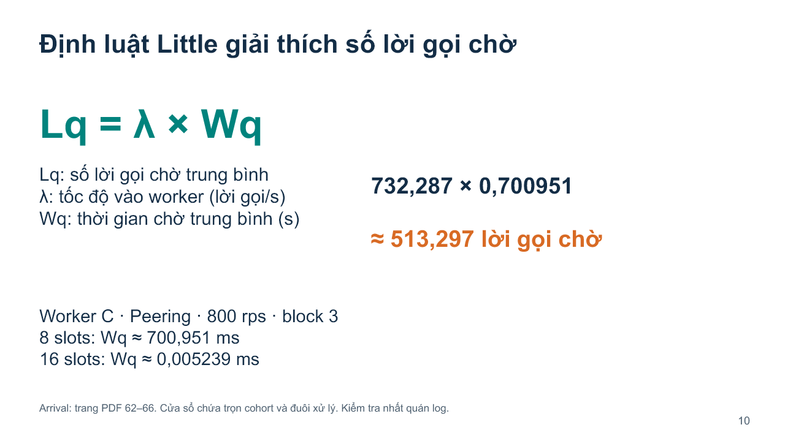

### Hiểu trước khi nói

Ba đại lượng đang hỏi ba chuyện khác nhau:

- **Lq**, đọc “L quy”: trong suốt khoảng quan sát, trung bình có bao nhiêu lời gọi đang chờ?
- **λ**, đọc “lambda”: trên cửa sổ đang xét, mỗi giây có bao nhiêu lời gọi thuộc nhóm được quan sát vào worker?
- **Wq**, đọc “W quy”: một lời gọi trong nhóm chờ trung bình bao nhiêu giây trước khi lấy slot?

Chữ q là queue, chỉ phần chờ. Công thức **Lq = λ × Wq** có đơn vị (lời gọi/giây) × giây = lời gọi. Phải đổi Wq từ ms sang giây trước khi nhân với tốc độ theo giây.

Ví dụ học, **không phải raw AWS**: có 3 lời gọi, mỗi lời gọi chờ 2 giây, trong một cửa sổ đủ dài 10 giây. Tổng thời gian chờ của mọi lời gọi là 6 “lời gọi-giây”. Chia 10 giây được Lq = 0,6 lời gọi. Mặt khác, λ = 3/10 = 0,3 lời gọi/s và Wq = 2 giây. Tích là 0,3 × 2 = 0,6. Có lúc 2 lời gọi cùng chờ, có lúc không ai chờ; trung bình 0,6 vẫn hợp lệ.

**Ví dụ thật trên slide:** worker C, Peering, 8 slots, block 3 ở cấu hình 800 rps. Log cho tốc độ của nhóm λ ≈ **732,287 lời gọi/s**, thời gian chờ trung bình Wq ≈ **700,951 ms = 0,700951 giây**. Nhân ra Lq ≈ **513,297 lời gọi chờ trung bình**.

Vì sao 732 khác 800? 800 là tốc độ gửi theo lịch trong cửa sổ tải. Để kiểm tra Little, nhóm dùng một cửa sổ chứa **trọn cùng nhóm lời gọi**, từ lần vào đầu đến lần thoát cuối, gồm đuôi xử lý sau khi hết gửi. Chờ nhiều khiến đuôi kéo dài, nên số lời gọi chia tổng thời gian đó nhỏ hơn tốc độ cấu hình. Không thay 732 bằng 800 trong phép thế số.

Ở 16 slots, cùng block/mode/worker, Wq khoảng **0,005239 ms**, tức 5,239 µs, rất nhỏ so với 700,951 ms. Đây là **mean chờ**, không phải P95 ứng dụng ở slide 9. Cũng không phải thời gian trong TGW.

Log ghi mốc vào hàng đợi và lấy slot. Cộng thời gian chờ từng lời gọi rồi chia cửa sổ giúp kiểm tra Lq. Hai vế Little dùng cùng log, nên là kiểm tra nhất quán theo định nghĩa, không phải hai thí nghiệm độc lập chứng minh nhau. Nhóm không cần giả định Poisson cho phép kiểm tra hữu hạn trên nhóm quan sát đầy đủ này.

### Lời nói trên lớp

“Little là công thức trong bài giảng liên hệ số công việc, tốc độ và thời gian. Với phần hàng đợi, nhóm viết L quy bằng lambda nhân W quy.

L quy là số lời gọi đang chờ trung bình. Lambda là lời gọi mỗi giây trên cửa sổ quan sát. W quy là thời gian chờ trung bình tính bằng giây. Ví dụ, nếu mỗi giây có nhiều lời gọi và mỗi lời gọi phải đợi lâu, trung bình sẽ có nhiều lời gọi nằm trong hàng đợi.

Với worker C, Peering, tám slots ở block ba, nhóm có khoảng bảy trăm ba mươi hai lời gọi mỗi giây và thời gian chờ trung bình khoảng không phẩy bảy không một giây. Tích của hai số cho khoảng năm trăm mười ba lời gọi chờ trung bình.

Lambda khác tám trăm cấu hình vì cửa sổ tính Little chứa cả đuôi xử lý của cùng nhóm lời gọi. Khi tăng lên mười sáu slots, thời gian chờ trung bình của trường hợp này giảm về khoảng không phẩy không không năm hai bốn mili giây. Log cho thấy phần chờ tại worker giảm rõ. Phép Little giúp kiểm tra tính nhất quán của log, không đo hàng đợi nội bộ AWS.”

### Chỉ vào đâu và chuyển slide

Chỉ ký hiệu bên trái, phép nhân bên phải, rồi 8/16 slots ở dưới. Chuyển: **“Để hiểu vì sao tám slots dễ tích hàng đợi ở tải này, nhóm xét khả năng phục vụ danh nghĩa.”**

**Nếu hỏi “513 lời gọi nằm trên CPU cùng lúc?”:** “Không. Đó là số chờ trung bình theo thời gian của nhóm lời gọi. Chỉ các lời gọi đã lấy slot mới đang phục vụ. 513 không phải số vCPU hay số công việc chạy CPU đồng thời.”

## Slide 11. 8 slots gần công suất phục vụ danh nghĩa

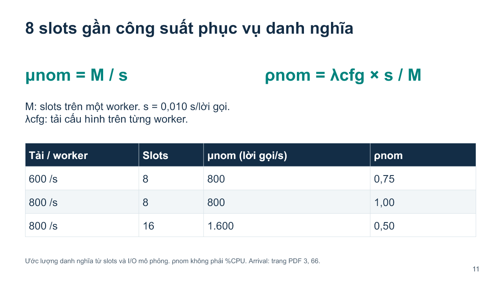

### Hiểu trước khi nói

Một slot mất khoảng **s = 0,010 giây/lời gọi** theo cấu hình. Nếu bỏ qua overhead và slot luôn bận, một slot phục vụ danh nghĩa **1/s = 100 lời gọi/s**. M slots cho **μ_nom = M/s**. Đọc μ là “mu”, nom là nominal, tức danh nghĩa.

Với 8 slots: 8 / 0,010 = **800 lời gọi/s**. Với 16 slots: 16 / 0,010 = **1.600 lời gọi/s**. Đây là ước lượng từ mô hình, không phải thông lượng AWS đảm bảo. Thời gian thực có thể dài hơn 10 ms vì lập lịch, overhead chương trình và biến động. Phải đối chiếu log phục vụ và chờ thực.

**ρ_nom**, đọc “rô danh nghĩa”, là tải cấu hình chia công suất danh nghĩa: λ_cfg × s / M. cfg nghĩa là cấu hình. 600/800 = 0,75; 800/800 = 1; 800/1.600 = 0,5. Số 1 nghĩa là tốc độ đến bằng tốc độ danh nghĩa, rất ít dư địa cho các phần phát sinh. Số 0,5 nghĩa là tải bằng một nửa công suất danh nghĩa, không có nghĩa CPU dùng 50%.

Hình dung có 8 quầy, mỗi quầy phục vụ danh nghĩa 100 khách/s. Nếu 800 khách/s đến, cả 8 quầy gần kín theo ước lượng. Một chút chậm thêm cũng có thể khiến khách mới phải chờ. Mở 16 quầy trong mô hình tạo dư địa. Đây chỉ là phép ước lượng để hiểu cơ chế, kết luận cải thiện dựa vào thí nghiệm slots và log.

Nhóm không lấy công thức thời gian chờ M/M/1 rồi áp vào workload này. Mô hình worker có nhiều slots, tải theo lịch và I/O mô phỏng; chưa xác nhận giả định đến Poisson hay phục vụ phân phối mũ.

### Lời nói trên lớp

“Nhóm ước lượng công suất danh nghĩa từ số slots và thời gian phục vụ cấu hình. M là số slots trên một worker, s là giây mỗi lời gọi. Công suất mu danh nghĩa bằng M chia s.

Một slot giữ mười mili giây có thể phục vụ danh nghĩa một trăm lời gọi mỗi giây. Tám slots tương ứng tám trăm, mười sáu slots tương ứng một nghìn sáu trăm.

Vì vậy, ở tải tám trăm và tám slots, tải gần bằng công suất danh nghĩa, không còn nhiều dư địa cho overhead. Với mười sáu slots, tải bằng khoảng một nửa công suất danh nghĩa. Đây là cách hiểu tại sao chờ có thể tăng mạnh khi slots hạn chế. Nhóm dùng log để kiểm tra phần chờ thật, không gọi con số này là giới hạn AWS hay phần trăm CPU.”

### Chỉ vào đâu và chuyển slide

Chỉ M/s, dòng 800/8 có ρ = 1, rồi 800/16 có ρ = 0,5. Chuyển: **“Ngoài số liệu tổng hợp, nhóm có trace để nhìn một yêu cầu đi qua các dịch vụ thế nào.”**

**Nếu hỏi “800 là giới hạn máy c6i.large?”:** “Không. Nó là công suất danh nghĩa của 8 slots với 10 ms I/O cấu hình. Đổi công việc, số slots hoặc chương trình sẽ đổi con số này.”

## Slide 12. OpenTelemetry theo dõi một yêu cầu

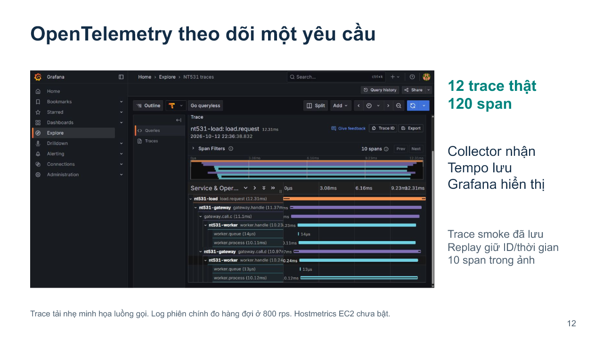

### Hiểu trước khi nói

**OpenTelemetry** cung cấp cách tạo và truyền dữ liệu quan sát. Chương trình nhóm gắn các span vào từng phần công việc, truyền context để chúng cùng thuộc một trace.

**Collector** nhận dữ liệu quan sát. **Tempo** lưu và truy vấn trace. **Grafana** hiển thị để người xem đọc. Trong bộ local còn có Prometheus cho metrics. Các công cụ này giúp quan sát và giải thích, không tự làm RTT thấp đi, không thay Terraform dựng mạng, và không tự tạo độ tin cậy thống kê cho nghiên cứu.

Một trace là hành trình **một request**. Các hàng trên hình là span của từng đoạn công việc: tạo tải, gateway, gọi worker, chờ slot, phục vụ. Độ dài thanh theo trục thời gian là thời gian span. Thanh C và D chồng nhau cho thấy hai lời gọi song song. C và D dùng chung tên service `nt531-worker`, nhưng là hai instance khác nhau.

Ảnh có một trace khoảng **12,31 ms**, worker.process khoảng 10,11–10,12 ms, worker.queue khoảng **13–14 µs = 0,013–0,014 ms**. Đó là một request smoke tải nhẹ. Số 12,31 không phải P95 và không phải RTT ping. Cũng không phải request ở bài 800 rps.

Nhóm lưu 12 trace, mỗi trace 10 span, tổng 120 span. **Replay** là nhập lại các trace thật đã lưu vào pipeline local, giữ ID và timestamp gốc. Phải nói rõ đang xem trace lịch sử. Dữ liệu hàng đợi tải cao ở slide 10 lấy từ log phiên chính, không lấy từ trace nhẹ trên hình để suy hàng đợi lớn.

Hostmetrics EC2 chưa bật trong bộ dashboard. Nếu biểu đồ CPU trống, không nói CPU bằng 0. CPU nghiên cứu lấy từ mpstat, ENA từ ethtool. Các thành phần đã triển khai và chưa triển khai cần phân biệt khi bảo vệ.

### Lời nói trên lớp

“Nhóm bổ sung OpenTelemetry để theo dõi hành trình một yêu cầu qua các dịch vụ. Collector nhận trace, Tempo lưu, Grafana hiển thị. Một trace gồm nhiều span, mỗi span là một phần công việc có thời điểm bắt đầu và kết thúc.

Trong hình này, hai nhánh gọi C và D chồng nhau về thời gian, cho thấy chạy song song. Ta thấy phần chờ lấy slot và phần phục vụ khoảng mười mili giây. Toàn request minh họa mất khoảng mười hai phẩy ba một mili giây.

Nhóm có mười hai trace smoke thật đã lưu, tổng một trăm hai mươi span. Đây là replay giữ nguyên ID và thời gian, không phải phiên tám trăm rps đang chạy. Trace giúp hiểu luồng công việc, còn log phiên chính cung cấp số liệu hàng đợi khi tải cao.”

### Chỉ vào đâu và chuyển slide

Chỉ trục thời gian, hai nhánh chồng nhau, worker.queue và worker.process. Chuyển: **“Từ hai lớp đo, nhóm rút ra lợi thế và phạm vi sử dụng của mỗi cách kết nối.”**

**Nếu hỏi “Trace có đo riêng thời gian TGW không?”:** “Không. Span lời gọi từ gateway bao gồm mạng và xử lý phía worker. Nhóm không có instrumentation bên trong TGW để tách chính xác thời gian nội bộ dịch vụ.”

## Slide 13. Lựa chọn mạng và phạm vi kết luận

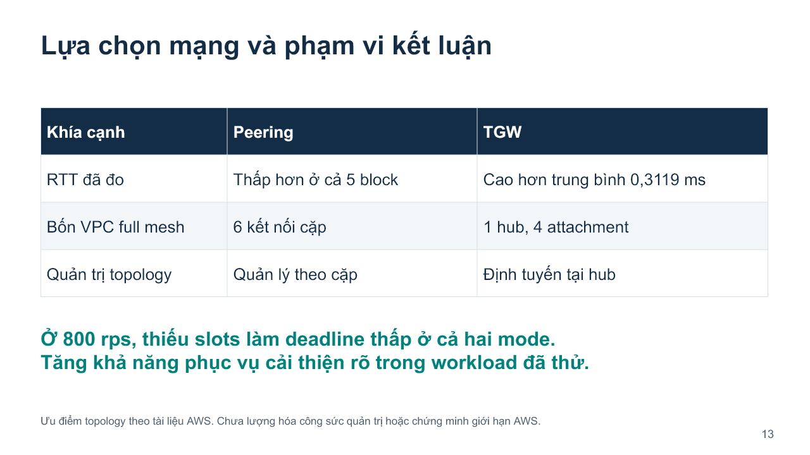

### Hiểu trước khi nói

Đọc mỗi hàng bảng theo một tiêu chí riêng. **Hàng RTT** là kết quả nhóm đo: Peering thấp hơn trong năm block. **Hàng kiến trúc** mô tả sáu kết nối cặp so với một hub và bốn attachment. **Hàng quản trị** là đặc điểm thiết kế: Peering quản lý kết nối theo cặp, TGW quản lý đường đi qua hub. Nhóm chưa làm phép thử thời gian cấu hình hoặc công sức vận hành, nên không nói TGW giảm bao nhiêu phần trăm công quản trị.

Với n VPC full mesh, số Peering là n(n−1)/2; số attachment VPC vào một hub trong mô hình này là n. Ví dụ học cho 10 VPC: 45 kết nối cặp so với 10 attachment. Nó minh họa vì sao topology tập trung đáng quan tâm khi mạng lớn hơn, không phải nhóm đã dựng và benchmark 10 VPC. Số kết nối ít hơn cũng không tự suy thành tốc độ cao hơn hay chi phí tổng thấp hơn.

**Kết luận ứng dụng:** với công việc và deadline đã chọn, thiếu slots làm tỷ lệ đúng hạn thấp ở cả hai đường mạng. Tăng slots trong mô hình I/O này cải thiện rõ. Không áp thành quy luật “cứ tăng concurrency là tốt”: chương trình giới hạn CPU, cơ sở dữ liệu hoặc bộ nhớ có thể phản ứng khác. Nhóm chỉ kiểm chứng 8 và 16 slots trên workload đang trình bày.

### Lời nói trên lớp

“Nhóm phân biệt kết quả đo và lợi thế kiến trúc. Về RTT, Peering thấp hơn trong cả năm block đã thử. Về topology, bốn VPC full mesh cần sáu Peering, còn TGW có một hub và bốn attachment. Cấu trúc hub hỗ trợ quản lý định tuyến tập trung theo tài liệu AWS. Nhóm chưa lượng hóa thời gian quản trị để nói lợi ích đó lớn bao nhiêu.

Về ứng dụng, tại tám trăm request mỗi giây, cả hai mạng đều có tỷ lệ đúng hạn thấp khi worker chỉ có tám slots. Tăng lên mười sáu slots cải thiện rõ trong workload I/O đã thử. Vì vậy khi chọn đường mạng, cần xét cùng khả năng phục vụ và deadline của ứng dụng.

Nhóm có kết luận theo từng tiêu chí và cấu hình, không đưa một phương án thắng tuyệt đối cho mọi hệ thống.”

### Chỉ vào đâu và chuyển slide

Chỉ từng hàng RTT, full mesh, quản trị, rồi câu xanh phía dưới. Chuyển: **“Nhóm xin chốt lại đóng góp và minh chứng của đồ án.”**

**Nếu hỏi “Vậy nên chọn cái nào?”:** “Nếu xét RTT trên cấu hình đo này, Peering có lợi thế. Nếu cần kết nối nhiều mạng qua hub và quản lý route tập trung, TGW có đặc điểm kiến trúc phù hợp. Để quyết định cho một hệ thống cụ thể, còn cần yêu cầu kết nối, chi phí và workload. Trong ứng dụng nhóm thử, trước hết phải giải quyết thiếu khả năng phục vụ tại worker.”

## Slide 14. Kết luận và minh chứng demo

### Hiểu trước khi nói

Bạn cần chốt **đã làm gì, đã thấy gì và bằng chứng ở đâu**. Hạ tầng dựng bằng Terraform. Script thu dữ liệu theo điều kiện. Raw và route proof lưu đầu ra và đường đi tại lúc đo. Analyzer tổng hợp, log hàng đợi kiểm tra Little, trace minh họa hành trình. Báo cáo và dashboard giúp xem kết quả. Không gọi công cụ là phát hiện: phát hiện là quan hệ giữa điều kiện thử và kết quả.

Câu trả lời chính: **RTT thấp hơn không đủ đảm bảo deadline tốt khi worker thiếu khả năng phục vụ trong workload này.** Điều này có giá trị hơn chỉ đo ping rồi nói mạng nào nhanh. Nhóm thay đổi slots có kiểm soát, lặp điều kiện và dùng log giải thích phần chờ. Nhóm không khám phá quy luật vật lý mới; đang vận dụng bài giảng để đánh giá một hệ thống có số liệu kiểm chứng.

Video là minh họa quá trình và bằng chứng. Nó không thay thế raw hay biến trace cũ thành phiên live. Tài liệu [kịch bản quay](Kich-ban-quay-demo-NT531.md) đã có từng cảnh. Sau trang này kết thúc phần chính, 15–18 là phụ lục chỉ mở nếu cần.

### Lời nói trên lớp

“Nhóm rút ra hai kết quả chính. Trong cấu hình đã đo, Peering có RTT thấp hơn TGW. Tuy nhiên, RTT thấp hơn chưa đủ giúp ứng dụng đúng hạn khi worker thiếu khả năng phục vụ. Ở workload tám trăm request mỗi giây, tăng từ tám lên mười sáu slots cải thiện rõ tỷ lệ đúng hạn và thời gian chờ.

Đóng góp của nhóm là mô hình so sánh trên cùng hạ tầng, thí nghiệm thay đổi slots, bộ dữ liệu có nguồn và log giải thích hàng đợi bằng Little. Trace trên Grafana giúp nhìn luồng gọi thực tế giữa các dịch vụ.

Code, giao thức đo và kết quả đã lưu để kiểm chứng. Nhóm trình bày đúng phạm vi năm block RTT và ba block ứng dụng. Em cảm ơn thầy và xin nhận câu hỏi.”

### Chỉ vào đâu

Chỉ hai kết luận lớn. Dừng một nhịp rồi cảm ơn. Nếu chuyển sang video, nói: **“Nhóm xin minh họa kết quả và một trace thật đã lưu qua video ngắn.”** Không đọc phụ lục liên tục nếu thời gian đã hết.

**Nếu hỏi “Đồ án có gì ngoài kết quả hiển nhiên?”:** “Nhóm đo mức chênh RTT, vị trí tải/slots mà deadline giảm, và mức cải thiện sau can thiệp trên hệ thống cụ thể. Log lượng hóa chờ và kiểm tra bằng Little. Kết quả định lượng và điều kiện tái tạo là phần nhóm cung cấp, dù nguyên lý hàng đợi là kiến thức đã biết.”

## Slide 15. Phụ lục: TCP và fan-in lịch sử

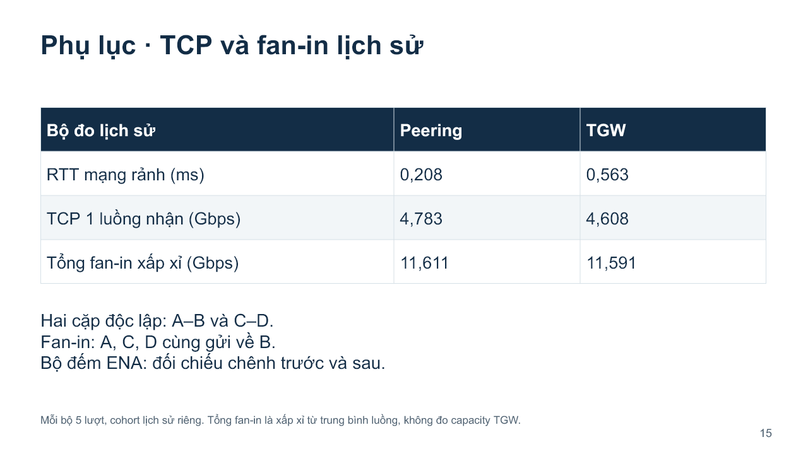

### Hiểu trước khi nói

**Thông lượng** là lượng dữ liệu truyền được trong một giây. Gbps là tỷ bit/giây, không phải tỷ byte/giây. Vì 1 byte = 8 bit, 4,8 Gbps tương đương danh nghĩa khoảng 0,6 GB/s theo đơn vị thập phân, trước khi xét cách tính overhead. Nhóm dùng thông lượng payload phía nhận của iperf3, không gọi đây là tốc độ vật lý riêng của AWS.

**TCP** là giao thức vận chuyển có cơ chế theo dõi và truyền lại dữ liệu khi cần. Bài TCP một luồng tạo một luồng A gửi B. Các số khoảng 4,783 và 4,608 Gbps là trung bình phía nhận của 5 lượt lịch sử, không phải dự báo chắc chắn lượt mới.

**Hai cặp độc lập:** A gửi B và C gửi D cùng lúc. Hai bài có endpoint riêng, không cố tạo tranh chấp cùng một máy nhận. Nó kiểm tra hoạt động đồng thời, không bắt buộc gây suy giảm.

**Fan-in:** A, C và D cùng gửi về B. Ba nguồn chia sẻ một receiver B, nên có thể ảnh hưởng tài nguyên chung tại B. Đây là bài TCP, khác với ứng dụng chính A–B–C/D: cùng bốn máy nhưng vai trò và đường đi của workload khác.

Tổng 11,611/11,591 Gbps trên bảng là **xấp xỉ từ tổng các trung bình luồng**, không phải đo đúng công suất tối đa TGW và không nên gọi là một phép đo tốc độ tức thời đồng bộ. Tài liệu common-window audit có phần đối chiếu riêng.

**ENA** là bộ điều khiển mạng trên EC2. Bộ đếm là số tích lũy, nên cần lấy sau trừ trước để biết tăng bao nhiêu trong cửa sổ. Một bộ đếm về allowance tăng cung cấp bằng chứng liên quan giới hạn tại endpoint; không tự chứng minh mọi retransmission do TGW. Retransmission TCP cũng không phải tỷ lệ request trễ hạn.

RTT 0,208/0,563 ms ở bảng là **bộ đo lịch sử khác**. RTT chính ở slide 7 là đợt xác nhận sau. Không ghép hai bộ như cùng một lần đo để làm số lần lặp lớn hơn.

### Lời nói khi thầy hỏi

“Ngoài phần chính, nhóm có bài TCP lịch sử. TCP một luồng A gửi B có thông lượng nhận trung bình khoảng bốn phẩy bảy tám ba Gbps qua Peering và bốn phẩy sáu không tám qua TGW.

Nhóm cũng thử hai cặp độc lập và fan-in ba nguồn cùng gửi về B. Hai cặp có receiver riêng, còn fan-in chia sẻ receiver nên phù hợp hơn để xem ảnh hưởng endpoint chung. Tổng fan-in trên bảng là tổng xấp xỉ trung bình luồng, không phải giới hạn TGW.

Nhóm đối chiếu chênh bộ đếm ENA trước và sau. Bộ đo này là cohort lịch sử riêng, không gộp vào năm block RTT của phần chính.”

## Slide 16. Phụ lục: đủ 8 điều kiện ứng dụng

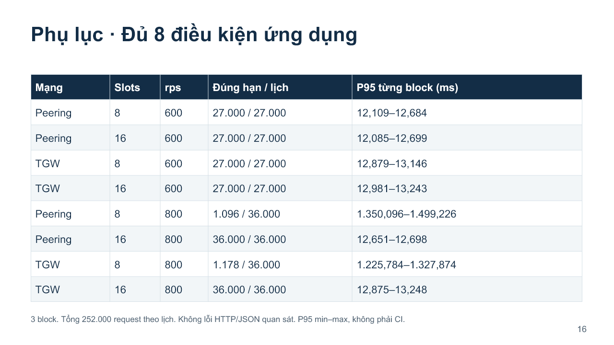

### Hiểu trước khi nói

Bảng liệt kê đủ các tổ hợp, tránh chỉ chọn dòng có kết quả đẹp. Cột “Đúng hạn/lịch” là số đếm, không phải tốc độ. **27.000/27.000** nghĩa là cả 27.000 đúng hạn qua ba block của một điều kiện 600 rps. **1.096/36.000** nghĩa là 1.096 đúng hạn trong 36.000 theo lịch ở điều kiện Peering, 8 slots, 800 rps.

Ở 600 rps, 8 slots cũng đạt hạn trong mẫu. Ở 800 rps, 8 slots giảm mạnh. 16 slots đạt hạn ở cả hai mức tải đã thử. Bảng hỗ trợ kết luận có điều kiện về tải và slots, không chỉ nói Peering/TGW theo một số trung bình.

Không có lỗi HTTP/JSON quan sát là một thông tin riêng. Vì deadline 50 ms, một phản hồi hợp lệ muộn vẫn nằm ngoài N_good. P95 là min–max của từng block, chưa phải khoảng tin cậy.

### Lời nói khi thầy hỏi

“Bảng có đủ tám điều kiện: hai đường mạng, hai mức slots và hai mức tải. Mỗi điều kiện sáu trăm rps có hai mươi bảy nghìn request qua ba block, còn tám trăm có ba mươi sáu nghìn.

Sáu trăm rps đạt đúng hạn ở cả bốn tổ hợp. Tám trăm rps chỉ có khoảng ba phần trăm đúng hạn ở tám slots, nhưng đạt một trăm phần trăm trong mẫu ở mười sáu slots. Không có lỗi HTTP/JSON được ghi nhận. Nhiều request ở tám slots thành công nhưng trễ hạn. Bảng này cho thấy cần đọc chất lượng theo cả tải, slots và đường mạng.”

## Slide 17. Phụ lục: câu hỏi thường gặp

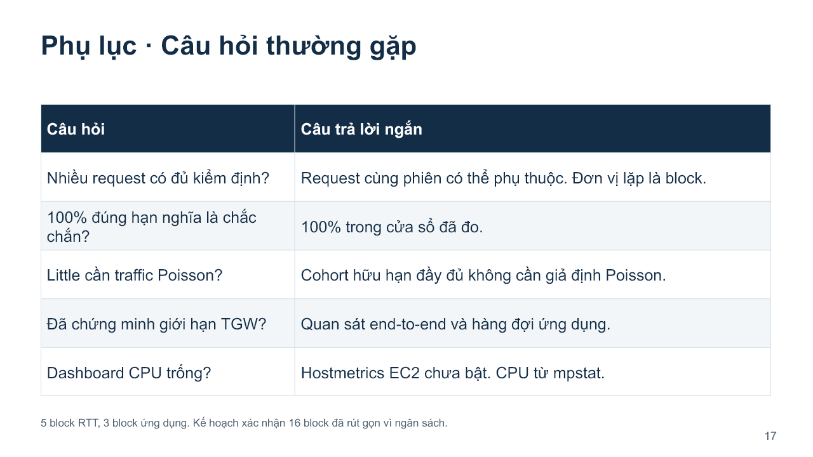

### Hiểu trước khi nói

Trang này giúp trả lời thẳng. Không cần cố dùng từ kiểm định phức tạp để bài nghe mạnh hơn. Những câu chưa có dữ liệu, nói đúng giới hạn rồi chỉ bằng chứng mình có.

**“Có 252.000 request sao vẫn ít mẫu?”** Hai câu hỏi khác nhau: trong từng cửa sổ, nhiều request giúp mô tả tỷ lệ/P95; giữa các lần chạy độc lập hơn, nhóm chỉ có 3 block ứng dụng. Request cùng phiên chia sẻ điều kiện, không nên coi là hàng trăm nghìn lần lặp độc lập của toàn hệ thống.

**“100% nghĩa là xác suất đúng hạn bằng 1?”** 100% là tần suất ở các cửa sổ đã đo. Chưa suy thành xác suất cho mọi lần chạy, vì môi trường, tải hoặc chương trình có thể thay đổi.

**“Little chứng minh nguồn đến Poisson?”** Không. Nhóm đang kiểm tra quan hệ hữu hạn trên cùng nhóm lời gọi được ghi nhận đầy đủ. Không suy từ đẳng thức này ra phân phối của quá trình đến.

**“Đã chứng minh giới hạn AWS?”** Chưa. Nhóm có các kết quả end-to-end và chờ ứng dụng, không có phép đo thành phần nội bộ TGW để xác định trần tuyệt đối dịch vụ.

**“Tăng slots luôn giải quyết được không?”** Chỉ kiểm chứng 8 lên 16 cho công việc I/O này. Nếu công việc bị giới hạn CPU hoặc một tài nguyên khác, tăng concurrency có thể không đạt cùng hiệu quả.

### Các câu trả lời có thể nói nguyên văn

“Các request trong cùng phiên cùng chia sẻ hạ tầng và hàng đợi. Nhóm dùng block làm đơn vị lặp khi đối chiếu các đợt, nên không lấy số request lớn để nhận đã có rất nhiều lần lặp độc lập.”

“Một trăm phần trăm là kết quả trong cửa sổ nhóm quan sát, không phải cam kết mọi phiên tương lai đều đạt.”

“Little ở đây kiểm tra tính nhất quán của log trên nhóm lời gọi đầy đủ. Phép đó không cần giả định Poisson, và cũng không chứng minh nguồn đến là Poisson.”

“Nhóm chưa chứng minh trần hiệu năng TGW. Kết luận đang nói về cấu hình đã đo và hàng đợi ứng dụng.”

“Grafana CPU trống do chưa bật hostmetrics EC2. Nhóm lấy CPU nghiên cứu từ mpstat, không diễn giải dữ liệu trống thành CPU bằng không.”

## Slide 18. Phụ lục: nguồn và liên hệ bài giảng

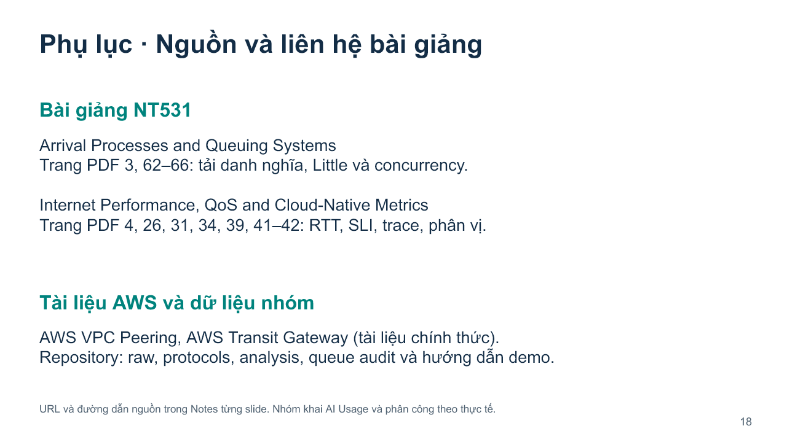

### Hiểu trước khi nói

Thầy có thể hỏi công thức ở đâu trong môn. Phải phân biệt **khái niệm có trong bài giảng**, **cách triển khai tính của nhóm**, và **kế hoạch nâng cao chưa hoàn thành**.

Trong bài Arrival Processes and Queuing Systems, trang PDF 62–66 liên hệ số công việc, tốc độ, thời gian và concurrency; nhóm dùng Little để đọc hàng đợi. Trong bài Internet Performance, QoS and Cloud-Native Metrics, trang PDF 26 nói SLI, trang 41–42 nói phân vị/tail, trang 31/34/39 nói quan sát và trace. Số trang là thứ tự trang PDF bắt đầu từ 1.

P95 là khái niệm bài giảng; nearest rank là thuật toán nhóm chọn trong code. μ_nom = M/s là ước lượng từ mô hình slots/I/O, có giải thích giả định. Không nói đã áp mô hình M/M/1 đúng cho toàn AWS. Các kế hoạch kiểm định 16 block được giữ trong tài liệu lịch sử, không trình bày như kết quả hoàn thành.

Tài liệu AWS giải thích đặc điểm Peering/TGW. Raw do chương trình thu là nguồn số liệu đo, không phải số liệu lấy trên mạng. Nội dung AI hỗ trợ và phân công nhóm phải khai theo thực tế và yêu cầu môn, không tự nhận đã làm từng bước thủ công nếu có hỗ trợ.

### Lời nói khi thầy hỏi

“Nhóm liên hệ Little với bài Arrival Processes, các trang PDF sáu mươi hai đến sáu mươi sáu. SLI, phân vị và trace liên hệ bài Internet Performance tại các trang ghi trên slide.

Thuật toán nearest rank và mô hình công suất danh nghĩa là lựa chọn triển khai có giải thích trong code và tài liệu. Số liệu kết quả lấy từ raw nhóm thu trên AWS. Nhóm dùng tài liệu chính thức AWS cho đặc điểm kiến trúc và ghi rõ nguồn. Các phần thiết kế kiểm định chưa hoàn thành được phân biệt với kết quả mô tả đang trình bày.”

---

## Khi quên giữa buổi, nhớ mạch sáu câu này

1. “Nhóm muốn biết đường mạng và khả năng phục vụ ảnh hưởng thế nào đến đúng hạn.” **Slide 2.**
2. “Nhóm dùng cùng bốn VPC/EC2, chọn sáu Peering hoặc một TGW với bốn attachment.” **Slide 3.**
3. “A gửi B, B gọi C/D song song. Worker có tám hoặc mười sáu slots.” **Slide 4.**
4. “Trong năm block, Peering có RTT thấp hơn. TGW trừ Peering trung bình khoảng 0,312 ms.” **Slide 7.**
5. “Ở 800 rps, cả hai mạng chỉ khoảng 3% đúng hạn với tám slots. Mười sáu slots đạt 100% trong cửa sổ đã đo.” **Slide 8–9.**
6. “Log cho thấy chờ ở worker giảm rõ. Little giúp kiểm tra số lời gọi chờ. Mạng và khả năng phục vụ phải được xét cùng nhau.” **Slide 10–14.**

## Sáu số nên thuộc

| Số cần nhớ                       | Nghĩa                                                        |
| ----------------------------------- | ------------------------------------------------------------- |
| 4 VPC, 6 Peering, 4 TGW attachment  | Kiến trúc, cùng bốn EC2                                   |
| 5 block RTT / 3 block ứng dụng    | Số đợt hợp lệ đã dùng                                 |
| +0,3119 ms                          | Chênh RTT TGW trừ Peering trung bình 5 block               |
| 800 rps, 8/16 slots, deadline 50 ms | Điều kiện ứng dụng có kết quả chính                  |
| Khoảng 3% lên 100%                | SLI quan sát, không phải tỷ lệ mất gói                 |
| +96,84 điểm phần trăm           | Hiệu ứng tăng slots trung bình, không phải % tăng tốc |

## Cách tập để hiểu, không chỉ học thuộc

Lượt 1: đọc “Hiểu trước khi nói”, thử tự giải thích cho một người chưa học mạng. Nếu phải dùng một thuật ngữ mới, mở bảng từ vựng. Đặc biệt phân biệt gateway B/TGW, slot/CPU và RTT/P95 ứng dụng.

Lượt 2: mở ảnh slide, che lời thoại rồi nói lại ý chính bằng lời của bạn. Với biểu đồ, luôn nói trục, đơn vị, chú giải trước số kết quả. Với công thức, nói câu hỏi nó trả lời, nghĩa ký hiệu, đơn vị, rồi mới thế số.

Lượt 3: tập ba người, quay hoặc bấm giờ. Dùng lời thoại ngắn nếu thiếu thời gian. Không cần đọc từng số thập phân dài, có thể nói 0,312 ms, khoảng 3% và khoảng 13 ms nhưng phải hiểu số gốc và mẫu số.

Lượt 4: một người hỏi các câu ở slide 17. Khi chưa biết, nói “nhóm chưa đo phần đó” và nêu bằng chứng liên quan đang có. Đừng biến giả thuyết thành kết quả hoặc nói vượt phạm vi chỉ để câu trả lời nghe chắc hơn.

## Dẫn nguồn và đối chiếu

- [Báo cáo tổng hợp](../34-bao-cao-tong-hop.md), [phạm vi đã chốt](../35-pham-vi-rut-gon-va-ket-luan.md), [ký hiệu và ví dụ bám bài giảng](../36-cong-thuc-bam-bai-giang.md).
- [RTT từng block](../../results/confirmation-rtt-v1/analysis.json), [8 điều kiện ứng dụng](../../results/analysis/reduced-study-summary.json), [log/Little audit](../../results/analysis/queue-occupancy-audit.json), [TCP lịch sử](../../results/analysis/report-metrics.json).
- Kiến trúc: [AWS Peering và giới hạn bắc cầu](https://docs.aws.amazon.com/vpc/latest/peering/vpc-peering-basics.html), [AWS TGW: hub, attachment và route](https://docs.aws.amazon.com/vpc/latest/tgw/what-is-transit-gateway.html). Các khái niệm ở slide 3 và 13 dùng tài liệu này, kết quả định lượng dùng raw của nhóm.
- Bài giảng do sinh viên cung cấp: *NT531 - Lecture 02 - Arrival Processes and Queuing Systems.pdf*, trang PDF 3, 62–66; *NT531 - Internet Performance, QoS and Cloud-Native Metrics.pdf*, trang PDF 4, 26, 31, 34, 39, 41–42. Không đưa bản bài giảng lên repository.
- [Kịch bản quay demo](Kich-ban-quay-demo-NT531.md), [cách mở Grafana và đọc trace](../37-quay-video-va-grafana.md).

Ví dụ 3 lời gọi/10 giây, 100 độ trễ minh họa và 10 VPC là ví dụ học, được ghi nhãn riêng. Chúng không bổ sung vào bộ dữ liệu đo. Tài liệu này không chạy thêm workload, không bật/tắt EC2 và không đổi hạ tầng.
