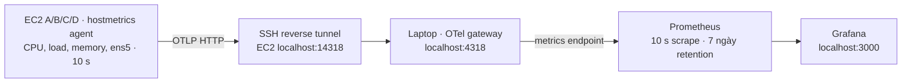

# NT531: OpenTelemetry, Prometheus và Grafana

Đây là bộ cấu hình cho **phiên demo observability riêng**. Chưa bật agent trên
EC2. Hoàn thành 16 block RTT xác nhận và bài loaded RTT bằng raw logs trước
khi chạy demo này. Dashboard giúp giải thích tài nguyên endpoint; sức mạnh
thống kê đến từ thiết kế lấy mẫu, effect size và độ bất định của số đo.

## Kiến trúc



Stack chạy trên laptop. Không tạo thêm EC2, không cần mở port collector hoặc
Grafana trên security group. Agent Linux chạy trực tiếp trên từng EC2 để đo
host, thay vì đo một container. HTTP đi bên trong SSH tunnel được mã hóa.
Stack dùng phiên bản cố định: Collector 0.135.0, Prometheus 3.5.0, Grafana
12.1.1. Đây là các phiên bản chọn để tái lập, không tuyên bố là bản mới nhất.

## Chạy stack trên Windows

Mở Docker Desktop ở chế độ Linux containers. Trong PowerShell ở thư mục dự án:

```powershell
py monitoring/build-dashboard.py
$grafanaSecret = Read-Host 'Mat khau Grafana cho phien demo' -AsSecureString
$env:GRAFANA_ADMIN_PASSWORD = [System.Net.NetworkCredential]::new('', $grafanaSecret).Password
Remove-Variable grafanaSecret
docker compose -f monitoring/compose.yaml config --quiet
docker compose -f monitoring/compose.yaml up -d
```

Truy cập http://localhost:3000, user `nt531`, mật khẩu vừa nhập. Datasource
và dashboard NT531 được provision tự động. Prometheus: http://localhost:9090.
Các cổng chỉ bind loopback. Tránh dùng `config` không có `--quiet` khi mật khẩu
đã được đặt vì Compose có thể in giá trị môi trường đã nội suy.

## Agent trên từng EC2: chỉ cho phiên demo

Tải gói Linux amd64 của `otelcol-contrib` 0.135.0 từ
[release chính thức](https://github.com/open-telemetry/opentelemetry-collector-releases/releases/tag/v0.135.0),
kiểm tra SHA256 bằng tệp checksums của release. Giải nén binary vào
`~/nt531-observability/otelcol-contrib`, sao chép `collector-agent.yaml` vào
cùng thư mục bằng SFTP. Không cần cài Docker trên EC2.

Trong một PowerShell riêng cho mỗi EC2, mở reverse tunnel (thay đường dẫn key
và EIP bằng thông tin hiện tại trong `deployment.json` hoặc Terraform output):

```powershell
ssh -i 'DUONG_DAN_KEY.pem' -N -o ExitOnForwardFailure=yes -o ServerAliveInterval=30 -R 127.0.0.1:14318:127.0.0.1:4318 ec2-user@EIP_MAY
```

Trong Termius của máy tương ứng, đặt `NT531_NODE=a`, `b`, `c` hoặc `d` và
`NT531_MODE=peering` hoặc `tgw` sau khi xác nhận AWS route. Nhãn mode không
tự chứng minh route. Nếu thay route, dừng agent, đổi nhãn rồi khởi động lại.

```bash
cd ~/nt531-observability
export NT531_NODE=a
export NT531_MODE=peering
chmod +x ./otelcol-contrib
./otelcol-contrib validate --config=collector-agent.yaml
./otelcol-contrib --config=collector-agent.yaml
```

Agent chạy foreground; Ctrl+C dừng agent. Giữ tunnel mở trong lúc demo.
Dashboard nhận dữ liệu thật sau khoảng 30–60 giây. Biểu đồ CPU/network dùng
rate theo một phút nên chỉ là diễn biến giám sát, không phải đo RTT từng gói.
Không có dữ liệu không được đọc thành CPU hoặc traffic bằng 0.

## Kiểm tra và lưu bằng chứng demo

```powershell
docker compose -f monitoring/compose.yaml ps
docker compose -f monitoring/compose.yaml logs --tail 40 collector prometheus
```

Prometheus query ví dụ: `system_cpu_time`, `system_network_io`,
`system_cpu_load_average_1m`. Gateway dùng `UnderscoreEscapingWithoutSuffixes`
để chỉ đổi dấu chấm thành underscore và giữ tên metric nhất quán, không thêm
suffix đơn vị/type. `system.cpu.time` vẫn tính bằng giây và `system.network.io`
vẫn tính bằng byte; chúng vẫn là cumulative counter để tính `rate()`.
Xác nhận label `nt531_node`, `nt531_mode`, `nt531_phase="observability-demo"`
và đủ máy thực sự chạy agent. Nếu query rỗng, kiểm tra agent, tunnel và log
collector trước. `up` của job gateway chỉ chứng minh endpoint scrape có sẵn,
không chứng minh tất cả EC2 đang gửi metrics.

Lưu screenshot theo cửa sổ UTC, phiên bản phần mềm, route snapshot và raw
ping/iperf3/mpstat/ENA vào một thư mục `results/observability-demo/SESSION`.
Metric network là byte giao diện, có overhead; không thay goodput receiver
của iperf3. Drop counter hệ điều hành không thay packet loss end-to-end hoặc
ENA allowance counter. Hostmetrics không cung cấp toàn bộ bộ đếm ENA; vẫn
lưu `ethtool -S ens5` trước/sau cửa sổ tải và đối chiếu delta.

## Dừng và quay lại thí nghiệm

Dừng agent bằng Ctrl+C trên từng EC2 và tunnel SSH trên laptop. Xác nhận trên
A/B: `pgrep -af 'otelcol|prometheus|grafana'` không có tiến trình giám sát còn
chạy, rồi mới bắt đầu một block RTT sạch. Dừng stack local:

```powershell
docker compose -f monitoring/compose.yaml down
Remove-Item Env:GRAFANA_ADMIN_PASSWORD
```

Named volumes giữ dữ liệu khi `down`; không dùng `down -v` nếu còn cần dữ liệu.
Không đăng ký agent thành service tự khởi động trong đợt RTT xác nhận.

## Trạng thái xác minh

Ngày 12/10 đã kiểm tra: Compose schema, parse sáu tệp YAML, tham chiếu pipeline,
JSON dashboard, nhãn demo và sự tồn tại của ba tag image đã pin. Tên/đơn vị
metric đã đối chiếu tài liệu phiên bản 0.135.0. Xem
[`config-validation.json`](../results/observability-demo/config-validation.json).
Chưa chạy container/pipeline với agent EC2 vì Docker daemon đang tắt và đợt
RTT xác nhận chưa hoàn thành. Phải kiểm tra số đo thật trước khi ghi “đã triển
khai observability” trong báo cáo; dashboard không chứa số liệu giả.

## Nguồn chính thức

- [Hostmetrics receiver 0.135.0](https://github.com/open-telemetry/opentelemetry-collector-contrib/blob/v0.135.0/receiver/hostmetricsreceiver/README.md).
- [Prometheus exporter 0.135.0](https://github.com/open-telemetry/opentelemetry-collector-contrib/blob/v0.135.0/exporter/prometheusexporter/README.md).
- [Grafana provisioning](https://grafana.com/docs/grafana/latest/administration/provisioning/).
